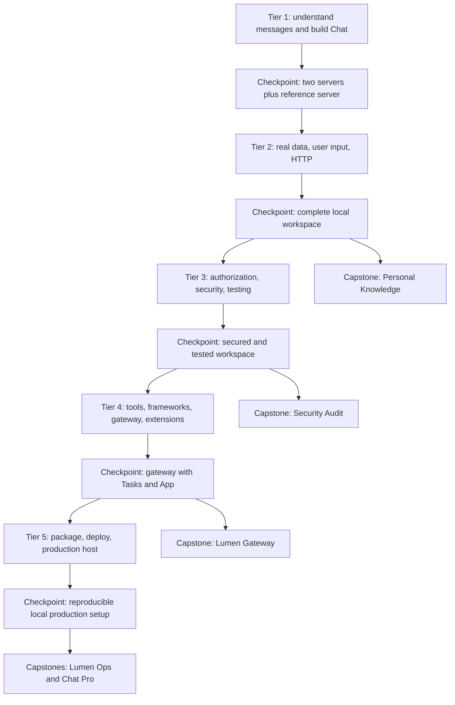

# Learning path

Delivery status: Phase 6. Tiers 1–4 (modules 00–17) and their checkpoints are delivered; later tiers, bonuses and capstones remain planned. See [the build plan](docs/PHASE_1_PLAN.md) and [verification notes](docs/VERIFICATION_NOTES.md).

You need basic Python, terminal navigation, and basic git. You will learn the other prerequisites as they become useful. MCP means Model Context Protocol: a shared way for applications to discover and use tools, data, and reusable prompts. Lumen Labs supplies the synthetic workplace; your growing workspace supplies its servers, and Lumen Chat is the application that uses them.

## Tier 1 — Foundations: 10 hours

| Module | Minutes | What you will demonstrate | Workspace / Chat |
|---|---:|---|---|
| [00 Setup](modules/00_setup/README.md) | 45 | Explain hosts/clients/servers; inspect a restricted reference server in two hosts | Orientation |
| [01 Architecture and wire](modules/01_architecture_wire/README.md) | 75 | Read JSON-RPC, discover capabilities, build a small raw server, capture traffic | Protocol foundations |
| [02 First server: tools [TS]](modules/02_first_server_tools/README.md) | 90 | Build typed, annotated tools and distinguish tool failures from protocol failures | Workspace 1: notes |
| [03 Resources [TS]](modules/03_resources/README.md) | 75 | Expose wiki URIs, templates, binary content, links and subscriptions | Workspace 2: wiki |
| [04 Prompts [TS]](modules/04_prompts/README.md) | 60 | Compose incident, release-note and meeting prompts with completions | Workspace 2 |
| [05 First client [TS]](modules/05_first_client/README.md) | 75 | Query both servers without a language model; handle pages and errors | Workspace 2 |
| [06 Building a host](modules/06_building_a_host/README.md) | 120 | Write the tool-call loop, provider mappings, routing and approvals | Chat 1: terminal |
| Checkpoint | 60 | Connect two course servers and a reference server through Chat | End-to-end foundation |

Introduce JSON and JSON-RPC in 01, JSON Schema in 02, async and context managers before 05, and language models/tool calling before 06. [TS] includes a complete parallel TypeScript lesson; it is optional for the Python schedule.

You are ready to move on when you can explain a complete tool call from user request to response, inspect the actual JSON, identify who approves an action, and run your client without an LLM. Demonstrate a malformed request and a successful recovery. The checkpoint must reject an unapproved write.

Run the [Tier 1 checkpoint and self-check](modules/06_building_a_host/CHECKPOINT.md) before continuing.

## Tier 2 — Real-world servers: 10 hours

| Module | Minutes | What you will demonstrate | Workspace / Chat |
|---|---:|---|---|
| [07 Real data](modules/07_real_data/README.md) | 150 | Issue CRUD, constrained analytics SQL, REST wrapping, limits and links | Workspace 3 |
| [08 Utilities](modules/08_server_utilities/README.md) | 105 | Lifespans, progress, cancellation, pagination, completion and deadlines | Workspace 3 |
| [09 Elicitation, sampling and roots](modules/09_elicitation_sampling_roots/README.md) | 135 | Request/retry confirmations; deprecated feature interpretation and current replacements | Chat 2 |
| [10 Streamable HTTP [TS]](modules/10_streamable_http/README.md) | 150 | Serve wiki/issues remotely on loopback, validate Origin and stream safely | Workspace 4 |
| Checkpoint | 60 | Operate notes/wiki/issues/analytics through Chat with approvals and progress | Usable workspace |

Teach SQLite transactions and parameter binding before CRUD; explain HTTP requests, response bodies, headers, and event streams before transport code. Explain why a retry may duplicate a write. Treat the retired handshake only in the linked migration guide.

You are ready to move on when you can reject a path escape and an unsafe SQL operation, cancel a report, deny a confirmation, and demonstrate an HTTP Origin rejection. A failed connection must not trigger an unapproved duplicate mutation. Run the [Tier 2 checkpoint](modules/10_streamable_http/CHECKPOINT.md). The Personal Knowledge Server capstone remains planned for Phase 8.

## Tier 3 — Security, authorization and quality: 12 hours

| Module | Minutes | What you will demonstrate | Workspace / Chat |
|---|---:|---|---|
| [11 Authorization](modules/11_authorization/README.md) | 210 | OAuth discovery, client metadata, PKCE, audience/issuer/scope checks | Workspace 5 |
| [12 Security](modules/12_security/README.md) | 210 | Reproduce bounded attacks and add defenses and regression tests | Workspace 5 |
| [13 Testing and observability](modules/13_testing_observability/README.md) | 210 | Offline tests, real captures, Inspector, traces, load and tool-selection evaluation | Workspace 5 |
| Checkpoint | 90 | Complete a security checklist backed by tests for each server | Tested workspace |

Teach authorization versus authentication, redirects, bearer tokens and scopes before OAuth helpers. Use local identities and synthetic secrets. Keep the vulnerable lab isolated from production entry points; payloads operate only on fixtures.

You are ready to move on when wrong-audience and insufficient-scope tokens fail, secrets stay out of logs, a poisoned result is treated as untrusted data, and CI catches stdout contamination. Explain what an evaluation measures and what it cannot prove. Run the [Tier 3 checkpoint](checkpoints/03_security/README.md). The full Security Audit capstone remains planned for Phase 8.

## Tier 4 — Agent ecosystem: 12 hours

| Module | Minutes | What you will demonstrate | Workspace / Chat |
|---|---:|---|---|
| 14 Tool design | 135 | Compare 25 low-level tools with six task-oriented tools using a fixed evaluation | Workspace 5 |
| 15 Frameworks and model APIs | 180 | Connect six frameworks; run the same triage task in at least three | Workspace 5 |
| 16 Composition | 150 | Route through a gateway with per-user visibility, limits and audit | Workspace 6 |
| 17 Official extensions | 165 | Negotiate Tasks and Apps, poll reports, supply input, display a dashboard | Chat 3 |
| Checkpoint | 90 | Use a chosen framework through the gateway with Tasks and an App | Integrated system |

[Tier 4 lessons](modules/14_tool_design/README.md) and the [checkpoint](checkpoints/04_ecosystem/README.md) are delivered.

Separate MCP from agent orchestration and provider-specific tool schemas. Teach evaluation baselines and repeated trials before claiming improvement. The same fake-model fixtures support offline framework tests; live model measurements are opt-in and record model/version/cost.

You are ready to move on when identical tool names cannot collide across servers, one user's cached catalog cannot expose another user's tools, and unsupported extensions degrade gracefully. Explain task handles, cancellation and mid-flight input. After this tier, attempt Lumen Gateway.

## Tier 5 — Shipping: 10 hours

| Module | Minutes | What you will demonstrate | Workspace / Chat |
|---|---:|---|---|
| 18 Packaging | 105 | Build Python/npm packages, Docker image and verified desktop bundle | Workspace 6 |
| 19 Registry | 75 | Validate server metadata and evaluate a third-party server | Workspace 6 |
| 20 Deployment | 150 | Run secured issues, authorization and reverse proxy locally; document cloud route | Workspace 6 |
| 21 Production hosts | 180 | Web Chat with bounded retries, approvals, configuration and extension UI | Chat 4 |
| Checkpoint | 90 | Rebuild and start the complete local stack, then tear it down | Release rehearsal |

Teach package indexes, containers and reverse proxies before deployment. Publishing and cloud accounts remain optional learner actions. Budget controls and teardown are part of the acceptance criteria.

You are ready to finish when a fresh environment can reproduce your build, timeouts and reconnects preserve approval boundaries, compatibility is visible to the user, and teardown removes local services without losing committed data. Then attempt Lumen Ops or Lumen Chat Pro.

## Two schedules

The main route totals 54 hours including five checkpoints. Add time for setup issues, all TypeScript equivalents, optional live integrations, and capstones. These are study schedules, not promises about implementation effort.

| Intensive week | Work | Hours |
|---|---|---:|
| 1 | Tier 1 (10h), then 07–09 and first 90 minutes of 10 (8h) | 18 |
| 2 | Finish Tier 2 (2h), Tier 3 (12h), module 14 and first 105 minutes of 15 (4h) | 18 |
| 3 | Finish Tier 4 (8h), Tier 5 (10h) | 18 |

| Part-time week | Work | Hours |
|---|---|---:|
| 1 | Modules 00–06 | 9 |
| 2 | Tier 1 checkpoint; 07–09 and first 90 minutes of 10 | 9 |
| 3 | Finish Tier 2; modules 11–12 | 9 |
| 4 | Module 13 and Tier 3 checkpoint; module 14 and first 105 minutes of 15 | 9 |
| 5 | Finish Tier 4; first hour of 18 | 9 |
| 6 | Finish Tier 5 | 9 |

Keep each checkpoint as a gate even if you spread a week across more calendar days.

## Optional routes and capstones

| Route | Outcome | Start after |
|---|---|---|
| B1 Full TypeScript | Reproduce all remaining Python lessons in TypeScript | Corresponding Python module |
| B2 Other SDKs | Build equivalent notes servers in confirmed official Go/C#/Java/Kotlin/Rust SDKs | 05 |
| B3 Reading and contributing | Trace schema to prose, inspect SEPs, prepare a small contribution | 01; revisit after 17 |
| B4 What's new | Skills, Server Cards, authorization extensions and newly verified capabilities | 17 |
| Personal Knowledge Server | Markdown full-text/semantic search, resources, prompts, completion and packaging | Tier 2 |
| Security Audit Lab | Findings, fixes and regression tests for a second vulnerable server | Tier 3 |
| Lumen Gateway | OAuth, per-user filtering, audit and rate limits | Tier 4 |
| Lumen Ops | Secured issues/analytics, elicitation, Tasks, App, evaluation and deployment | Tier 5 |
| Lumen Chat Pro | Multi-server web host, selectable provider, approvals and extension UI | Tier 5 |

Each capstone includes user stories, acceptance criteria, Mermaid architecture, runnable starter, full reference solution, tests, completed security checklist, extension challenges and rubric. Semantic search uses a reproducible local model with explicit first-download instructions; acceptance tests use fixed vectors without network access.
