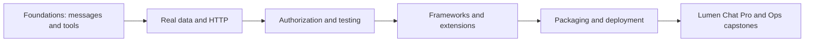

# Getting started with MCP

Model Context Protocol (MCP) gives applications a common way to discover and use tools, data and reusable prompts. This hands-on course is for people who know basic Python and want to build the connections themselves.

**Delivery status: Phase 2 foundation.** The 22 lessons arrive in later phases. See [the learning path](LEARNING_PATH.md), [feature map](docs/FEATURE_MAP.md), and [verification notes](docs/VERIFICATION_NOTES.md). The foundation runs today; this is not yet the completed course.

## What you will build

The Lumen workspace grows from notes and wiki servers into issues, analytics, calendar and a gateway. Lumen Chat starts as a terminal host and becomes a web application with model choice, approvals, Tasks and interactive Apps. Every example uses synthetic data for the fictional Lumen Labs company.



## Five-minute foundation quick start

Install [Python 3.12](https://www.python.org/downloads/), [uv](https://docs.astral.sh/uv/getting-started/installation/), [Node 26 LTS](https://nodejs.org/en/download) (24 also supported), and git. Run the following from PowerShell, macOS Terminal or a Linux shell:

```text
git clone https://github.com/anandtopu/getting_started_with_mcp.git
cd getting_started_with_mcp
uv sync
npm install
uv run python scripts/check_env.py
npm run inspector -- uv run python scripts/foundation_server.py
```

The Inspector opens a local interface. Connect to the server, select **Tools**, and call **dataset_counts** with `{}`. Expect `{"employees":80,"issues":400}`. Resources exposes `lumen://dataset/summary`; Prompts exposes `explain_dataset`. The server only reads synthetic files. First-time package downloads can take longer than five minutes.

In PowerShell, use `npm.cmd` if execution policy blocks `npm.ps1`. All other commands above are identical across platforms. For a terminal-only check:

```text
npm run inspector -- --cli uv run python scripts/foundation_server.py --method tools/list
uv run python scripts/run_all_examples.py
```

The MCP specification is dated **2026-07-28**. Python uses official SDK v2. TypeScript uses the official split v2 server/client packages. [Version verification and substitutions](docs/VERIFICATION_NOTES.md) explain the choices.

## See the protocol

JSON-RPC is the message format MCP uses: a request names a method and carries an ID; its response repeats that ID. A notification has no ID. The wiretap forwards the server's bytes unchanged and prints redacted, directional diagnostics on stderr.

```text
uv run python scripts/capture_wire.py
```

Read the [captured foundation exchanges](docs/wire/foundation_server.jsonl). This file was produced by an actual client/server run. It contains list/read/get/call operations, not a handwritten simulation. The capture command overwrites the fixture with new timing values. Run an arbitrary stdio server through the proxy with:

```text
uv run python scripts/wiretap.py --capture .runtime/my-capture.jsonl -- uv run python scripts/foundation_server.py
```

Only use course synthetic data for published captures. Redaction covers sensitive field names and environment secrets; it cannot identify every secret in arbitrary prose. Transport bytes themselves are never altered.

## Three ways to use the course

1. Follow [LEARNING_PATH.md](LEARNING_PATH.md) in order, with a checkpoint after each tier.
2. Find a topic in [FEATURE_MAP.md](docs/FEATURE_MAP.md); planned paths become links as lessons land.
3. Use the capstone specifications once delivered in Phase 8. Their planned scope is in the learning path.

| Tier | Main Python route |
|---|---:|
| Foundations, 00–06 | 10 hours |
| Real-world servers, 07–10 | 10 hours |
| Security and quality, 11–13 | 12 hours |
| Agent ecosystem, 14–17 | 12 hours |
| Shipping, 18–21 | 10 hours |
| Total including checkpoints | 54 hours |

## Dependencies and models

The default environment includes data tools and development checks. Optional extras are independent:

```text
uv sync --extra host
uv sync --extra http --extra auth --extra observability
uv sync --all-extras
```

Copy `.env.example` to `.env` in your editor. The default fake provider needs no model, key, or network. To use a real provider, change both `LLM_PROVIDER` and `LLM_MODEL`; examples and key names are in [.env.example](.env.example). Hosted calls may cost money. Model helpers cap output and requests have timeouts. Framework dependencies will get isolated groups when their integrations land in module 15.

If you prefer pip, create an environment with `python -m venv .venv`. In PowerShell run `.venv/Scripts/python.exe -m pip install -e . --group dev`; on macOS/Linux use `.venv/bin/python -m pip install -e . --group dev`. Recent pip supports dependency groups; upgrade pip first if `--group` is unavailable. Run scripts with that environment's Python. The uv lockfile remains the reproducible reference environment.

## Checks and data

```text
uv run pytest
uv run ruff check .
uv run ruff format --check .
npm run check
uv run python scripts/check_links.py
uv run python scripts/check_course.py
uv run python scripts/run_all_examples.py
```

Tests require no keys or internet. Package installation needs network on a fresh machine. In-memory tests check SDK behavior, subprocess tests check real stdio, and wiretap tests check byte preservation, EOF, failure and timeout. CI also runs Inspector and Windows/Linux matrices. `check_course.py --release` intentionally fails until all modules arrive.

Generated data is committed in [data/](data/). Rebuild it with `uv run python scripts/build_data.py`, or write a separate copy with `--output .runtime/data`. The seed and reference date are fixed; manifests record content hashes. Analytics money uses integer cents. Database byte reproducibility is tested on each runtime; SQLite versions can affect binary layout, so compare logical rows across different SQLite releases.

The deliberately vulnerable server is isolated under [data/security/](data/security/), requires `--lab`, and exposes only constant synthetic values. It is excluded from the normal server launch manifest.

## FAQ

**Do I need an LLM?** No for the foundation and most lessons. A language model is only needed for the model-assisted host examples; tests always use fakes.

**Is a host the same as a client?** The host is the application. A client is its connector to an MCP server. A server advertises tools, resources and prompts. One host can have several clients.

**Why does the server look silent?** A stdio server waits for protocol requests. Connect with Inspector; ordinary output on stdout would corrupt that protocol.

**Why are roots and sampling not defaults?** They are deprecated in the target revision. The course teaches current replacements and clearly labeled compatibility material.

**Where are the lessons?** They are being delivered by phase. This foundation does not claim the planned examples already exist.

**Can I install just the wheel?** Shared code is packaged, but the course dataset lives in the checkout. Set `LUMEN_REPO_ROOT` to the checkout if using an installed wheel elsewhere.

## Contributing and license

See [CONTRIBUTING.md](CONTRIBUTING.md), the [code of conduct](CODE_OF_CONDUCT.md), and [changelog](CHANGELOG.md). Original course code and synthetic data are [MIT licensed](LICENSE). Upstream SDKs retain their own licenses.
