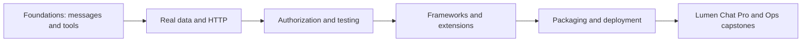

# Getting started with MCP

Model Context Protocol (MCP) gives applications a common way to discover and use tools, data and reusable prompts. This hands-on course is for people who know basic Python and want to build the connections themselves.

**Delivery status: Phase 8 delivered.** All 22 modules, four bonus modules, five capstones and six printable cheatsheets are available. Python and TypeScript tracks use pinned official SDKs; native SDK examples cover Go, C#, Rust and Java. See [the learning path](LEARNING_PATH.md), [feature map](docs/FEATURE_MAP.md), and [verification notes](docs/VERIFICATION_NOTES.md).

## Start Tier 1

| Module | Lesson | Languages |
|---|---|---|
| 00 | [Setup and orientation](modules/00_setup/README.md) | Python, TypeScript |
| 01 | [Architecture and wire](modules/01_architecture_wire/README.md) | Python, TypeScript |
| 02 | [Typed tools and notes](modules/02_first_server_tools/README.md) | Python, TypeScript |
| 03 | [Resources and wiki](modules/03_resources/README.md) | Python, TypeScript |
| 04 | [Prompt workflows](modules/04_prompts/README.md) | Python, TypeScript |
| 05 | [Clients and pagination](modules/05_first_client/README.md) | Python, TypeScript |
| 06 | [Lumen Chat v1](modules/06_building_a_host/README.md) | Python, TypeScript |

After setup, run the free, deterministic [Tier 1 checkpoint](modules/06_building_a_host/CHECKPOINT.md):

```text
uv run python modules/06_building_a_host/python/use_case/main.py --demo
```

It performs three documented reads and one approved in-memory note creation across
two course servers and the restricted filesystem reference server. No model keys
are needed. Run without `--demo` for interactive approval; provider configuration
is explained in module 06.

## Continue with Tier 2

| Module | Lesson | Languages |
|---|---|---|
| 07 | [Real data: issues, analytics, APIs](modules/07_real_data/README.md) | Python, TypeScript |
| 08 | [Context, lifetime, progress and cancellation](modules/08_server_utilities/README.md) | Python, TypeScript |
| 09 | [User input, retries and current replacements](modules/09_elicitation_sampling_roots/README.md) | Python, TypeScript |
| 10 | [Streamable HTTP](modules/10_streamable_http/README.md) | Python, TypeScript |

```text
uv sync --frozen --extra http --extra host
uv run python -m common.chat_v2 --demo
uv run python scripts/tier2.py
```

The [Tier 2 checkpoint](modules/10_streamable_http/CHECKPOINT.md) connects notes,
wiki, issues and analytics, obtains confirmation, and shows report progress.
Default runs use synthetic data and a fake model; no keys are needed.

## Continue with Tier 3

| Module | Lesson |
|---|---|
| 11 | [OAuth authorization and secured issues](modules/11_authorization/README.md) |
| 12 | [Security threats and defenses](modules/12_security/README.md) |
| 13 | [Testing, debugging and observability](modules/13_testing_observability/README.md) |

```text
uv sync --frozen --all-extras
uv run python scripts/tier3.py
uv run python checkpoints/03_security/acceptance.py
```

The [Tier 3 checkpoint](checkpoints/03_security/README.md) includes the filled
[security checklist](docs/SECURITY_CHECKLIST.md). Default checks use a synthetic
local OAuth fixture. [Keycloak Compose](deployment/auth/README.md) provides the
separate identity-provider path; isolated Linux CI checks it and the container lab.

## Continue with Tier 4

| Module | Lesson |
|---|---|
| 14 | [Tool design and evaluation](modules/14_tool_design/README.md) |
| 15 | [Agent frameworks and remote model APIs](modules/15_agent_frameworks/README.md) |
| 16 | [Composition and the Lumen Gateway](modules/16_composition/README.md) |
| 17 | [Tasks and MCP Apps](modules/17_extensions/README.md) |

```text
uv sync --frozen --all-extras
uv run python scripts/tier4.py
uv run python checkpoints/04_ecosystem/acceptance.py --framework agents
```

The [Tier 4 checkpoint](checkpoints/04_ecosystem/README.md) combines a chosen
framework, seven gateway upstreams, durable report Tasks and an analytics App.
Default models are deterministic. See the [framework compatibility table](frameworks/README.md)
for isolated adapters and the [host matrix](docs/PHASE_6_HOST_MATRIX.md) for UI checks.

## What you will build

The Lumen workspace grows from notes and wiki servers into issues, analytics, calendar and a gateway. Lumen Chat starts as a terminal host and becomes a web application with model choice, approvals, Tasks and interactive Apps. Every example uses synthetic data for the fictional Lumen Labs company.



## Five-minute foundation quick start

Install [Python 3.12](https://www.python.org/downloads/), [uv](https://docs.astral.sh/uv/getting-started/installation/), [Node 26 LTS](https://nodejs.org/en/download) (24 also supported), and git. Run the following from PowerShell, macOS Terminal or a Linux shell:

```text
git clone https://github.com/anandtopu/getting_started_with_mcp.git
cd getting_started_with_mcp
uv sync --frozen --extra http --extra auth --extra observability
npm ci
uv run python scripts/check_env.py
npm run inspector -- uv run python scripts/foundation_server.py
```

The Inspector opens a local interface. Connect to the server, select **Tools**, and call **dataset_counts** with `{}`. Expect `{"employees":80,"issues":400}`. Resources exposes `lumen://dataset/summary`; Prompts exposes `explain_dataset`. The server only reads synthetic files. First-time package downloads can take longer than five minutes.

In PowerShell, use `npm.cmd` if execution policy blocks `npm.ps1`. All other commands above are identical across platforms. For a terminal-only check:

```text
npm run inspector -- --cli uv run python scripts/foundation_server.py --protocol-era modern --method tools/list
uv run python scripts/run_all_examples.py
```

The MCP specification is dated **2026-07-28**. Python uses official SDK v2. TypeScript uses the official split v2 server/client packages. [Version verification and substitutions](docs/VERIFICATION_NOTES.md) explain the choices.

## See the protocol

JSON-RPC is the message format MCP uses: a request names a method and carries an ID; its response repeats that ID. A notification has no ID. The wiretap forwards the server's bytes unchanged and prints redacted, directional diagnostics on stderr.

```text
uv run python scripts/capture_wire.py
```

Read the [captured foundation exchanges](docs/wire/foundation_server.jsonl). This file was produced by an actual client/server run. It contains list/read/get/call operations, not a handwritten simulation. The capture command overwrites the fixture with new timing values. Run an arbitrary stdio server through the proxy with:

```text
uv run python scripts/wiretap.py --capture .runtime/my-capture.jsonl -- uv run python scripts/foundation_server.py
```

Only use course synthetic data for published captures. Redaction covers sensitive field names and environment secrets; it cannot identify every secret in arbitrary prose. Transport bytes themselves are never altered.

## Three ways to use the course

1. Follow [LEARNING_PATH.md](LEARNING_PATH.md) in order, with a checkpoint after each tier.
2. Find a topic in [FEATURE_MAP.md](docs/FEATURE_MAP.md); follow a topic directly to its implementation.
3. Choose a [capstone](capstones/README.md) with runnable starter, reference implementation and acceptance checks.

| Tier | Main Python route |
|---|---:|
| Foundations, 00–06 | 10 hours |
| Real-world servers, 07–10 | 10 hours |
| Security and quality, 11–13 | 12 hours |
| Agent ecosystem, 14–17 | 12 hours |
| Shipping, 18–21 | 10 hours |
| Total including checkpoints | 54 hours |

## Ship with Tier 5

| Module | Lesson |
|---|---|
| 18 | [Packages, Docker and MCPB](modules/18_packaging/README.md) |
| 19 | [Registry and server review](modules/19_registry/README.md) |
| 20 | [Secured deployment and teardown](modules/20_deployment/README.md) |
| 21 | [Lumen Chat v4 web host](modules/21_production_hosts/README.md) |

```text
uv sync --all-extras
npm ci
npm run build:chat
uv run python -m common.web_chat --port 8766
```

Open `http://127.0.0.1:8766` for approvals, report input, task cancellation and
an isolated analytics App. Practice mode uses real MCP calls without model keys.
Run the [shipping checkpoint](checkpoints/05_shipping/README.md) for packages and
full local deployment. See [verification](docs/PHASE_7_VERIFICATION.md) for tested
boundaries and remaining manual checks.

## Dependencies and models

The default environment includes data tools and development checks. Optional extras are independent:

```text
uv sync --extra host
uv sync --extra http --extra auth --extra observability
uv sync --all-extras
```

Copy `.env.example` to `.env` in your editor. The default fake provider needs no model, key, or network. To use a real provider, change both `LLM_PROVIDER` and `LLM_MODEL`; examples and key names are in [.env.example](.env.example). Hosted calls may cost money. Model helpers cap output and requests have timeouts. Frameworks use the optional frameworks extra and isolated locks where required; see Module 15.

If you prefer pip, create an environment with `python -m venv .venv`. In PowerShell run `.venv/Scripts/python.exe -m pip install -e . --group dev`; on macOS/Linux use `.venv/bin/python -m pip install -e . --group dev`. Recent pip supports dependency groups; upgrade pip first if `--group` is unavailable. Run scripts with that environment's Python. The uv lockfile remains the reproducible reference environment.

## Checks and data

The complete course checks use all optional adapters; prepare them before going offline.

```text
uv sync --all-extras
npm ci
uv run pytest
uv run ruff check .
uv run ruff format --check .
npm run check
uv run python scripts/check_links.py
uv run python scripts/check_course.py
uv run python scripts/run_all_examples.py
```

Tests require no keys or internet. Package installation needs network on a fresh machine. In-memory tests check SDK behavior, subprocess tests check real stdio, and wiretap tests check byte preservation, EOF, failure and timeout. CI also runs Inspector and Windows/Linux matrices. `check_course.py --release` checks all modules, bonuses, capstones, references and printable sheets.

Generated data is committed in [data/](data/). Rebuild it with `uv run python scripts/build_data.py`, or write a separate copy with `--output .runtime/data`. The seed and reference date are fixed; manifests record content hashes. Analytics money uses integer cents. Database byte reproducibility is tested on each runtime; SQLite versions can affect binary layout, so compare logical rows across different SQLite releases.

The deliberately vulnerable server is isolated under [data/security/](data/security/), requires `--lab`, and exposes only constant synthetic values. It is excluded from the normal server launch manifest.

## FAQ

**Do I need an LLM?** No for the foundation and most lessons. A language model is only needed for the model-assisted host examples; tests always use fakes.

**Is a host the same as a client?** The host is the application. A client is its connector to an MCP server. A server advertises tools, resources and prompts. One host can have several clients.

**Why does the server look silent?** A stdio server waits for protocol requests. Connect with Inspector; ordinary output on stdout would corrupt that protocol.

**Why are roots and sampling not defaults?** They are deprecated in the target revision. The course teaches current replacements and clearly labeled compatibility material.

**Where are the lessons?** All 22 main modules, four bonuses and five capstones are delivered.

**Can I install just the wheel?** Shared code is packaged, but the course dataset lives in the checkout. Set `LUMEN_REPO_ROOT` to the checkout if using an installed wheel elsewhere.

## Contributing and license

See [CONTRIBUTING.md](CONTRIBUTING.md), the [code of conduct](CODE_OF_CONDUCT.md), and [changelog](CHANGELOG.md). Original course code and synthetic data are [MIT licensed](LICENSE). Upstream SDKs retain their own licenses.

## Bonus modules and capstones

- [B1: TypeScript companion track and coverage limits](modules/bonus/B1_typescript_track/README.md), including native hosts, frameworks, input, Tasks and Apps.
- [B2: Go, C#, Rust and Java](modules/bonus/B2_other_sdks/README.md), with pinned builds and a shared client contract. Java uses the stable SDK's older protocol compatibility.
- [B3: read the specification and contribute](modules/bonus/B3_spec_contributing/README.md).
- [B4: Skills, Server Cards and authorization extensions](modules/bonus/B4_whats_new/README.md), with status and interoperability limits.
- [Five capstones](capstones/README.md): Personal Knowledge, Security Audit, Lumen Gateway, Lumen Ops and Lumen Chat Pro.

## Keep these references nearby

[Mental model](docs/MENTAL_MODEL.md) · [Protocol messages](docs/PROTOCOL_GUIDE.md) · [Choosing a design](docs/CHOOSING_THE_RIGHT_DESIGN.md) · [Host setup](docs/HOST_SETUP.md) · [Glossary](docs/GLOSSARY.md) · [Troubleshooting](docs/TROUBLESHOOTING.md) · [Migration](docs/MIGRATING_FROM_OLDER_VERSIONS.md) · [Security](docs/SECURITY_CHECKLIST.md) · [Six PDF cheatsheets](cheatsheets/README.md).

```text
uv sync --frozen
npm ci
uv run pytest
npm run check
uv run python scripts/check_course.py --release
uv run python scripts/run_all_examples.py
uv run python scripts/phase8.py
```

Dependency installation needs network once. Default checks then use local fixtures and no model credentials. Native compiler builds, package installation, Docker and browser checks have explicit commands in [Phase 8 verification](docs/PHASE_8_VERIFICATION.md). See the [definition of done](docs/DEFINITION_OF_DONE.md) for completed gates and optional integrations.

## Post-build review

The [original-prompt review](docs/reviews/2026-10-30-review-summary.md) records security fixes, native examples and verification. B1 now includes a [native OAuth gateway deployment and complete Chat Pro backend](docs/TYPESCRIPT_APPLICATIONS.md). Run `npm run chat:typescript` for the web host; the [acceptance record](docs/TYPESCRIPT_APPLICATIONS_VERIFICATION.md) tracks local tests and deployment CI. The MCPB build-tool dependency advisory remains documented with its bounded build-only mitigation.
