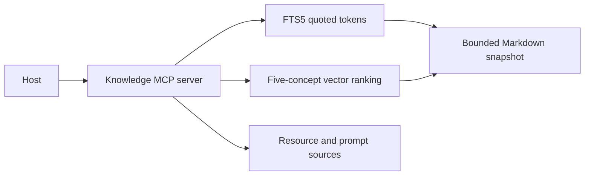

# Capstone 1: Personal Knowledge Server

As a Lumen engineer, I can find a release note using either its words or a related concept, open its source, and request a grounded summary.

## Prerequisites

Finish Tier 2. From the repository root run `uv sync --all-extras` and `npm ci`. All data is synthetic. Commands work in PowerShell and POSIX terminals.

## User stories and acceptance criteria

- Full-text search uses SQLite FTS5 with quoted tokens and bound parameters.
- Semantic search uses a five-dimensional, normalized local concept vector and cosine ranking; shipping finds release.md without a lexical match.
- Unknown concepts return no result. The small encoder is not a claim of general semantic understanding.
- Resources expose only the indexed Markdown snapshot; completion suggests exact names.
- Build and launch an isolated Python wheel and a Python MCPB bundle; no upload is needed.

## Architecture



## Start with a working baseline

Run `uv run python capstones/01_personal_knowledge/starter/main.py`. The starter is an executable deny-all policy scaffold. Implement this project's four cases in `choose`, then run `uv run python scripts/check_capstone.py --project 1 --starter`. The baseline intentionally fails that acceptance check; the reference passes. No starter performs an unapproved write.

## Reference solution

```text
uv run python capstones/01_personal_knowledge/solution/main.py
uv run pytest capstones/01_personal_knowledge/tests -q
```

Expected: `PASS capstone 1` and passing tests. The reference solution composes the course's tested helpers instead of copying authentication or host code. Inspect the linked implementations before changing policy.

The stdio server is `uv run python capstones/01_personal_knowledge/solution/server.py`. It is a local demonstration inheriting the launching user's authority; it does not expose a remote service.


## Tests and captured traffic

Run `uv run python scripts/capstones.py --project 1 --capture` to regenerate [actual traffic](wire/main.jsonl). Captures contain synthetic data and redact credentials. [Tests](tests/test_capstone.py) execute the reference contract. The [security checklist](security_checklist.md) and [rubric](rubric.md) explain what a successful submission must prove.

## Evaluation and limits

Run `uv run python scripts/check_capstone.py --project 1` against the [explicit policy evaluation cases](eval/cases.jsonl). The checker compares actual decisions with the committed expected outcomes; `--starter` checks your work. Deterministic acceptance checks behavior, not a language model's accuracy. For a model comparison, run each input against the same catalog without executing proposed writes, record exact arguments, count false approvals, and report provider/model/date and cost. Do not call a fake-model score a measured usability improvement.

This is a bounded teaching system. Read [extend it](extend_it.md) before adding real users, external data or multiple workers. No real publishing or paid service is required.

## Package and install

Run `uv run python scripts/knowledge_package.py --prepare` once, then `uv run python scripts/knowledge_package.py` offline. The command builds a wheel and validates/packs MCPB 0.3, then launches both wheel copies through uvx outside the checkout. Artifacts are under `.runtime/phase8/knowledge`. The bundle requires uv on PATH; a desktop GUI installation is a separate manual check.

Use `uvx --from <absolute-wheel-path> lumen-knowledge --notes <absolute-notes-folder>` for your own Markdown directory. Replace the two angle-bracket values; the default packaged notes are synthetic. The server snapshots at startup; restart to reindex. Nested notes, unknown names, file budgets and concept-model limitations must remain explicit.

Implementation: [FTS/vector index and MCP registration](../../common/knowledge.py), [installed CLI](../../common/knowledge_cli.py), [build contract](package/pyproject.toml), [bundle manifest](package/mcpb.json). No publication is required.
