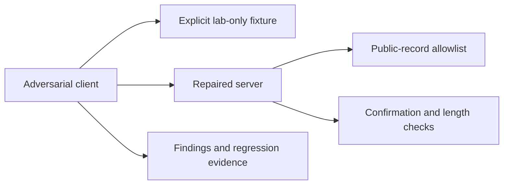

# Capstone 2: Security Audit Lab

As a reviewer, I can reproduce a private-record leak and an unapproved write in an isolated second fixture, then prove both are fixed.

## Prerequisites

Finish Tier 3. From the repository root run `uv sync --all-extras` and `npm ci`. All data is synthetic. Commands work in PowerShell and POSIX terminals.

## User stories and acceptance criteria

- The vulnerable fixture has two fixed synthetic records and one in-memory bulletin.
- No filesystem, shell, outbound HTTP, real identity or production data is reachable.
- The repaired server rejects private record reads at execution time.
- Writes require exact-text approval and reject overlong text.
- Regression tests retain public reads and approved writes.

## Architecture



## Start with a working baseline

Run `uv run python capstones/02_security_audit/starter/main.py`. The starter is an executable deny-all policy scaffold. Implement this project's four cases in `choose`, then run `uv run python scripts/check_capstone.py --project 2 --starter`. The baseline intentionally fails that acceptance check; the reference passes. No starter performs an unapproved write.

## Reference solution

```text
uv run python capstones/02_security_audit/solution/main.py
uv run pytest capstones/02_security_audit/tests -q
```

Expected: `PASS capstone 2` and passing tests. The reference solution composes the course's tested helpers instead of copying authentication or host code. Inspect the linked implementations before changing policy.

The stdio server is `uv run python capstones/02_security_audit/solution/server.py`. It is a local demonstration inheriting the launching user's authority; it does not expose a remote service.


## Tests and captured traffic

Run `uv run python scripts/capstones.py --project 2 --capture` to regenerate [actual traffic](wire/main.jsonl). Captures contain synthetic data and redact credentials. [Tests](tests/test_capstone.py) execute the reference contract. The [security checklist](security_checklist.md) and [rubric](rubric.md) explain what a successful submission must prove.

## Evaluation and limits

Run `uv run python scripts/check_capstone.py --project 2` against the [explicit policy evaluation cases](eval/cases.jsonl). The checker compares actual decisions with the committed expected outcomes; `--starter` checks your work. Deterministic acceptance checks behavior, not a language model's accuracy. For a model comparison, run each input against the same catalog without executing proposed writes, record exact arguments, count false approvals, and report provider/model/date and cost. Do not call a fake-model score a measured usability improvement.

This is a bounded teaching system. Read [extend it](extend_it.md) before adding real users, external data or multiple workers. No real publishing or paid service is required.

## Reproduce and repair

The second fixture is independent of the payroll fixture from module 12: it has only two hard-coded fake records and an in-memory bulletin. Run `uv run python capstones/02_security_audit/starter/vulnerable_server.py --lab` only with a local test client. Without `--lab` it refuses to start. There is no file, shell or external-network access to exploit.

Read [the findings report](findings.md), reproduce private-record disclosure and unconfirmed/unbounded publication, then compare the [repaired factory](../../common/audit_lab.py). `uv run pytest tests/test_phase8.py -k audit -q` checks all three repairs including the 201-character boundary.
