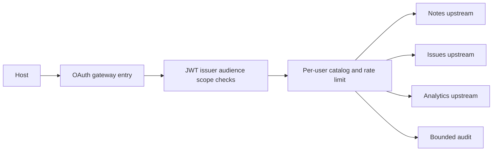

# Capstone 3: Lumen Gateway

As a workspace user, I see only tools my OAuth scopes allow and cannot call hidden writes by guessing their names.

## Prerequisites

Finish Tier 4. From the repository root run `uv sync --all-extras` and `npm ci`. All data is synthetic. Commands work in PowerShell and POSIX terminals.

## User stories and acceptance criteria

- OAuth issuer, audience, expiry and scope checks reuse the tested JWT verifier.
- Per-user catalogs partition by subject, scopes and catalog revision.
- Call-time policy refresh blocks stale approvals and revoked upstream routes.
- Per-user rate limits and allowlisted audit fields exclude tokens and arguments.
- An unavailable upstream cannot grant access or cause a write to be retried.

## Architecture



## Start with a working baseline

Run `uv run python capstones/03_lumen_gateway/starter/main.py`. The starter is an executable deny-all policy scaffold. Implement this project's four cases in `choose`, then run `uv run python scripts/check_capstone.py --project 3 --starter`. The baseline intentionally fails that acceptance check; the reference passes. No starter performs an unapproved write.

## Reference solution

```text
uv run python capstones/03_lumen_gateway/solution/main.py
uv run pytest capstones/03_lumen_gateway/tests -q
```

Expected: `PASS capstone 3` and passing tests. The reference solution composes the course's tested helpers instead of copying authentication or host code. Inspect the linked implementations before changing policy.

The stdio server is `uv run python capstones/03_lumen_gateway/solution/server.py`. It is a local demonstration; use the HTTP entry point for authenticated access.


## Tests and captured traffic

Run `uv run python scripts/capstones.py --project 3 --capture` to regenerate [actual traffic](wire/main.jsonl). Captures contain synthetic data and redact credentials. [Tests](tests/test_capstone.py) execute the reference contract. The [security checklist](security_checklist.md) and [rubric](rubric.md) explain what a successful submission must prove.

## Evaluation and limits

Run `uv run python scripts/check_capstone.py --project 3` against the [explicit policy evaluation cases](eval/cases.jsonl). The checker compares actual decisions with the committed expected outcomes; `--starter` checks your work. Deterministic acceptance checks behavior, not a language model's accuracy. For a model comparison, run each input against the same catalog without executing proposed writes, record exact arguments, count false approvals, and report provider/model/date and cost. Do not call a fake-model score a measured usability improvement.

This is a bounded teaching system. Read [extend it](extend_it.md) before adding real users, external data or multiple workers. No real publishing or paid service is required.

## OAuth gateway integration

Run `uv run python scripts/gateway_lab.py` for a real loopback issuer and gateway with SDK-driven authorization-code/PKCE exchange. It verifies scope-partitioned discovery, a useful read, wrong-audience rejection and Origin rejection. The single-user issuer is a fixture, not enterprise login.

The [HTTP factory](../../common/gateway_http.py) accepts a configured JWT verifier and task database path. [Gateway policy](../../common/gateway.py) checks the verified subject and workspace scopes at discovery and execution, bounds rate windows, uses fixed upstreams and emits redacted principal/route audit events. Upstream requests run in a cleared context; incoming bearer tokens are not forwarded. [Failure and revocation tests](../../tests/test_tier4.py) cover partial upstream failure and permission changes. For a real issuer, register the exact resource and workspace:read/workspace:write scopes before exposing the service.
