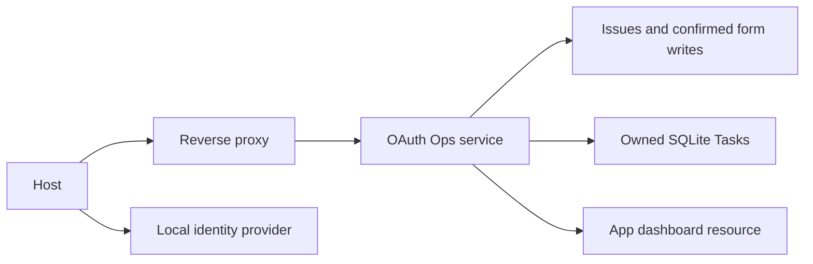

# Capstone 4: Lumen Ops Server

As an operations lead, I can review issue changes, approve a form, poll a report across restart, and inspect the same analytics as text or an App.

## Prerequisites

Finish Tier 5. From the repository root run `uv sync --all-extras` and `npm ci`. All data is synthetic. Commands work in PowerShell and POSIX terminals.

## User stories and acceptance criteria

- HTTP calls require an OAuth token for this exact resource and required scopes.
- Both ordinary writes and elicited bulk changes require issues:write.
- Form retry state binds the reviewed arguments; decline performs no write.
- SQLite persists Task handles; the same authenticated subject owns reads, input and cancellation.
- The App has an explicit bridge allowlist and no parent DOM or network access.
- The Docker service uses a writable Task directory on a read-only root filesystem.

## Architecture



## Start with a working baseline

Run `uv run python capstones/04_lumen_ops/starter/main.py`. The starter is an executable deny-all policy scaffold. Implement this project's four cases in `choose`, then run `uv run python scripts/check_capstone.py --project 4 --starter`. The baseline intentionally fails that acceptance check; the reference passes. No starter performs an unapproved write.

## Reference solution

```text
uv run python capstones/04_lumen_ops/solution/main.py
uv run pytest capstones/04_lumen_ops/tests -q
```

Expected: `PASS capstone 4` and passing tests. The reference solution composes the course's tested helpers instead of copying authentication or host code. Inspect the linked implementations before changing policy.

The stdio server is `uv run python capstones/04_lumen_ops/solution/server.py`. It is a local demonstration; use the HTTP entry point for authenticated access.


## Tests and captured traffic

Run `uv run python scripts/capstones.py --project 4 --capture` to regenerate [actual traffic](wire/main.jsonl). Captures contain synthetic data and redact credentials. [Tests](tests/test_capstone.py) execute the reference contract. The [security checklist](security_checklist.md) and [rubric](rubric.md) explain what a successful submission must prove.

## Evaluation and limits

Run `uv run python scripts/check_capstone.py --project 4` against the [explicit policy evaluation cases](eval/cases.jsonl). The checker compares actual decisions with the committed expected outcomes; `--starter` checks your work. Deterministic acceptance checks behavior, not a language model's accuracy. For a model comparison, run each input against the same catalog without executing proposed writes, record exact arguments, count false approvals, and report provider/model/date and cost. Do not call a fake-model score a measured usability improvement.

This is a bounded teaching system. Read [extend it](extend_it.md) before adding real users, external data or multiple workers. No real publishing or paid service is required.

## Run the complete HTTP service

The [entry point](../../common/ops_deployment.py) combines the [Ops factory](../../common/ops.py), issue/form handlers, SQLite task store and App resource. Configure `LUMEN_ISSUER`, `LUMEN_RESOURCE` and `LUMEN_JWKS_URL`; run `uv run python -m common.ops_deployment`. It defaults to 127.0.0.1:8000. `LUMEN_TASKS_DB` selects durable task storage; issue changes are deliberately disposable copies of the fixture.

For the complete local Keycloak/proxy stack, from the root run:

```text
docker compose -f deployment/compose.yaml -f capstones/04_lumen_ops/deployment/compose.yaml up --build -d --wait
uv run python scripts/keycloak_check.py --deployed
uv run pytest tests/test_phase8.py -k ops_http -q
docker compose -f deployment/compose.yaml -f capstones/04_lumen_ops/deployment/compose.yaml down
```

The named `ops_tasks` volume survives teardown. Add `--volumes` to the final command only when you intend to discard report history. The service runs without root, behind the loopback proxy, with a read-only image and a writable task volume. The [Dockerfile](deployment/Dockerfile) includes the actual bundled dashboard.

[Registry metadata](server.json) passes the official vendored schema; `ops.lumen.example` is a documented fictional deployment address, not a published service. Replace it only after provisioning and verifying a real endpoint and namespace. Tests prove wrong issuer/audience/expiry denial, read-versus-write scope, form retry and task ownership over HTTP.
