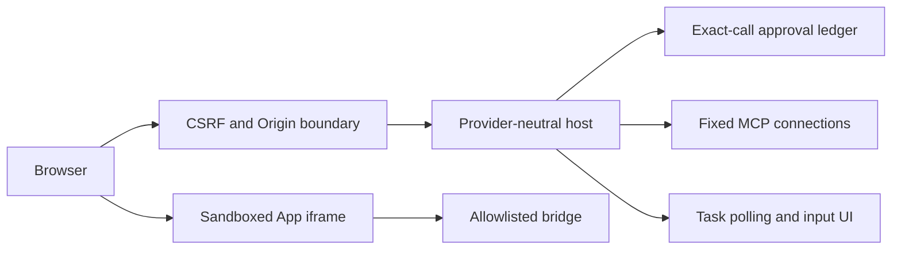

# Capstone 5: Lumen Chat Pro

As a user, I choose a provider, connect several reviewed servers, inspect exact calls, answer input and view Tasks and Apps in a local browser.

## Prerequisites

Finish Tier 5. From the repository root run `uv sync --all-extras` and `npm ci`. All data is synthetic. Commands work in PowerShell and POSIX terminals.

## User stories and acceptance criteria

- Provider keys and remote bearer tokens remain in the host process.
- The default fake provider is deterministic and needs no account.
- One-use approvals bind arguments and the complete tool definition.
- Ordinary elicitation and Task input are separate from the initial call approval.
- Reconnect refreshes capabilities; only locally allowlisted reads may retry.
- Three real Chromium scenarios cover workflows, isolation, mobile layout and forged Origin.

## Architecture



## Start with a working baseline

Run `uv run python capstones/05_lumen_chat_pro/starter/main.py`. The starter is an executable deny-all policy scaffold. Implement this project's four cases in `choose`, then run `uv run python scripts/check_capstone.py --project 5 --starter`. The baseline intentionally fails that acceptance check; the reference passes. No starter performs an unapproved write.

## Reference solution

```text
uv run python capstones/05_lumen_chat_pro/solution/main.py
uv run pytest capstones/05_lumen_chat_pro/tests -q
```

Expected: `PASS capstone 5` and passing tests. The reference solution composes the course's tested helpers instead of copying authentication or host code. Inspect the linked implementations before changing policy.

Launch the web solution with `uv run python capstones/05_lumen_chat_pro/solution/web.py`, then open http://127.0.0.1:8766. Use `npm run test:browser` for the actual browser acceptance suite.


## Tests and captured traffic

Run `uv run python scripts/capstones.py --project 5 --capture` to regenerate [actual traffic](wire/main.jsonl). Captures contain synthetic data and redact credentials. [Tests](tests/test_capstone.py) execute the reference contract. The [security checklist](security_checklist.md) and [rubric](rubric.md) explain what a successful submission must prove.

## Evaluation and limits

Run `uv run python scripts/check_capstone.py --project 5` against the [explicit policy evaluation cases](eval/cases.jsonl). The checker compares actual decisions with the committed expected outcomes; `--starter` checks your work. Deterministic acceptance checks behavior, not a language model's accuracy. For a model comparison, run each input against the same catalog without executing proposed writes, record exact arguments, count false approvals, and report provider/model/date and cost. Do not call a fake-model score a measured usability improvement.

This is a bounded teaching system. Read [extend it](extend_it.md) before adding real users, external data or multiple workers. No real publishing or paid service is required.

## Launch and operate Chat Pro

Run `npm run build:chat`, then `uv run python capstones/05_lumen_chat_pro/solution/web.py`. Open http://127.0.0.1:8766. Keep Fake selected for the repeatable no-key walkthrough. Try “Find release notes”, “Create a note”, “Close issues”, “Generate a report” and “Show the dashboard”. Inspect the proposed arguments, decline once, then repeat and approve. The report asks a detail question and displays Task state; the dashboard runs through the sandboxed App bridge.

Choose Anthropic, OpenAI, Gemini or Ollama in the provider menu only after setting its server-side model/key variables as described in [module 21](../../modules/21_production_hosts/README.md). Browser storage never receives provider credentials. [The shared backend](../../common/web_chat.py) and [JavaScript App frontend](../../common/web_ui/app.source.js) form the reference solution; the capstone does not copy those security-sensitive components.

Run `npm run test:browser` after `npx playwright install chromium`. [Browser tests](../../tests/browser/chat.pw.ts) check approval/decline, input, Tasks, and an App escaping its permitted calls. The service is a local single-user teaching host, not a multi-tenant deployment.
