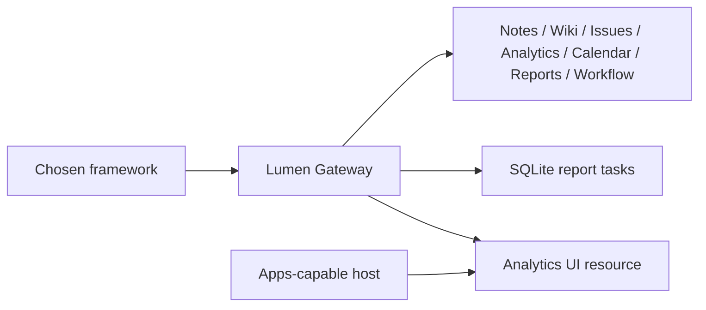

# Tier 4 checkpoint: Lumen Chat v3 through the Gateway

Run from the repository root:

```text
uv sync --frozen --all-extras
npm ci
uv run python checkpoints/04_ecosystem/acceptance.py --framework agents
```

Choose `agents`, `langgraph` or `pydantic`. The selected real framework connects
to the gateway through stdio, uses only the two workflow read tools, and drafts
an update for the fixture week beginning 2026-07-13. The checkpoint then reconnects
to that gateway to create a durable report, answer its form input, poll its result,
cancel another report, and read the associated analytics App resource. Expect
`PASS Tier 4 checkpoint`. All model decisions and input answers are explicit test
fixtures; there are no paid model calls or implicit publishing approvals.



## Acceptance checklist

- Seven upstream catalogs merge under unique aliases; the reader cannot write.
- The real framework produces a draft from the fixture's 14 weekly work items.
- A report handle survives reconnect and the completed result counts 400 items.
- Mid-flight input is answered once; cancellation is terminal.
- App tool metadata identifies the HTML resource; a plain client receives text.
- Complete the [manual App rendering check](../../docs/PHASE_6_HOST_MATRIX.md)
  to verify the UI in your chosen desktop host. The terminal checkpoint verifies
  resources and protocol behavior; it does not display HTML itself.

Tests: [Python](../../tests/test_tier4.py),
[bridge](../../common/typescript/apps.test.ts).
The [Module 16 HTTP example](../../modules/16_composition/python/examples/02_policy_gateway.py)
adds actual OAuth discovery/PKCE and resource-server checks. Upstreams are local
fixed trusted services; a production deployment needs separately issued upstream
credentials. Catalog caches partition by subject, scopes and policy revision.

Use the framework compatibility table in [frameworks](../../frameworks/README.md).
Continue to Phase 7 only when the shipping modules are delivered.
