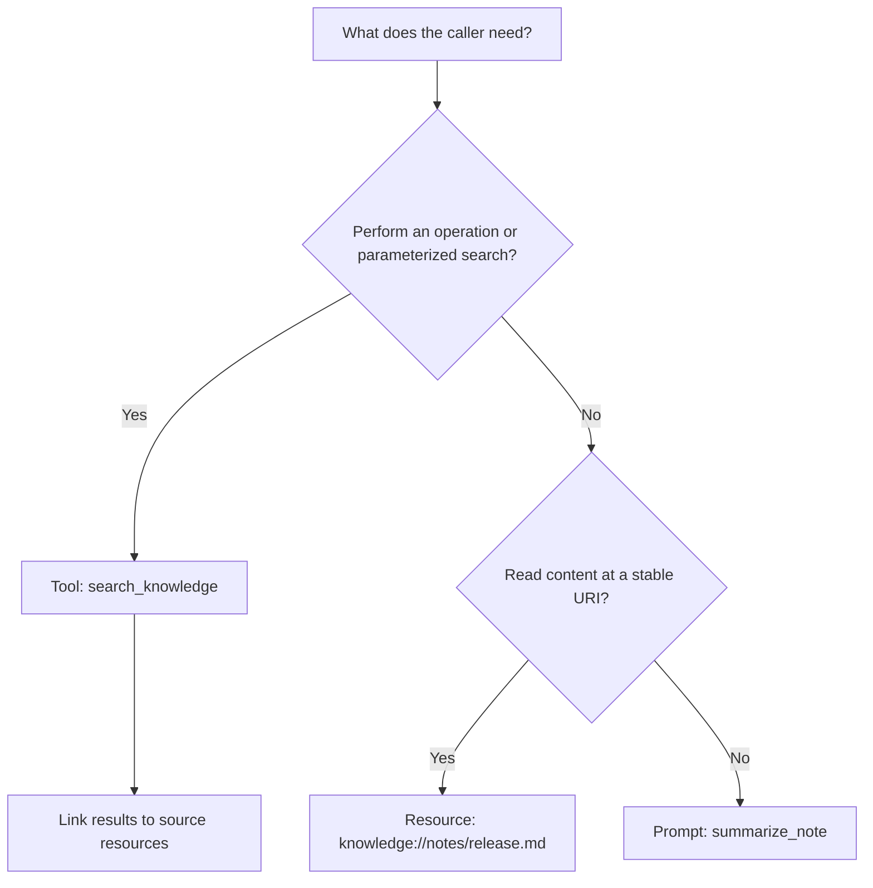
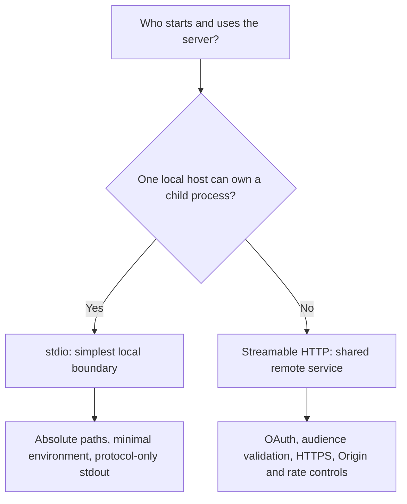
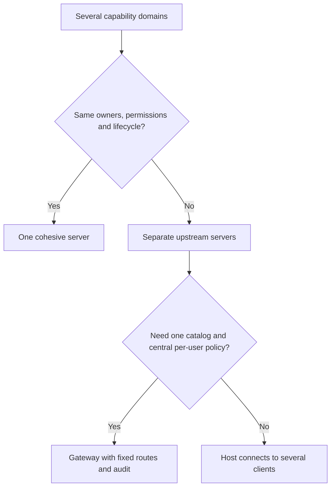
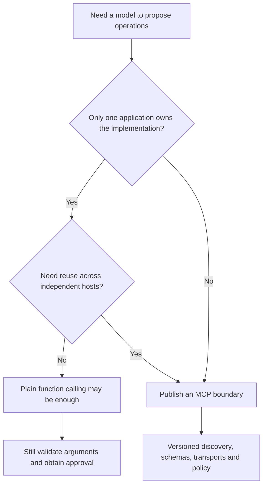

# Choose the smallest useful MCP design

Start with the user action and its trust boundary. Each choice below has a runnable example; combine primitives when a workflow needs more than one.

## Tool, resource or prompt?

The [knowledge server](../capstones/01_personal_knowledge/README.md) uses all three: search finds candidates, resources expose sources, and prompts guide a grounded summary. A prompt still contains data that the host reviews before adding to model context.

## stdio or Streamable HTTP?

Use [notes packaging](../modules/18_packaging/README.md) for local installs and [Ops](../capstones/04_lumen_ops/README.md) for remote access. HTTP adds deployment and identity responsibilities; localhost alone is not user authentication.

## One server or a gateway?

The [gateway](../capstones/03_lumen_gateway/README.md) filters discovery and rechecks every call. Keep upstream credentials separate and define partial-failure behavior. Namespacing prevents collisions; it does not provide authorization.

## MCP or plain function calling?

MCP standardizes the external boundary; it does not replace the model's tool-calling format. [Module 06](../modules/06_building_a_host/README.md) converts MCP definitions into provider formats and keeps model proposals separate from execution.
