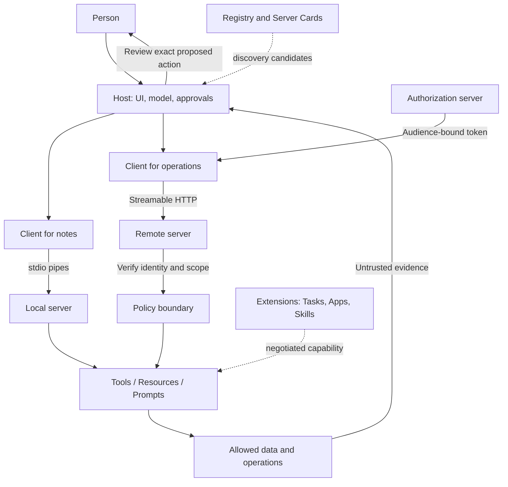

# MCP on one page

MCP connects an application to capabilities and context. The **host** owns the conversation and permission decisions; a **client** is its protocol connection to a **server**. The server can be a local program or a remote service. The model sees descriptions and results, not a grant of authority.

**Choose the primitive.** A tool performs a bounded operation. A resource exposes addressable content. A prompt supplies a reusable conversation template. Completion suggests argument values. Catalogs are paginated and can change; refetch them before relying on old meaning.

**Read the exchange.** A request has a JSON-RPC ID and method; its response repeats the ID. A notification has no ID. Revision 2026-07-28 carries protocol and client capability metadata on each request. `server/discover` reports support; it does not create an implicit protocol session. A tool may finish, return an error, ask for input and retry, or return an extension-defined Task handle.

**Keep trust explicit.** A tool description, annotation, skill, registry listing or model proposal cannot authorize execution. The host obtains approval; the server independently checks identity, scope and input. A content digest detects changes, not a trustworthy author. An App runs behind a browser boundary with only its allowed bridge calls.

[Protocol examples](PROTOCOL_GUIDE.md) · [Design choices](CHOOSING_THE_RIGHT_DESIGN.md) · [Security checklist](SECURITY_CHECKLIST.md) · [Glossary](GLOSSARY.md)
