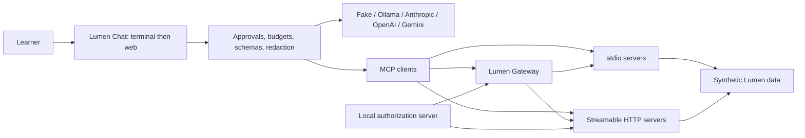

# Phase 1: getting_started_with_mcp

Status: proposed implementation plan, prepared October 29, 2026 (America/Chicago). Stop after this phase; begin Phase 2 only after the user's go-ahead.

## Decisions and assumptions

- Build in the existing workspace root. The eventual GitHub repository name is `getting_started_with_mcp`; the local folder can retain its present name. GitHub creation and publication belong to implementation, after inspecting the connected account and checking for an existing repository.
- Audience: basic Python, no assumed LLM, async, JSON Schema, OAuth, or TypeScript knowledge. Introduce each prerequisite before using it. Python is the main route; full parallel TypeScript lessons cover 02–05 and 10, with the remaining track in B1.
- Target MCP 2026-07-28, Python 3.12–3.14, Node 26 LTS recommended and Node 24 LTS supported. These are proposed course support boundaries, subject to the dependency resolver and CI. Do not claim other versions work merely because a package allows them.
- Default learning and tests require no paid model. Lumen Chat has a deterministic fake provider for tests and an Ollama option for learning; hosted model keys remain optional.
- Keep all 22 modules, four bonuses, five capstones, and five checkpoints. The 54-hour estimate covers the main Python route including checkpoints, not all optional tracks and capstones.
- Use one synthetic Lumen Labs dataset. Employees are an 80-person sample of the fictional 200-person company. Fix the seed, reference date, IDs, PDF metadata, row order, and serialization so regeneration is reproducible.
- Runnable exercise starters implement a smaller working behavior. Exercise tests describe the missing capability; they are run separately from solution/production CI so intentional learner failures do not make the main suite red.
- The wiretap writes unchanged protocol bytes to stdout and directional, timed diagnostics to stderr. Structured capture files include invocation, versions, direction, and monotonic timing. Captures use synthetic data; secret-bearing HTTP headers are excluded. HTTP captures use transport instrumentation, since a stdio proxy cannot observe HTTP.
- Dependencies listed in verification notes are observed releases with proposed bounds, not a resolved environment. Generate real lockfiles in Phase 2 and recheck APIs against installed distributions before writing dependent examples.

## Corrections required by verification

Use the official TypeScript v2 split packages in place of the requested monolithic package. The official repository identifies the latter as v1 maintenance. Use `httpx2` for the MCP Python SDK's HTTP integration, and `mcp_types` for protocol models. The official v2 documentation confirms `MCPServer`, `Client`, and in-memory connections; installed-version tests remain mandatory. See [verification notes](VERIFICATION_NOTES.md).

Roots, sampling, and protocol logging receive brief, clearly labeled Deprecated compatibility lessons. New file tools use server-configured allow-lists; new model workflows call the provider helper; new diagnostics use stderr and OpenTelemetry. Captured compatibility exchanges and executable fixture analysis explain the old behavior without invoking deprecated SDK APIs in the normal test suite. Legacy code spellings and old/new implementations remain confined to `MIGRATING_FROM_OLDER_VERSIONS.md`; modules link there. Module 09 still teaches both sides of elicitation and request/retry handling.

The overview page contains initialization wording inconsistent with its current extension guidance. Follow the revision-specific specification and per-request extension negotiation, recording discrepancies rather than copying overview prose into examples.

## Architecture



Keep business functions independent of transports. Each lesson has small local adapters and tests; later modules reuse stable shared functions without silently changing the behavior of earlier lessons. Each version of Workspace and Chat has a reproducible entry point.

For confirmations, bind approval to the validated operation and arguments. Re-check authorization at execution, reject stale approvals, and use idempotency keys for writes that can be retried. Annotations describe behavior; they do not enforce permission. Roots and resource URIs likewise do not replace filesystem access controls.

## Final repository structure

This is the intended completed tree. Only the four planning documents exist in Phase 1. Braced alternatives below represent separate files, not filenames containing braces.

```text
getting_started_with_mcp/
  README.md
  LEARNING_PATH.md
  pyproject.toml
  uv.lock
  package.json
  package-lock.json
  tsconfig.json
  eslint.config.js
  vitest.config.ts
  .python-version
  .node-version
  .env.example
  .gitignore
  .gitattributes
  .pre-commit-config.yaml
  LICENSE
  CONTRIBUTING.md
  CODE_OF_CONDUCT.md
  CHANGELOG.md
  .github/
    workflows/ci.yml
    ISSUE_TEMPLATE/{bug,content_error,example_request}.yml
    PULL_REQUEST_TEMPLATE.md
  common/
    __init__.py
    {llm,config,data,pretty,approval,security,protocol,testing}.py
    typescript/{package.json,tsconfig.json,config.ts,data.ts,testing.ts}
  data/
    directory/employees.json
    wiki/{engineering,product,hr,onboarding,incident_postmortems}/*.md
    issues.db
    analytics.db
    crm/{customers,deals}.csv
    calendar/events.json
    files/{specs,contracts,meeting_notes}/
    support_tickets.jsonl
    eval/tool_selection.jsonl
    security/{README.md,poisoned_wiki.md,vulnerable_server.py}
    manifest.json
  modules/
    00_setup/
    01_architecture_wire/
    02_first_server_tools/
    03_resources/
    04_prompts/
    05_first_client/
    06_building_a_host/
    07_real_data/
    08_server_utilities/
    09_elicitation_sampling_roots/
    10_streamable_http/
    11_authorization/
    12_security/
    13_testing_observability/
    14_tool_design/
    15_agent_frameworks/
    16_composition/
    17_extensions/
    18_packaging/
    19_registry/
    20_deployment/
    21_production_hosts/
    bonus/
      B1_typescript/NN_<matching_module>/
      B2_other_sdks/{go,csharp,java,kotlin,rust}/
      B3_spec_contributing/
      B4_whats_new/
  checkpoints/
    {01_foundations,02_workspace,03_security,04_gateway,05_shipping}/
  capstones/
    01_personal_knowledge/
    02_security_audit/
    03_lumen_gateway/
    04_lumen_ops/
    05_lumen_chat_pro/
  cheatsheets/
    {tier_1,tier_2,tier_3,tier_4,tier_5,protocol}.md
  docs/
    PHASE_1_PLAN.md
    FEATURE_MAP.md
    MENTAL_MODEL.md
    PROTOCOL_GUIDE.md
    CHOOSING_THE_RIGHT_DESIGN.md
    HOST_SETUP.md
    SECURITY_CHECKLIST.md
    GLOSSARY.md
    TROUBLESHOOTING.md
    MIGRATING_FROM_OLDER_VERSIONS.md
    VERIFICATION_NOTES.md
  scripts/
    {build_data,check_env,wiretap,run_all_examples,capture_wire,check_links,check_course}.py
  tests/
    {test_banned_apis,test_stdout,test_origins,test_links,test_course_structure,
     test_dataset,test_wiretap,test_protocol_contract,test_secrets}.py
  deployment/
    {compose.yaml,Dockerfile,proxy.conf}
    auth/{README.md,realm.json}
```

Every numbered module expands to this structure. Specific example basenames and the use-case entry point are assigned in [FEATURE_MAP.md](FEATURE_MAP.md); add examples wherever three cannot cover the material in small files.

```text
NN_topic/
  README.md
  quiz.md
  python/
    examples/{01_<concept>,02_<concept>,03_<concept>}.py
    use_case/main.py
    exercises/{01_practice,02_apply,03_stretch}.py
    exercises/test_exercises.py
    solutions/{01_practice,02_apply,03_stretch}.py
    tests/test_module.py
  typescript/                         # modules 02, 03, 04, 05, 10
    package.json
    tsconfig.json
    examples/{01_<concept>,02_<concept>,03_<concept>}.ts
    use_case/main.ts
    exercises/{01_practice,02_apply,03_stretch}.ts
    solutions/{01_practice,02_apply,03_stretch}.ts
    tests/module.test.ts
  host_configs/{claude_desktop,claude_code,vscode,cursor}.json
  wire/{manifest.json,<scenario>.jsonl}
```

B1 mirrors the remaining modules' example/exercise/solution/test structure. B2 includes a common README, version matrix, shared behavior fixtures, and native build/test manifests for each confirmed SDK. B3 and B4 use the numbered-module teaching contract. Each capstone contains `README.md`, `starter/`, `solution/`, `tests/`, `security_checklist.md`, `rubric.md`, `extend_it.md`, and `eval/` when tool selection matters. Each checkpoint contains a README, acceptance test, and self-check.

## Teaching and acceptance contract

Each module has the exact requested README sections, three or more examples, a realistic use case, three runnable exercises with separate solutions, and 5–8 answered quiz questions. Use the requested Workspace/Chat version line near the top; retain the heading and outcome banner from the supplied template. Every concept gets an analogy, sequence diagram, wire evidence, and an explanation of what the SDK does underneath.

Explain LLMs and tool calling before module 06's loop, JSON-RPC before raw message entry, JSON Schema before tool schemas, async before async clients, HTTP before remote transports, and OAuth before auth helpers. TypeScript sidebars teach types, promises, modules, and npm when first needed. Keep commands shell-neutral; use subprocess argument arrays and explicit paths, with no `make` or shell-specific environment assignment.

The feature map is the coverage contract. A feature becomes complete only when its file, captured traffic, use case, exercise/solution, and meaningful test exist. Plans name future paths as code text to avoid publishing misleading broken links. Convert each entry to a real relative link when delivered. No generated empty files will be used to satisfy coverage checks.

## Delivery phases

| Phase | Deliverables | Exit gate |
|---|---|---|
| 1 | This plan, verification notes, feature map, learning path | User reviews and says continue |
| 2 | Packaging/configuration, helpers, scripts, deterministic data, CI, root documents | Resolve locks; validate data and wiretap; lint; offline tests |
| 3 | Tier 1: modules 00–06 and checkpoint | First-server quick start; clients and fake-host loop; Python/TS parity |
| 4 | Tier 2: modules 07–10 and checkpoint | Safe writes, data limits, retries, streaming, Origin rejection |
| 5 | Tier 3: modules 11–13 and checkpoint | Auth failure tests, security regressions, observability, Inspector CI |
| 6 | Tier 4: modules 14–17 and checkpoint | Measured tool design, framework adapters, filtered gateway, extension flows |
| 7 | Tier 5: modules 18–21 and checkpoint | Local deployment and final host; packaging and registry validation |
| 8 | B1–B4, five capstones, reference docs and cheatsheets | Full coverage and release checklist, with every remaining gap stated |

Pause at the end of each phase as requested. A phase cannot be called complete while its mandatory checks are unrun or failing. Publishing to TestPyPI is a learner-controlled exercise with a tested local build; uploading a package requires a real account and credentials. No external publishing command belongs in ordinary smoke tests.

## Validation plan

1. Resolve Python and npm dependencies, then use frozen installs in CI. Framework environments may need separate locks if their MCP requirements conflict; never downgrade the main course silently.
2. Run offline unit/contract tests against the SDK in memory, with fake provider responses and a network-denial fixture. Run stdio subprocess and loopback HTTP integration tests separately; external services and models are `live`, skipped by default.
3. Test every server through a manifest-driven runner with startup deadlines, graceful shutdown and forced cleanup. Inspector CLI can list tools, resources, templates and prompts. Multi-round conversations and long-lived notifications use the course client harness.
4. Record real stdio and HTTP exchanges; validate against the pinned protocol schema. Snapshot normalization removes only declared nondeterministic values. In-memory tests alone cannot prove emitted wire correctness.
5. Run ruff, formatting, TypeScript type checking, ESLint, Vitest, stdout-only-JSON checks, deprecation-warning errors, legacy API scans, cross-language contract parity and data reproducibility checks.
6. Test denied origins, audience/issuer/scope failures, unsafe paths and symlinks, SQL limits, approval bypasses, duplicate mutations, prompt-injection handling, secret redaction and gateway user isolation.
7. CI matrix: Ubuntu and Windows × Python 3.12/3.13/3.14; separate Ubuntu and Windows × Node 24/26. Include a macOS representative smoke job. Local link checks run offline; external link checks run separately with retries and clear failures.
8. Measure a clean quick start and visually exercise the host UI. Record actual host/app versions and feature support; distinguish documentation evidence from tests actually run.

## Open verification work before implementation

Model names/prices, four host configuration formats, individual framework APIs, Keycloak compatibility, desktop bundle format, registry publisher, cloud offerings, other-language SDK stability, and OpenTelemetry semantic-convention maturity need their own checks before their corresponding code is authored. None is declared verified by this plan. Prefer Keycloak for local OAuth interoperability; switch to a clearly labeled development server only if a concrete compatibility test justifies it.

No implementation, wire capture, package installation, CI run, or remote publication has occurred in Phase 1.
