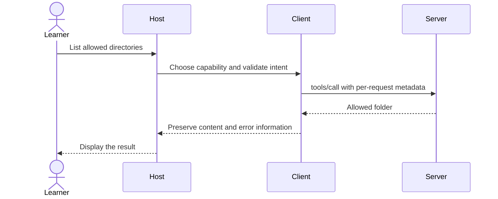

# Module 00: Setup and orientation — connect a restricted reference server

Workspace and Chat version 0: inspect a reference workspace; Chat arrives in module 06.

**Time:** 45 minutes · **Level:** beginner · **LLM needed:** no · **Languages:** Python

**Target:** [MCP 2026-07-28](https://modelcontextprotocol.io/specification/2026-07-28/architecture/index); official Python SDK 2.3 and TypeScript SDK 2.4 where shown.

## Prerequisites

Basic Python, a terminal, and the root setup commands.

## Learning objectives

- Distinguish a host, client, and server.
- Calculate custom connector counts and standard adapter counts.
- Verify local Python and Node runtimes.
- Connect the restricted filesystem server to two hosts.

## The big idea

Imagine three offices that each need access to four filing systems. Twelve custom connectors require twelve separate agreements. A shared protocol lets each office and filing system implement one adapter: seven pieces instead of twelve. MCP is often called a USB-C port for AI because it standardizes the connection. The analogy stops at the socket: MCP does not decide whether a document is trustworthy, who may change it, or whether a model understands it. A host is the application a person uses; its client speaks MCP to a server that exposes capabilities. One host can own several clients.

## How it works



**Under the hood.** JSON is structured text with object fields and arrays; module 01 explains its message envelope. The host launches the reference server as a child process and connects two pipes. Standard input carries requests; standard output carries protocol replies; standard error carries diagnostics. The server receives one allowed directory at startup. It rejects paths outside that folder. A reference implementation is maintained example software, not a blanket security certification.

The **specification** defines dated interoperable messages; official **SDKs** implement them in programming languages. The **Inspector** is a debugging client that calls capabilities without an LLM. **Reference servers** show practical integrations. The **Registry** catalogs server metadata; a listing is not proof of trust. Public proposals, called **SEPs**, and the project governance process explain protocol changes. A host supplies UI, policies, and usually a model. None of the first six modules needs model credentials.

## On the wire

Regenerate with `uv run python scripts/tier1.py --module 0 --capture`, then `uv run python scripts/render_wire_docs.py`. Timing values, IDs and machine paths may differ on your computer. The proxy forwards original bytes; only its capture copy is redacted.

<!-- wire:start -->

Source: [captured 03_reference_server](wire/03_reference_server.jsonl). Each JSON block below is a complete message copied from that run.

```json
{
  "jsonrpc": "2.0",
  "id": 2,
  "method": "tools/call",
  "params": {
    "name": "list_allowed_directories",
    "arguments": {},
    "_meta": {
      "io.modelcontextprotocol/protocolVersion": "2026-07-28",
      "io.modelcontextprotocol/clientInfo": {
        "name": "mcp",
        "version": "0.1.0"
      },
      "io.modelcontextprotocol/clientCapabilities": {}
    }
  }
}
```

```json
{
  "result": {
    "content": [
      {
        "type": "text",
        "text": "Allowed directories:\nD:\\Learning_Projects\\getting_started_with_mcp_prompt\\data\\files"
      }
    ],
    "structuredContent": {
      "content": "Allowed directories:\nD:\\Learning_Projects\\getting_started_with_mcp_prompt\\data\\files"
    },
    "resultType": "complete",
    "_meta": {
      "io.modelcontextprotocol/serverInfo": {
        "name": "secure-filesystem-server",
        "version": "2.1.0"
      }
    }
  },
  "jsonrpc": "2.0",
  "id": 2
}
```

<!-- wire:end -->

Read `id` first: it pairs a reply with the request. `method` chooses an operation and `params` carries its arguments. The reserved `_meta` keys carry the current protocol version, client identity and capabilities; replies identify the server. `resultType: complete` says this operation has finished. Cacheable results also carry `ttlMs` and `cacheScope`. An `error` envelope is a protocol failure; `isError` inside a tool result is an execution failure. Notifications have no request ID; subscription events carry their listener identity in metadata. Only the kinds used in this lesson appear in its capture.

See all exchanges and exact versions in the [capture manifest](wire/manifest.json). The [negative-example runner](../../scripts/lesson_mistakes.py) makes the common mistakes below reproducible.

## Key APIs at a glance

| Python | TypeScript | What it does | When to use it |
|---|---|---|---|
| StdioServerParameters | StdioClientTransport | Describe a child process | Launch a local server |
| Client | Client | Own a connection | List and call capabilities |
| safe_path | safePath | Enforce a directory boundary | Work with committed fixtures |

## Walkthrough

### Install once from the repository root

Follow the [root quick start](../../README.md) to install uv, Node and git, then run:

```text
uv sync
npm ci
uv run python scripts/check_env.py
```

For a venv/pip fallback, see [CONTRIBUTING](../../CONTRIBUTING.md). Always run commands from the repository root. In PowerShell use `npm.cmd` if execution policy blocks `npm.ps1`. A missing optional model or Docker is not a failure for Tier 1. The committed data contains 80 synthetic employees representing a sample of the fictional 200-person company.


### 1. Count integration edges and name the three roles.

Read [01_ecosystem.py](python/examples/01_ecosystem.py), then run:

```text
uv run python modules/00_setup/python/examples/01_ecosystem.py
```

Expected: custom_connectors: 12; standard_adapters: 7.
### 2. Check local runtimes without contacting a model.

Read [02_environment.py](python/examples/02_environment.py), then run:

```text
uv run python modules/00_setup/python/examples/02_environment.py
```

Expected: Installed runtimes; missing optional Ollama/Docker is informational.
### 3. Read the reference server allowed-directory boundary.

Read [03_reference_server.py](python/examples/03_reference_server.py), then run:

```text
uv run python modules/00_setup/python/examples/03_reference_server.py
```

Expected: Only this checkout’s data/files directory.
### Verify and capture the whole lesson

```text
uv run python scripts/tier1.py --module 0 --capture
uv run pytest modules/00_setup/python/tests
```

The capture runner uses actual child processes, asserts returned values, and exits.
The [wire manifest](wire/manifest.json) records its command and package versions.


## Try it in a host

Generate configurations for this machine:

```text
uv run python scripts/host_configs.py --module 0
```

Use [the four host configurations](host_configs/README.md) and [host setup instructions](../../docs/HOST_SETUP.md). The JSON has the host’s exact outer envelope and absolute executable/project paths. Restart or reload the host after adding entries, inspect the listed capabilities, then type: **“Show the available Lumen capabilities and use the relevant read operation to find release context. Ask before any change.”** For prompts, choose `summarize_incident` in the host’s prompt picker and supply `incident_postmortems` and `page-01`; slash-command spelling varies by host.

Complete this in **two hosts**, such as VS Code and Cursor, and ask **“List files in the allowed Lumen folder. Do not modify files.”** Host configuration formats were checked against official documentation; interactive host UI behavior is not an automated test claim.

## Real-world use case

Lumen wants a read-only review of its synthetic specs and contracts before building custom integrations. The reference filesystem server gives two different chat apps the same folder boundary. Run the local listing below, then repeat the chat request in two hosts.

Read [the Python use case](python/use_case/main.py) and run:

```text
uv run python modules/00_setup/python/use_case/main.py
```

This command is a client and exits after completing its scenario.

The listing includes contracts, specs, and meeting notes. Ask the host to list files, then read a Markdown spec; approve only those read calls.

The [shared implementation](../../common/reference_workspace.py) contains the service logic reused by the numbered examples.

## Common mistakes

Reproduce any row with `uv run python scripts/lesson_mistakes.py --module 0 --case N`, replacing N with the row number. These are the actual returned error’s first line; SDK validation may add field details below it.

| Case | Exact error excerpt | Fix |
|---|---|---|
| 1 | `Path must stay inside the allowed folder.` | Use a path inside data/files; parent-directory traversal is rejected. |
| 2 | `[Errno 2] No such file or directory: 'D:\\Learning_Projects\\getting_started_with_mcp_prompt\\data\\files\\missing.md'` | Choose an existing fixture from the directory listing. |
| 3 | `1 validation error for Settings` | Use fake, anthropic, openai, gemini, or ollama as the provider. |
| 4 | `1 validation error for Settings` | Choose a positive timeout, such as 30 seconds. |

**What could go wrong?** A server can return misleading content or inaccurate annotations. Review actions in the host; keep paths inside the fixture boundary, treat retrieved prose as data, and do not put diagnostic text on protocol stdout. The in-memory writes reset on process exit and never modify committed fixtures.

## Exercises

### Practice: integration counts

Return custom connectors and standard adapters for N hosts and M systems. Start with the [runnable starter](python/exercises/01_practice.py).
The baseline intentionally handles fewer cases; its extension checks should fail until you finish.

```text
uv run python modules/00_setup/python/exercises/01_practice.py
uv run python scripts/check_exercise.py --module 0 --exercise 1
```

Compare with the [separate worked solution](python/solutions/01_practice.py); run the same check with `--solution`.

### Apply: allowed paths

Filter relative filenames, rejecting absolute paths, parent segments, and backslash traversal. Start with the [runnable starter](python/exercises/02_apply.py).
The baseline intentionally handles fewer cases; its extension checks should fail until you finish.

```text
uv run python modules/00_setup/python/exercises/02_apply.py
uv run python scripts/check_exercise.py --module 0 --exercise 2
```

Compare with the [separate worked solution](python/solutions/02_apply.py); run the same check with `--solution`.

### Stretch: host config

Build the two different host envelopes without changing the server entry. Start with the [runnable starter](python/exercises/03_stretch.py).
The baseline intentionally handles fewer cases; its extension checks should fail until you finish.

```text
uv run python modules/00_setup/python/exercises/03_stretch.py
uv run python scripts/check_exercise.py --module 0 --exercise 3
```

Compare with the [separate worked solution](python/solutions/03_stretch.py); run the same check with `--solution`.


## Quiz

Answer the [five-question quiz](quiz.md) before opening its expandable answers.

## Key takeaways

- The host. A client is its protocol connection.
- No. Discovery and authorization are different decisions.
- 12; standardizing both sides reduces the adapter count to 7.
- Standard error, because standard output carries protocol messages.
- No. It limits paths; the host must still review writes and retrieved content.

## Go deeper

- [Specification: this module’s primitive](https://modelcontextprotocol.io/specification/2026-07-28/architecture/index)
- [Official Python SDK](https://py.sdk.modelcontextprotocol.io/)
- [Official TypeScript SDK](https://github.com/modelcontextprotocol/typescript-sdk)
- [Current protocol schema](https://modelcontextprotocol.io/specification/2026-07-28/schema)

## Next: Module 01

Continue to [Module 01](../01_architecture_wire/README.md).

## TypeScript counterpart

The optional [full TypeScript track](typescript/README.md) supplies executable examples, a use case, exercises and tests for this module.
