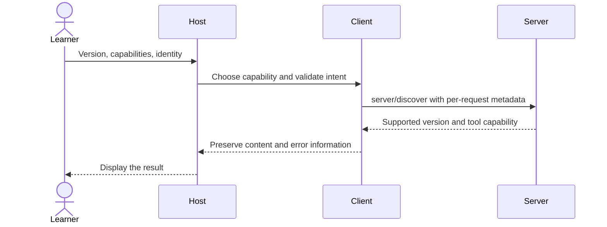

# Module 01: Architecture and the wire — read and write JSON-RPC
> After this module you can read a JSON-RPC exchange and run an SDK-free MCP server.

**Time:** ~75 min · **Level:** beginner · **LLM needed:** no · **Languages:** Python

**Target:** [MCP 2026-07-28](https://modelcontextprotocol.io/specification/2026-07-28/server/discover); official Python SDK 2.3 and TypeScript SDK 2.4 where shown.

**Workspace and Chat version 0 / 0:** Read a json-rpc exchange and run an sdk-free mcp server.

**Spec sections:** [Current specification](https://modelcontextprotocol.io/specification/2026-07-28/server/discover).

[TypeScript companion](typescript/README.md) covers the native cases and API differences.

## Prerequisites

Complete [Module 00](../00_setup/README.md), run `uv sync` and `npm ci`, and work from the repository root.

## Learning objectives

- Match responses to request IDs.
- Distinguish notifications, protocol errors, and results.
- Explain per-request version and capability metadata.
- Trace actual stdout through a transparent proxy.

## The big idea

JSON-RPC resembles a numbered service ticket. A request names a job and carries a ticket ID; the response repeats the ID so several jobs cannot get mixed up. A notification is an announcement that asks for no response. MCP defines which jobs exist and the shapes of their arguments and results. JSON is a text format: objects use braces, arrays use brackets, keys use double quotes, and true/false/null are lowercase. JSON-RPC adds the envelope around that data.

## How it works



**Under the hood.** Read common/raw_server.py before the SDK client. Its dispatch function validates the envelope, verifies metadata, chooses a method, and constructs a correlated reply. The input loop reads one JSON line and flushes each reply. The raw server intentionally supports only discovery, tool listing and one read tool. It does not pretend to implement every MCP capability.

In revision 2026-07-28, version and client capabilities travel in each request’s _meta. Client identity and response server identity make tracing easier. server/discover reports capabilities and supported versions. resultType distinguishes complete results from input-required results, which module 09 will implement. A stateless protocol core does not prohibit application state: an ephemeral notes list or an explicit subscription still has a lifetime. Stdio uses local process pipes; Streamable HTTP carries requests over HTTP and can use event streams. The older connection lifecycle is explained only in the [migration guide](../../docs/MIGRATING_FROM_OLDER_VERSIONS.md).

## On the wire

Regenerate with `uv run python scripts/tier1.py --module 1 --capture`, then `uv run python scripts/render_wire_docs.py`. Timing values, IDs and machine paths may differ on your computer. The proxy forwards original bytes; only its capture copy is redacted.

<!-- wire:start -->

Source: [captured 01_jsonrpc](wire/01_jsonrpc.jsonl). Each JSON block below is a complete message copied from that run.

```json
{
  "jsonrpc": "2.0",
  "id": 1,
  "method": "server/discover",
  "params": {
    "_meta": {
      "io.modelcontextprotocol/protocolVersion": "2026-07-28",
      "io.modelcontextprotocol/clientCapabilities": {},
      "io.modelcontextprotocol/clientInfo": {
        "name": "Lumen handwritten client",
        "version": "1.0"
      }
    }
  }
}
```

```json
{
  "jsonrpc": "2.0",
  "id": 1,
  "result": {
    "resultType": "complete",
    "_meta": {
      "io.modelcontextprotocol/serverInfo": {
        "name": "Lumen raw directory",
        "version": "1.0"
      }
    },
    "ttlMs": 0,
    "cacheScope": "private",
    "supportedVersions": [
      "2026-07-28"
    ],
    "capabilities": {
      "tools": {}
    }
  }
}
```

```json
{
  "jsonrpc": "2.0",
  "id": 4,
  "method": "missing/method",
  "params": {
    "_meta": {
      "io.modelcontextprotocol/protocolVersion": "2026-07-28",
      "io.modelcontextprotocol/clientCapabilities": {},
      "io.modelcontextprotocol/clientInfo": {
        "name": "Lumen handwritten client",
        "version": "1.0"
      }
    }
  }
}
```

```json
{
  "jsonrpc": "2.0",
  "id": 4,
  "error": {
    "code": -32601,
    "message": "Method not found"
  }
}
```

<!-- wire:end -->

Read `id` first: it pairs a reply with the request. `method` chooses an operation and `params` carries its arguments. The reserved `_meta` keys carry the current protocol version, client identity and capabilities; replies identify the server. `resultType: complete` says this operation has finished. Cacheable results also carry `ttlMs` and `cacheScope`. An `error` envelope is a protocol failure; `isError` inside a tool result is an execution failure. Notifications have no request ID; subscription events carry their listener identity in metadata. Only the kinds used in this lesson appear in its capture.

See all exchanges and exact versions in the [capture manifest](wire/manifest.json). The [negative-example runner](../../scripts/lesson_mistakes.py) makes the common mistakes below reproducible.

## Key APIs at a glance

| Python | TypeScript | What it does | When to use it |
|---|---|---|---|
| dispatch | Not required in this module | Manual JSON-RPC routing | Learn what the SDK replaces |
| json.loads / json.dumps | JSON.parse / JSON.stringify | Decode/encode JSON | Inspect raw messages |
| scripts/wiretap.py | Same proxy | Forward unchanged bytes | Capture real exchanges |

## Walkthrough

### Type one real request by hand

Run example 02, paste this request on one line, and press Enter. It is a client input you can type; the response shown in On the wire is captured, not invented.

```json
{"jsonrpc":"2.0","id":1,"method":"tools/list","params":{"_meta":{"io.modelcontextprotocol/protocolVersion":"2026-07-28","io.modelcontextprotocol/clientCapabilities":{},"io.modelcontextprotocol/clientInfo":{"name":"learner","version":"1"}}}}
```

Repeat against the official reference server with `node node_modules/@modelcontextprotocol/server-filesystem/dist/index.js data/files`. Its tool list is larger but the envelope is the same. Use Ctrl+C to stop either server. To inspect interactively, run `npm run inspector -- uv run python modules/01_architecture_wire/python/examples/02_raw_server.py`, then select current protocol mode in Inspector. The CLI requires `--protocol-era modern`. Legacy-only hosts cannot use this deliberately small raw server.


### 1. Correlate a request ID and distinguish a notification from an error.

Read [01_jsonrpc.py](python/examples/01_jsonrpc.py), then run:

```text
uv run python modules/01_architecture_wire/python/examples/01_jsonrpc.py
```

Expected: A response with id 7; notification response None; error -32601.
### 2. Run the SDK-free JSON-RPC dispatcher; read common/raw_server.py first.

Read [02_raw_server.py](python/examples/02_raw_server.py), then run:

```text
uv run python modules/01_architecture_wire/python/examples/02_raw_server.py
```

Expected: Waits silently for JSON lines; stop with Ctrl+C.

This is a server: waiting silently is normal. Use the capture runner below or launch Inspector in a separate terminal; do not expect a chat prompt.
### 3. Capture actual client requests through the transparent stdio proxy.

Read [03_wiretap_client.py](python/examples/03_wiretap_client.py), then run:

```text
uv run python modules/01_architecture_wire/python/examples/03_wiretap_client.py
```

Expected: directory_count; 80 synthetic employees; .runtime/raw.jsonl.
### Verify and capture the whole lesson

```text
uv run python scripts/tier1.py --module 1 --capture
uv run pytest modules/01_architecture_wire/python/tests
```

The capture runner uses actual child processes, asserts returned values, and exits.
The [wire manifest](wire/manifest.json) records its command and package versions.


## Try it in a host

Generate configurations for this machine:

```text
uv run python scripts/host_configs.py --module 1
```

Use [the four host configurations](host_configs/README.md) and [host setup instructions](../../docs/HOST_SETUP.md). The JSON has the host’s exact outer envelope and absolute executable/project paths. Restart or reload the host after adding entries and inspect the listed capabilities. Ask **“Count the synthetic employee sample.”** Expect `directory_count` to return `80 synthetic employees`. This small server advertises tools only.

Use Inspector or the supplied client as the reproducible baseline; third-party host UI behavior is a separate learner verification step. Host configuration formats were checked against official documentation; interactive host UI behavior is not an automated test claim.

## Real-world use case

A Lumen engineer sees a tool disappear from a host. Use the handwritten client to separate a wrong method, bad parameters, unsupported version, and malformed JSON. The annotated capture proves which layer rejected the request.

Read [the Python use case](python/use_case/main.py) and run:

```text
uv run python modules/01_architecture_wire/python/use_case/main.py
```

This command is a client and exits after completing its scenario.

The use case emits success replies, -32601 for an unknown method, -32602 for invalid tool arguments, -32700 for malformed JSON, -32600 for a non-object request, and -32022 for a version mismatch. A notification has no reply.

The [shared implementation](../../common/raw_server.py) contains the service logic reused by the numbered examples.

## Common mistakes

Reproduce any row with `uv run python scripts/lesson_mistakes.py --module 1 --case N`, replacing N with the row number. These are the actual returned error’s first line; SDK validation may add field details below it.

| Case | Exact error excerpt | Fix |
|---|---|---|
| 1 | `{"code": -32601, "message": "Method not found"}` | Use tools/list or tools/call; method names are exact. |
| 2 | `{"code": -32602, "message": "Invalid Params"}` | Send params as an object, with a valid metadata object. |
| 3 | `{"code": -32022, "message": "Unsupported protocol version", "data": {"supported": ["2026-07-28"], "requested": "2099-01-01"}}` | Send the supported revision and inspect supported/requested error data. |
| 4 | `{"code": -32600, "message": "Invalid request ID"}` | Use a string or integer request ID, never a boolean. |

**What could go wrong?** A server can return misleading content or inaccurate annotations. Review actions in the host; keep paths inside the fixture boundary, treat retrieved prose as data, and do not put diagnostic text on protocol stdout. The in-memory writes reset on process exit and never modify committed fixtures.

## Exercises

### Practice: correlate

Preserve the request ID when constructing a JSON-RPC result. Start with the [runnable starter](python/exercises/01_practice.py).
The baseline intentionally handles fewer cases; its extension checks should fail until you finish.

```text
uv run python modules/01_architecture_wire/python/exercises/01_practice.py
uv run python scripts/check_exercise.py --module 1 --exercise 1
```

Compare with the [separate worked solution](python/solutions/01_practice.py); run the same check with `--solution`.

### Apply: is notification

Identify a valid method notification without treating errors as notifications. Start with the [runnable starter](python/exercises/02_apply.py).
The baseline intentionally handles fewer cases; its extension checks should fail until you finish.

```text
uv run python modules/01_architecture_wire/python/exercises/02_apply.py
uv run python scripts/check_exercise.py --module 1 --exercise 2
```

Compare with the [separate worked solution](python/solutions/02_apply.py); run the same check with `--solution`.

### Stretch: validate meta

Reject a missing capability object or a different protocol revision. Start with the [runnable starter](python/exercises/03_stretch.py).
The baseline intentionally handles fewer cases; its extension checks should fail until you finish.

```text
uv run python modules/01_architecture_wire/python/exercises/03_stretch.py
uv run python scripts/check_exercise.py --module 1 --exercise 3
```

Compare with the [separate worked solution](python/solutions/03_stretch.py); run the same check with `--solution`.


## Quiz

Answer the [five-question quiz](quiz.md) before opening its expandable answers.

## Key takeaways

- A response repeats the request ID so the client can pair messages that arrive out of order.
- A notification has no request ID and receives no response.
- Parse error -32700 means the incoming bytes were not valid JSON.
- Stateless protocol requests can still address explicit application state through handles.
- The wiretap forwards original bytes unchanged and formats a separate diagnostic copy.

## Go deeper

- [Specification: this module’s primitive](https://modelcontextprotocol.io/specification/2026-07-28/server/discover)
- [Official Python SDK](https://py.sdk.modelcontextprotocol.io/)
- [Official TypeScript SDK](https://github.com/modelcontextprotocol/typescript-sdk)
- [Current protocol schema](https://modelcontextprotocol.io/specification/2026-07-28/schema)

## Next: Module 02

Continue to [Module 02](../02_first_server_tools/README.md).

## TypeScript counterpart

The optional [full TypeScript track](typescript/README.md) supplies executable examples, a use case, exercises and tests for this module.
