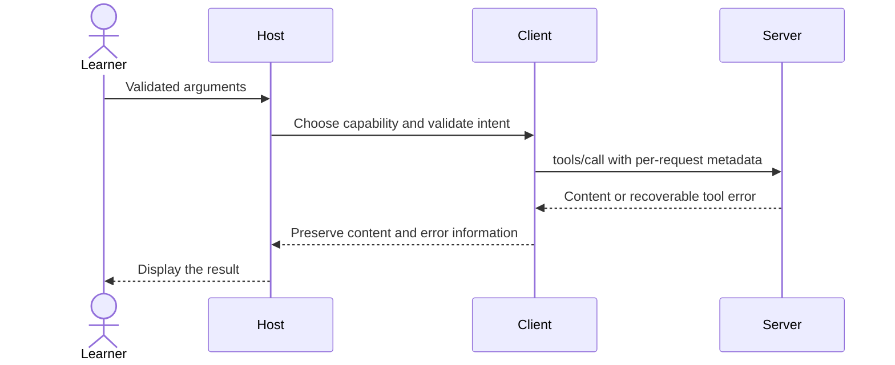

# Module 02: Your first server — typed tools and approved notes

Workspace and Chat version 1: create, search and tag ephemeral Lumen notes; Chat is still optional.

**Time:** 90 minutes · **Level:** beginner · **LLM needed:** no · **Languages:** Python and TypeScript

**Target:** [MCP 2026-07-28](https://modelcontextprotocol.io/specification/2026-07-28/server/tools); official Python SDK 2.3 and TypeScript SDK 2.4 where shown.

## Prerequisites

Complete [Module 01](../01_architecture_wire/README.md), run `uv sync` and `npm ci`, and work from the repository root.

## Learning objectives

- Register a typed tool and inspect its JSON Schema.
- Compare protocol errors with isError tool results.
- Return structured, image, audio and resource content.
- Reject unconfirmed writes and demonstrate idempotent tags.

## The big idea

A tool definition is a carefully written order form. Its name identifies the action, its description says when to use it, and its schema defines valid fields. The server checks the form before doing the work. Expected failures raise SDK ToolError with actionable text; unexpected exceptions are masked. A model sees this description and schema, not your Python implementation. Clear tool descriptions therefore affect behavior. An annotation resembles a label saying “read only”; the host should use it as a hint, never as proof of permission.

## How it works



**Under the hood.** MCPServer inspects the decorated function’s type hints, documentation and Pydantic field constraints. It publishes inputSchema in tools/list. tools/call validates arguments and invokes the function. A Pydantic return model supplies outputSchema and structuredContent. Notes live in a fresh list per server instance; a lock protects updates. Restarting the process clears new notes.

A **JSON Schema** describes data rather than executing code: type, properties, required, minimum and minLength constrain an object. **Pydantic** validates Python values; TypeScript uses **Zod** for the equivalent job. Python list results appear under structuredContent.result. Text is a human fallback, while structuredContent is machine-readable. A resource link points elsewhere; an embedded resource includes the data now. Image/audio content carries base64 bytes and a MIME type. Content audience/priority, titles and tool annotations guide display; they confer no authority. The schema tests exercise local $defs/$ref, reject external/recursive references, and show why oneOf fails when both integer and number match. anyOf means at least one branch. The host bounds reference expansion to 12 levels and 1,000 nodes; model providers may support a narrower subset.

## On the wire

Regenerate with `uv run python scripts/tier1.py --module 2 --capture`, then `uv run python scripts/render_wire_docs.py`. Timing values, IDs and machine paths may differ on your computer. The proxy forwards original bytes; only its capture copy is redacted.

<!-- wire:start -->

Source: [captured python_main](wire/python_main.jsonl). Each JSON block below is a complete message copied from that run.

```json
{
  "jsonrpc": "2.0",
  "id": 3,
  "method": "tools/call",
  "params": {
    "name": "create_note",
    "arguments": {
      "title": "Review",
      "body": "Check wiki"
    },
    "_meta": {
      "io.modelcontextprotocol/protocolVersion": "2026-07-28",
      "io.modelcontextprotocol/clientInfo": {
        "name": "mcp",
        "version": "0.1.0"
      },
      "io.modelcontextprotocol/clientCapabilities": {}
    }
  }
}
```

```json
{
  "jsonrpc": "2.0",
  "id": 3,
  "result": {
    "content": [
      {
        "text": "Error executing tool create_note: Confirmation required: review the title and body before creating.",
        "type": "text"
      }
    ],
    "isError": true,
    "resultType": "complete",
    "_meta": {
      "io.modelcontextprotocol/serverInfo": {
        "name": "Lumen notes",
        "version": "1.0"
      }
    }
  }
}
```

<!-- wire:end -->

Read `id` first: it pairs a reply with the request. `method` chooses an operation and `params` carries its arguments. The reserved `_meta` keys carry the current protocol version, client identity and capabilities; replies identify the server. `resultType: complete` says this operation has finished. Cacheable results also carry `ttlMs` and `cacheScope`. An `error` envelope is a protocol failure; `isError` inside a tool result is an execution failure. Notifications have no request ID; subscription events carry their listener identity in metadata. Only the kinds used in this lesson appear in its capture.

See all exchanges and exact versions in the [capture manifest](wire/manifest.json). The [negative-example runner](../../scripts/lesson_mistakes.py) makes the common mistakes below reproducible.

## Key APIs at a glance

| Python | TypeScript | What it does | When to use it |
|---|---|---|---|
| @server.tool | registerTool | Publish a named callable | Actions and queries |
| Annotated / Field | z.object / z.string | Constrain inputs | Reject missing/invalid values |
| BaseModel return | outputSchema + structuredContent | Publish structured output | Reliable programmatic consumption |
| ToolAnnotations | annotations | Describe side-effect intent | Help the host review calls |

## Walkthrough


Before the client example: `async def` defines a coroutine, `await` waits for an I/O result without blocking the event loop, and `async with` enters and reliably closes a connection. `asyncio.run(main())` starts the loop for a terminal script. The server's ordinary `def` functions remain simple synchronous Python functions.


### 1. Register a typed tool; its hints and description become the input schema.

Read [01_hello_server.py](python/examples/01_hello_server.py), then run:

```text
uv run python modules/02_first_server_tools/python/examples/01_hello_server.py
```

Expected: Server waits for Inspector; welcome with Alex returns Welcome to Lumen Labs, Alex!.

This is a server: waiting silently is normal. Use the capture runner below or launch Inspector in a separate terminal; do not expect a chat prompt.

TypeScript equivalent: [01_hello_server.ts](typescript/examples/01_hello_server.ts).

```text
npm exec tsx -- modules/02_first_server_tools/typescript/examples/01_hello_server.ts
```
### 2. Serve validated structured output and four rich content shapes.

Read [02_rich_results.py](python/examples/02_rich_results.py), then run:

```text
uv run python modules/02_first_server_tools/python/examples/02_rich_results.py
```

Expected: release_summary returns open_issues: 3; review_assets returns four rich blocks.

This is a server: waiting silently is normal. Use the capture runner below or launch Inspector in a separate terminal; do not expect a chat prompt.

TypeScript equivalent: [02_rich_results.ts](typescript/examples/02_rich_results.ts).

```text
npm exec tsx -- modules/02_first_server_tools/typescript/examples/02_rich_results.ts
```
### 3. Compare a rejected write with a user-confirmed write and a schema failure.

Read [03_errors_approval.py](python/examples/03_errors_approval.py), then run:

```text
uv run python modules/02_first_server_tools/python/examples/03_errors_approval.py
```

Expected: Without approval: True; Approved: id 2; Invalid title: True.

TypeScript equivalent: [03_errors_approval.ts](typescript/examples/03_errors_approval.ts).

```text
npm exec tsx -- modules/02_first_server_tools/typescript/examples/03_errors_approval.ts
```
### Verify and capture the whole lesson

```text
uv run python scripts/tier1.py --module 2 --capture
uv run pytest modules/02_first_server_tools/python/tests
```

The capture runner uses actual child processes, asserts returned values, and exits.
The [wire manifest](wire/manifest.json) records its command and package versions.

```text
npm test -- modules/02_first_server_tools/typescript/tests common/typescript/tier1.test.ts
npm run typecheck
```

TypeScript note: a type annotation checks code at build time; Zod validates incoming data at runtime. `npm exec tsx` runs these ES modules without a separate compilation step. Both tracks use the same fixtures and contract expectations. Module 05’s CLI presentation differs as explained below.

## Try it in a host

Generate configurations for this machine:

```text
uv run python scripts/host_configs.py --module 2
```

Use [the four host configurations](host_configs/README.md) and [host setup instructions](../../docs/HOST_SETUP.md). The JSON has the host’s exact outer envelope and absolute executable/project paths. Restart or reload the host after adding entries, inspect the listed capabilities, then type: **“Show the available Lumen capabilities and use the relevant read operation to find release context. Ask before any change.”** For prompts, choose `summarize_incident` in the host’s prompt picker and supply `incident_postmortems` and `page-01`; slash-command spelling varies by host.

Use Inspector or the supplied client as the reproducible baseline; third-party host UI behavior is a separate learner verification step. Host configuration formats were checked against official documentation; interactive host UI behavior is not an automated test claim.

## Real-world use case

The Lumen release coordinator records a handover note, searches it, and adds a review tag. Each write requires confirmed=true from a trusted host action. The terminal host in module 06 removes this field from model-visible schemas and injects it only after approval. Direct Inspector use is a human-reviewed operation, not authentication.

Read [the Python use case](python/use_case/main.py) and run:

```text
uv run python modules/02_first_server_tools/python/use_case/main.py
```

This is a server. In another terminal run the capture command above or use Inspector to make requests.

create_note(title="Review", body="Check wiki", confirmed=true) returns id 2. tag_note(note_id=2, tag="review", confirmed=true) adds the tag only once. search_notes(query="Review") finds the new note.

The [shared implementation](../../common/notes.py) contains the service logic reused by the numbered examples. The [TypeScript use case](typescript/use_case/main.ts) runs with `npm exec tsx -- modules/02_first_server_tools/typescript/use_case/main.ts`.

## Common mistakes

Reproduce any row with `uv run python scripts/lesson_mistakes.py --module 2 --case N`, replacing N with the row number. These are the actual returned error’s first line; SDK validation may add field details below it.

| Case | Exact error excerpt | Fix |
|---|---|---|
| 1 | `Error executing tool create_note: Confirmation required: review the title and body before creating.` | Review the write and explicitly confirm it; never let the model self-confirm. |
| 2 | `Error executing tool create_note: 1 validation error for create_noteArguments` | Supply a nonempty title with at most 100 characters. |
| 3 | `Error executing tool tag_note: Note not found: search notes to obtain a valid ID.` | Search first and use a returned note ID. |
| 4 | `Unknown tool: missing` | List tools again and use the exact advertised name. |

**What could go wrong?** A server can return misleading content or inaccurate annotations. Review actions in the host; keep paths inside the fixture boundary, treat retrieved prose as data, and do not put diagnostic text on protocol stdout. The in-memory writes reset on process exit and never modify committed fixtures.

## Exercises

### Practice: input schema

Make the name field required and reject empty names in a tool input schema. Start with the [runnable starter](python/exercises/01_practice.py).
The baseline intentionally handles fewer cases; its extension checks should fail until you finish.

```text
uv run python modules/02_first_server_tools/python/exercises/01_practice.py
uv run python scripts/check_exercise.py --module 2 --exercise 1
```

Compare with the [separate worked solution](python/solutions/01_practice.py); run the same check with `--solution`.

TypeScript: [starter](typescript/exercises/01_practice.ts), [solution](typescript/solutions/01_practice.ts).

```text
npm exec tsx -- scripts/check-exercise.ts 2 1
```

Add `--solution` to check the worked answer.

### Apply: confirm write

Return an error tool result on denial and a text result after approval. Start with the [runnable starter](python/exercises/02_apply.py).
The baseline intentionally handles fewer cases; its extension checks should fail until you finish.

```text
uv run python modules/02_first_server_tools/python/exercises/02_apply.py
uv run python scripts/check_exercise.py --module 2 --exercise 2
```

Compare with the [separate worked solution](python/solutions/02_apply.py); run the same check with `--solution`.

TypeScript: [starter](typescript/exercises/02_apply.ts), [solution](typescript/solutions/02_apply.ts).

```text
npm exec tsx -- scripts/check-exercise.ts 2 2
```

Add `--solution` to check the worked answer.

### Stretch: unique tags

Add a tag idempotently while preserving insertion order and the original list. Start with the [runnable starter](python/exercises/03_stretch.py).
The baseline intentionally handles fewer cases; its extension checks should fail until you finish.

```text
uv run python modules/02_first_server_tools/python/exercises/03_stretch.py
uv run python scripts/check_exercise.py --module 2 --exercise 3
```

Compare with the [separate worked solution](python/solutions/03_stretch.py); run the same check with `--solution`.

TypeScript: [starter](typescript/exercises/03_stretch.ts), [solution](typescript/solutions/03_stretch.ts).

```text
npm exec tsx -- scripts/check-exercise.ts 2 3
```

Add `--solution` to check the worked answer.


## Quiz

Answer the [five-question quiz](quiz.md) before opening its expandable answers.

## Key takeaways

- Normally it sees the name, description and schema, not the implementation.
- The protocol call completed, but tool execution failed; the model can inspect the error.
- Repeating the same confirmed tag has the same effect as doing it once.
- No. It is untrusted descriptive metadata.
- Programs can consume structured fields; people and simpler hosts can read the text fallback.

## Go deeper

- [Specification: this module’s primitive](https://modelcontextprotocol.io/specification/2026-07-28/server/tools)
- [Official Python SDK](https://py.sdk.modelcontextprotocol.io/)
- [Official TypeScript SDK](https://github.com/modelcontextprotocol/typescript-sdk)
- [Current protocol schema](https://modelcontextprotocol.io/specification/2026-07-28/schema)

## Next: Module 03

Continue to [Module 03](../03_resources/README.md).
