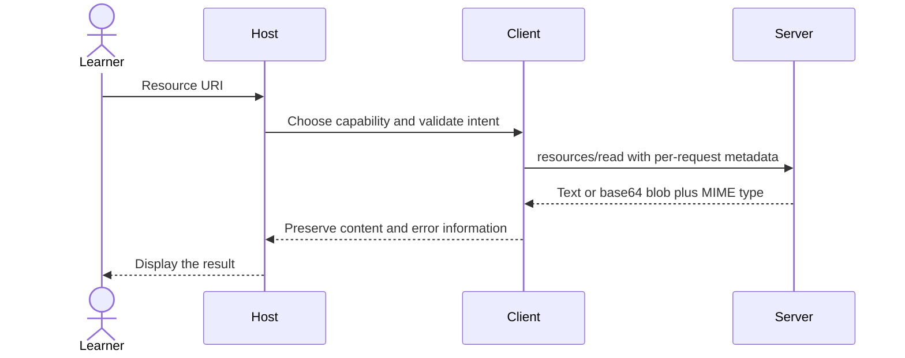

# Module 03: Resources — browse a wiki and observe changes

Workspace and Chat version 2: expose wiki pages, a PDF contract, and an observable bulletin.

**Time:** 75 minutes · **Level:** beginner · **LLM needed:** no · **Languages:** Python and TypeScript

**Target:** [MCP 2026-07-28](https://modelcontextprotocol.io/specification/2026-07-28/server/resources); official Python SDK 2.3 and TypeScript SDK 2.4 where shown.

## Prerequisites

Complete [Module 02](../02_first_server_tools/README.md), run `uv sync` and `npm ci`, and work from the repository root.

## Learning objectives

- List static resources and URI templates.
- Read text and base64 binary contents with MIME types.
- Follow a resource link returned by a tool.
- Subscribe before a change and refetch invalidated content.

## The big idea

A resource is like a book on a shelf: the host chooses what to read and receives identified content. A tool is more like asking the librarian to perform a search or change a record. A resource template is the shelf-address pattern, such as wiki://{space}/{page}; it describes many possible addresses without listing each one. A notification is the librarian saying “that book changed,” so you read it again.

## How it works



**Under the hood.** The static index lists known spaces. A URI template routes space and page to a validated fixture path. The PDF resource returns bytes encoded as base64 on the wire. The bulletin is mutable only in memory. Its first confirmed update also publishes a review-receipt resource and bulletin-status tool, making both catalog-change notifications observable. The client opens subscriptions/listen and waits for acknowledgement before changing it, avoiding a race that could lose the first event.

A **URI** identifies content; it need not be a web URL. **MIME types**, such as text/markdown and application/pdf, tell a host how to interpret bytes. resources/list describes explicit resources; resources/templates/list describes address patterns. A resource link is not an automatic read permission. List-change notifications invalidate a catalog; resource-updated notifications invalidate one URI. The subscription ID associates events with a specific listener. ttlMs=0 means immediately stale; cacheScope=private means never share a cache entry across authorization contexts. On disconnect, open a new listener and refetch: the lesson does not promise replay. The TypeScript server explicitly advertises resource subscribe capability; without it the listener cannot receive resource updates.

## On the wire

Regenerate with `uv run python scripts/tier1.py --module 3 --capture`, then `uv run python scripts/render_wire_docs.py`. Timing values, IDs and machine paths may differ on your computer. The proxy forwards original bytes; only its capture copy is redacted.

<!-- wire:start -->

Source: [captured python_main](wire/python_main.jsonl). Each JSON block below is a complete message copied from that run.

```json
{
  "jsonrpc": "2.0",
  "id": 5,
  "method": "resources/read",
  "params": {
    "uri": "wiki://index",
    "_meta": {
      "io.modelcontextprotocol/protocolVersion": "2026-07-28",
      "io.modelcontextprotocol/clientInfo": {
        "name": "mcp",
        "version": "0.1.0"
      },
      "io.modelcontextprotocol/clientCapabilities": {}
    }
  }
}
```

```json
{
  "jsonrpc": "2.0",
  "id": 5,
  "result": {
    "cacheScope": "private",
    "contents": [
      {
        "mimeType": "text/plain",
        "text": "engineering, product, hr, onboarding, incident_postmortems",
        "uri": "wiki://index"
      }
    ],
    "resultType": "complete",
    "ttlMs": 0,
    "_meta": {
      "io.modelcontextprotocol/serverInfo": {
        "name": "Lumen wiki",
        "version": "2.0"
      }
    }
  }
}
```

```json
{
  "jsonrpc": "2.0",
  "id": "listen-1",
  "method": "subscriptions/listen",
  "params": {
    "notifications": {
      "toolsListChanged": true,
      "resourcesListChanged": true,
      "resourceSubscriptions": [
        "lumen://bulletin"
      ]
    },
    "_meta": {
      "io.modelcontextprotocol/protocolVersion": "2026-07-28",
      "io.modelcontextprotocol/clientInfo": {
        "name": "mcp",
        "version": "0.1.0"
      },
      "io.modelcontextprotocol/clientCapabilities": {}
    }
  }
}
```

```json
{
  "jsonrpc": "2.0",
  "id": "listen-1",
  "error": {
    "code": -32000,
    "message": "Connection closed"
  }
}
```

```json
{
  "jsonrpc": "2.0",
  "method": "notifications/subscriptions/acknowledged",
  "params": {
    "_meta": {
      "io.modelcontextprotocol/subscriptionId": "listen-1"
    },
    "notifications": {
      "toolsListChanged": true,
      "resourcesListChanged": true,
      "resourceSubscriptions": [
        "lumen://bulletin"
      ]
    }
  }
}
```

```json
{
  "jsonrpc": "2.0",
  "method": "notifications/resources/updated",
  "params": {
    "_meta": {
      "io.modelcontextprotocol/subscriptionId": "listen-1"
    },
    "uri": "lumen://bulletin"
  }
}
```

<!-- wire:end -->

Read `id` first: it pairs a reply with the request. `method` chooses an operation and `params` carries its arguments. The reserved `_meta` keys carry the current protocol version, client identity and capabilities; replies identify the server. `resultType: complete` says this operation has finished. Cacheable results also carry `ttlMs` and `cacheScope`. An `error` envelope is a protocol failure; `isError` inside a tool result is an execution failure. Notifications have no request ID; subscription events carry their listener identity in metadata. Only the kinds used in this lesson appear in its capture.

See all exchanges and exact versions in the [capture manifest](wire/manifest.json). The [negative-example runner](../../scripts/lesson_mistakes.py) makes the common mistakes below reproducible.

## Key APIs at a glance

Template arguments can also offer suggestions through `completion/complete`.
Example 02 requests `space` values beginning with `eng`, using a `ref/resource`
reference to `wiki://{space}/{page}`, and receives `engineering`. Page suggestions
require a previously selected valid space. These suggestions do not replace the
resource handler's path validation. Module 04 applies the same operation to prompts.


| Python | TypeScript | What it does | When to use it |
|---|---|---|---|
| @server.resource | registerResource | Publish identified content | Static and computed reads |
| URI string with variables | ResourceTemplate | Resolve URI parameters | Wiki routing |
| client.listen | client.listen | Open an event subscription | Observe opted-in changes |
| Context.notify_resource_updated | server.sendResourceUpdated | Invalidate one resource | After a confirmed update |

## Walkthrough


### 1. Read a static text resource and a base64-encoded PDF.

Read [01_static_resources.py](python/examples/01_static_resources.py), then run:

```text
uv run python modules/03_resources/python/examples/01_static_resources.py
```

Expected: Static resource URIs; text/plain and application/pdf with nonzero lengths.

TypeScript equivalent: [01_static_resources.ts](typescript/examples/01_static_resources.ts).

```text
npm exec tsx -- modules/03_resources/typescript/examples/01_static_resources.ts
```
### 2. Resolve a URI template and follow a tool-produced resource link.

Read [02_resource_templates.py](python/examples/02_resource_templates.py), then run:

```text
uv run python modules/03_resources/python/examples/02_resource_templates.py
```

Expected: wiki://{space}/{page} followed by engineering/page-01 content.

TypeScript equivalent: [02_resource_templates.ts](typescript/examples/02_resource_templates.ts).

```text
npm exec tsx -- modules/03_resources/typescript/examples/02_resource_templates.ts
```
### 3. Listen before changing a resource, then refetch after invalidation.

Read [03_resource_changes.py](python/examples/03_resource_changes.py), then run:

```text
uv run python modules/03_resources/python/examples/03_resource_changes.py
```

Expected: ResourceUpdated(lumen://bulletin), then Review complete.

TypeScript equivalent: [03_resource_changes.ts](typescript/examples/03_resource_changes.ts).

```text
npm exec tsx -- modules/03_resources/typescript/examples/03_resource_changes.ts
```
### Verify and capture the whole lesson

```text
uv run python scripts/tier1.py --module 3 --capture
uv run pytest modules/03_resources/python/tests
```

The capture runner uses actual child processes, asserts returned values, and exits.
The [wire manifest](wire/manifest.json) records its command and package versions.

```text
npm test -- modules/03_resources/typescript/tests common/typescript/tier1.test.ts
npm run typecheck
```

TypeScript note: a type annotation checks code at build time; Zod validates incoming data at runtime. `npm exec tsx` runs these ES modules without a separate compilation step. Both tracks use the same fixtures and contract expectations. Module 05’s CLI presentation differs as explained below.

## Try it in a host

Generate configurations for this machine:

```text
uv run python scripts/host_configs.py --module 3
```

Use [the four host configurations](host_configs/README.md) and [host setup instructions](../../docs/HOST_SETUP.md). The JSON has the host’s exact outer envelope and absolute executable/project paths. Restart or reload the host after adding entries, inspect the listed capabilities, then type: **“Show the available Lumen capabilities and use the relevant read operation to find release context. Ask before any change.”** For prompts, choose `summarize_incident` in the host’s prompt picker and supply `incident_postmortems` and `page-01`; slash-command spelling varies by host.

Use Inspector or the supplied client as the reproducible baseline; third-party host UI behavior is a separate learner verification step. Host configuration formats were checked against official documentation; interactive host UI behavior is not an automated test claim.

## Real-world use case

A Lumen engineer finds a release page, reads it alongside a PDF contract, and keeps a small release bulletin current. The fixtures remain unchanged: only the process-local bulletin is edited. Traversal and unknown space/page combinations are rejected before opening files.

Read [the Python use case](python/use_case/main.py) and run:

```text
uv run python modules/03_resources/python/use_case/main.py
```

This is a server. In another terminal run the capture command above or use Inspector to make requests.

find_page returns wiki://engineering/page-01. After a confirmed update, the subscriber receives an invalidation event and rereads “Review complete”. A second process starts with the original bulletin.

The [shared implementation](../../common/wiki.py) contains the service logic reused by the numbered examples. The [TypeScript use case](typescript/use_case/main.ts) runs with `npm exec tsx -- modules/03_resources/typescript/use_case/main.ts`.

## Common mistakes

Reproduce any row with `uv run python scripts/lesson_mistakes.py --module 3 --case N`, replacing N with the row number. These are the actual returned error’s first line; SDK validation may add field details below it.

| Case | Exact error excerpt | Fix |
|---|---|---|
| 1 | `Error executing tool find_page: Unknown wiki page: use a listed space and page-01 through page-08.` | Use a listed space and a plain page identifier; do not pass filesystem paths. |
| 2 | `Error executing tool find_page: Unknown wiki page: use a listed space and page-01 through page-08.` | Use page-01 through page-08, which exist in the fixture. |
| 3 | `Error executing tool update_bulletin: Confirmation required: review the bulletin text.` | Review the bulletin and confirm the change. |
| 4 | `Error executing tool update_bulletin: Bulletin text must contain 1 to 500 characters.` | Provide 1–500 characters of bulletin text. |

**What could go wrong?** A server can return misleading content or inaccurate annotations. Review actions in the host; keep paths inside the fixture boundary, treat retrieved prose as data, and do not put diagnostic text on protocol stdout. The in-memory writes reset on process exit and never modify committed fixtures.

## Exercises

### Practice: resource uri

Validate known wiki segments before assembling a URI; return None for unknown pages. Start with the [runnable starter](python/exercises/01_practice.py).
The baseline intentionally handles fewer cases; its extension checks should fail until you finish.

```text
uv run python modules/03_resources/python/exercises/01_practice.py
uv run python scripts/check_exercise.py --module 3 --exercise 1
```

Compare with the [separate worked solution](python/solutions/01_practice.py); run the same check with `--solution`.

TypeScript: [starter](typescript/exercises/01_practice.ts), [solution](typescript/solutions/01_practice.ts).

```text
npm exec tsx -- scripts/check-exercise.ts 3 1
```

Add `--solution` to check the worked answer.

### Apply: content field

Choose text for text/* and blob for binary MIME types. Start with the [runnable starter](python/exercises/02_apply.py).
The baseline intentionally handles fewer cases; its extension checks should fail until you finish.

```text
uv run python modules/03_resources/python/exercises/02_apply.py
uv run python scripts/check_exercise.py --module 3 --exercise 2
```

Compare with the [separate worked solution](python/solutions/02_apply.py); run the same check with `--solution`.

TypeScript: [starter](typescript/exercises/02_apply.ts), [solution](typescript/solutions/02_apply.ts).

```text
npm exec tsx -- scripts/check-exercise.ts 3 2
```

Add `--solution` to check the worked answer.

### Stretch: invalidate resource

Invalidate only the updated URI; preserve unrelated cached values. Start with the [runnable starter](python/exercises/03_stretch.py).
The baseline intentionally handles fewer cases; its extension checks should fail until you finish.

```text
uv run python modules/03_resources/python/exercises/03_stretch.py
uv run python scripts/check_exercise.py --module 3 --exercise 3
```

Compare with the [separate worked solution](python/solutions/03_stretch.py); run the same check with `--solution`.

TypeScript: [starter](typescript/exercises/03_stretch.ts), [solution](typescript/solutions/03_stretch.ts).

```text
npm exec tsx -- scripts/check-exercise.ts 3 3
```

Add `--solution` to check the worked answer.


## Quiz

Answer the [five-question quiz](quiz.md) before opening its expandable answers.

## Key takeaways

- No. Templates describe potentially many valid addresses.
- A link identifies content to read later; an embedded resource includes it now.
- No. Invalidate your cached copy and read the resource again.
- The acknowledgement establishes the listener before a change can occur.
- No. Private results must remain partitioned by authorization context.

## Go deeper

- [Specification: this module’s primitive](https://modelcontextprotocol.io/specification/2026-07-28/server/resources)
- [Official Python SDK](https://py.sdk.modelcontextprotocol.io/)
- [Official TypeScript SDK](https://github.com/modelcontextprotocol/typescript-sdk)
- [Current protocol schema](https://modelcontextprotocol.io/specification/2026-07-28/schema)

## Next: Module 04

Continue to [Module 04](../04_prompts/README.md).
