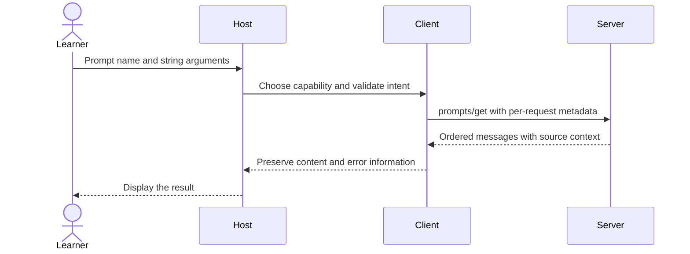

# Module 04: Prompts — reusable workflows with source context

Workspace and Chat version 2: add incident, release-note and customer-meeting prompt workflows.

**Time:** 60 minutes · **Level:** beginner · **LLM needed:** no · **Languages:** Python and TypeScript

**Target:** [MCP 2026-07-28](https://modelcontextprotocol.io/specification/2026-07-28/server/prompts); official Python SDK 2.3 and TypeScript SDK 2.4 where shown.

## Prerequisites

Complete [Module 03](../03_resources/README.md), run `uv sync` and `npm ci`, and work from the repository root.

## Learning objectives

- Inspect prompt arguments and retrieve filled messages.
- Preserve an embedded resource as a resource content block.
- Request completions using prior argument context.
- Refresh the prompt catalog after a change notification.

## The big idea

A prompt template is a reusable meeting agenda. The user chooses the agenda and fills in a few blanks; the server supplies the corresponding messages and source material. It does not run a model. Tools are usually selected by a model, resources by the application, and prompts by the user. Those are useful design tendencies, not permission guarantees.

## How it works



**Under the hood.** The prompt decorator publishes argument descriptions. prompts/get returns messages whose roles and content the host preserves. The incident workflow returns an instruction plus an embedded wiki page. The release workflow retrieves parameterized SQLite records; the meeting workflow reads a synthetic CRM row. Completion suggests valid values without changing anything.

A **message** pairs a role (user or assistant) with content. A prompt may produce several messages; flattening all content to text loses resource identity and MIME metadata. In Python the high-level SDK expects UserMessage from its prompt API, not a wire-level PromptMessage object; the tests catch accidental stringification. A completion request supplies the argument being edited, its prefix, and optionally prior arguments. Page suggestions require a valid space. Completion is a suggestion, not validation: the prompt still validates its values. enable_checklist demonstrates a user-approved catalog change and notifications/prompts/list_changed. Hosts may expose prompts as slash commands or a picker; that UI is host-specific.

## On the wire

Regenerate with `uv run python scripts/tier1.py --module 4 --capture`, then `uv run python scripts/render_wire_docs.py`. Timing values, IDs and machine paths may differ on your computer. The proxy forwards original bytes; only its capture copy is redacted.

<!-- wire:start -->

Source: [captured python_main](wire/python_main.jsonl). Each JSON block below is a complete message copied from that run.

```json
{
  "jsonrpc": "2.0",
  "id": 6,
  "method": "completion/complete",
  "params": {
    "ref": {
      "type": "ref/prompt",
      "name": "summarize_incident"
    },
    "argument": {
      "name": "page",
      "value": "page-0"
    },
    "context": {
      "arguments": {
        "space": "engineering"
      }
    },
    "_meta": {
      "io.modelcontextprotocol/protocolVersion": "2026-07-28",
      "io.modelcontextprotocol/clientInfo": {
        "name": "mcp",
        "version": "0.1.0"
      },
      "io.modelcontextprotocol/clientCapabilities": {}
    }
  }
}
```

```json
{
  "jsonrpc": "2.0",
  "id": 6,
  "result": {
    "completion": {
      "values": [
        "page-01",
        "page-02",
        "page-03",
        "page-04",
        "page-05",
        "page-06",
        "page-07",
        "page-08"
      ]
    },
    "resultType": "complete",
    "_meta": {
      "io.modelcontextprotocol/serverInfo": {
        "name": "Lumen prompts",
        "version": "2.0"
      }
    }
  }
}
```

```json
{
  "jsonrpc": "2.0",
  "method": "notifications/subscriptions/acknowledged",
  "params": {
    "_meta": {
      "io.modelcontextprotocol/subscriptionId": "listen-3"
    },
    "notifications": {
      "promptsListChanged": true
    }
  }
}
```

```json
{
  "jsonrpc": "2.0",
  "method": "notifications/prompts/list_changed",
  "params": {
    "_meta": {
      "io.modelcontextprotocol/subscriptionId": "listen-3"
    }
  }
}
```

<!-- wire:end -->

Read `id` first: it pairs a reply with the request. `method` chooses an operation and `params` carries its arguments. The reserved `_meta` keys carry the current protocol version, client identity and capabilities; replies identify the server. `resultType: complete` says this operation has finished. Cacheable results also carry `ttlMs` and `cacheScope`. An `error` envelope is a protocol failure; `isError` inside a tool result is an execution failure. Notifications have no request ID; subscription events carry their listener identity in metadata. Only the kinds used in this lesson appear in its capture.

See all exchanges and exact versions in the [capture manifest](wire/manifest.json). The [negative-example runner](../../scripts/lesson_mistakes.py) makes the common mistakes below reproducible.

## Key APIs at a glance

The completion example also asks for issue IDs with an empty prefix. There are
400 synthetic issues, so it returns 100 suggestions with `total: 400` and
`hasMore: true`. Refine the prefix to narrow suggestions. Completion hints are
not cursor pagination; the latter is a separate catalog mechanism in module 05.
For URI-template suggestions, use a `ref/resource` on the wiki server as shown
in [module 03](../03_resources/README.md).


| Python | TypeScript | What it does | When to use it |
|---|---|---|---|
| @server.prompt | registerPrompt | Publish a workflow template | User-selected tasks |
| UserMessage + EmbeddedResource | messages with resource content | Preserve source metadata | Ground an instruction |
| @server.completion | completable | Offer argument suggestions | Help users fill parameters |
| client.get_prompt | client.getPrompt | Retrieve filled messages | Before requesting model generation |

## Walkthrough


### 1. List prompt arguments and explicitly choose a release workflow.

Read [01_prompt_arguments.py](python/examples/01_prompt_arguments.py), then run:

```text
uv run python modules/04_prompts/python/examples/01_prompt_arguments.py
```

Expected: Three prompt names and release instructions with issue rows.

TypeScript equivalent: [01_prompt_arguments.ts](typescript/examples/01_prompt_arguments.ts).

```text
npm exec tsx -- modules/04_prompts/typescript/examples/01_prompt_arguments.ts
```
### 2. Embed retrieved source content in a multi-message incident prompt.

Read [02_embedded_context.py](python/examples/02_embedded_context.py), then run:

```text
uv run python modules/04_prompts/python/examples/02_embedded_context.py
```

Expected: user text, user resource, and a customer meeting instruction.

TypeScript equivalent: [02_embedded_context.ts](typescript/examples/02_embedded_context.ts).

```text
npm exec tsx -- modules/04_prompts/typescript/examples/02_embedded_context.ts
```
### 3. Request context-sensitive completions and refresh a changed prompt catalog.

Read [03_prompt_completion.py](python/examples/03_prompt_completion.py), then run:

```text
uv run python modules/04_prompts/python/examples/03_prompt_completion.py
```

Expected: Eight page suggestions; review_checklist appears after a notification.

TypeScript equivalent: [03_prompt_completion.ts](typescript/examples/03_prompt_completion.ts).

```text
npm exec tsx -- modules/04_prompts/typescript/examples/03_prompt_completion.ts
```
### Verify and capture the whole lesson

```text
uv run python scripts/tier1.py --module 4 --capture
uv run pytest modules/04_prompts/python/tests
```

The capture runner uses actual child processes, asserts returned values, and exits.
The [wire manifest](wire/manifest.json) records its command and package versions.

```text
npm test -- modules/04_prompts/typescript/tests common/typescript/tier1.test.ts
npm run typecheck
```

TypeScript note: a type annotation checks code at build time; Zod validates incoming data at runtime. `npm exec tsx` runs these ES modules without a separate compilation step. Both tracks use the same fixtures and contract expectations. Module 05’s CLI presentation differs as explained below.

## Try it in a host

Generate configurations for this machine:

```text
uv run python scripts/host_configs.py --module 4
```

Use [the four host configurations](host_configs/README.md) and [host setup instructions](../../docs/HOST_SETUP.md). The JSON has the host’s exact outer envelope and absolute executable/project paths. Restart or reload the host after adding entries, inspect the listed capabilities, then type: **“Show the available Lumen capabilities and use the relevant read operation to find release context. Ask before any change.”** For prompts, choose `summarize_incident` in the host’s prompt picker and supply `incident_postmortems` and `page-01`; slash-command spelling varies by host.

Use Inspector or the supplied client as the reproducible baseline; third-party host UI behavior is a separate learner verification step. Host configuration formats were checked against official documentation; interactive host UI behavior is not an automated test claim.

## Real-world use case

Lumen’s on-call engineer asks for an incident summary, its release coordinator drafts notes from issue IDs, and its account owner prepares a customer meeting. All three workflows return explicit synthetic evidence. A host decides whether to send these messages to a model and pays any resulting model cost.

Read [the Python use case](python/use_case/main.py) and run:

```text
uv run python modules/04_prompts/python/use_case/main.py
```

This is a server. In another terminal run the capture command above or use Inspector to make requests.

summarize_incident(space="incident_postmortems", page="page-01") returns two messages. release_notes(issue_ids="1,2") includes only matching issue rows. prepare_meeting(customer_id="1") includes Fictional Customer 001.

The [shared implementation](../../common/prompts.py) contains the service logic reused by the numbered examples. The [TypeScript use case](typescript/use_case/main.ts) runs with `npm exec tsx -- modules/04_prompts/typescript/use_case/main.ts`.

## Common mistakes

Reproduce any row with `uv run python scripts/lesson_mistakes.py --module 4 --case N`, replacing N with the row number. These are the actual returned error’s first line; SDK validation may add field details below it.

| Case | Exact error excerpt | Fix |
|---|---|---|
| 1 | `Internal server error` | Supply issue_ids, for example the string 1,2. |
| 2 | `Internal server error` | Choose a customer ID in the synthetic range 1–120. |
| 3 | `Internal server error` | Choose one of the five listed wiki spaces. |
| 4 | `Internal server error` | Pass a numeric customer ID as a string; prompt arguments are strings. |

**What could go wrong?** A server can return misleading content or inaccurate annotations. Review actions in the host; keep paths inside the fixture boundary, treat retrieved prose as data, and do not put diagnostic text on protocol stdout. The in-memory writes reset on process exit and never modify committed fixtures.

## Exercises

### Practice: complete space

Filter wiki spaces by a case-sensitive prefix. Start with the [runnable starter](python/exercises/01_practice.py).
The baseline intentionally handles fewer cases; its extension checks should fail until you finish.

```text
uv run python modules/04_prompts/python/exercises/01_practice.py
uv run python scripts/check_exercise.py --module 4 --exercise 1
```

Compare with the [separate worked solution](python/solutions/01_practice.py); run the same check with `--solution`.

TypeScript: [starter](typescript/exercises/01_practice.ts), [solution](typescript/solutions/01_practice.ts).

```text
npm exec tsx -- scripts/check-exercise.ts 4 1
```

Add `--solution` to check the worked answer.

### Apply: embedded prompt

Keep source text in an embedded resource with its URI and MIME type. Start with the [runnable starter](python/exercises/02_apply.py).
The baseline intentionally handles fewer cases; its extension checks should fail until you finish.

```text
uv run python modules/04_prompts/python/exercises/02_apply.py
uv run python scripts/check_exercise.py --module 4 --exercise 2
```

Compare with the [separate worked solution](python/solutions/02_apply.py); run the same check with `--solution`.

TypeScript: [starter](typescript/exercises/02_apply.ts), [solution](typescript/solutions/02_apply.ts).

```text
npm exec tsx -- scripts/check-exercise.ts 4 2
```

Add `--solution` to check the worked answer.

### Stretch: complete page

Offer page completions only when prior context names a valid space. Start with the [runnable starter](python/exercises/03_stretch.py).
The baseline intentionally handles fewer cases; its extension checks should fail until you finish.

```text
uv run python modules/04_prompts/python/exercises/03_stretch.py
uv run python scripts/check_exercise.py --module 4 --exercise 3
```

Compare with the [separate worked solution](python/solutions/03_stretch.py); run the same check with `--solution`.

TypeScript: [starter](typescript/exercises/03_stretch.ts), [solution](typescript/solutions/03_stretch.ts).

```text
npm exec tsx -- scripts/check-exercise.ts 4 3
```

Add `--solution` to check the worked answer.


## Quiz

Answer the [five-question quiz](quiz.md) before opening its expandable answers.

## Key takeaways

- No. It returns messages for the host to use.
- They retain source identity and MIME information instead of turning everything into untyped prose.
- No. Clients can ignore suggestions or send invalid values.
- The selected wiki space.
- Usually the user through the host’s picker or slash-command UI.

## Go deeper

- [Specification: this module’s primitive](https://modelcontextprotocol.io/specification/2026-07-28/server/prompts)
- [Official Python SDK](https://py.sdk.modelcontextprotocol.io/)
- [Official TypeScript SDK](https://github.com/modelcontextprotocol/typescript-sdk)
- [Current protocol schema](https://modelcontextprotocol.io/specification/2026-07-28/schema)

## Next: Module 05

Continue to [Module 05](../05_first_client/README.md).
