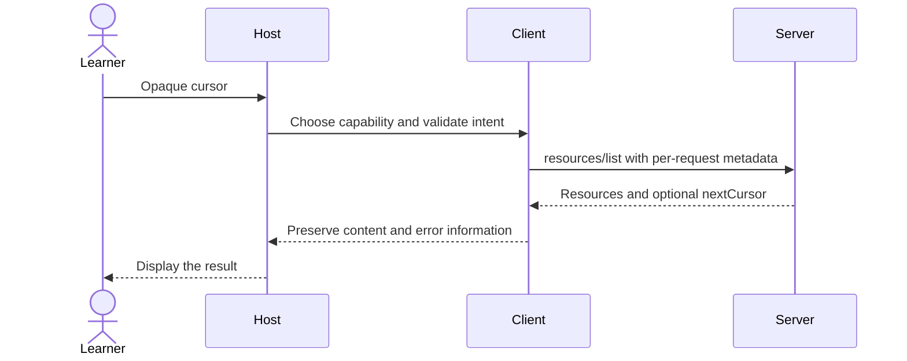

# Module 05: Your first client — own connections and query the workspace
> After this module you can query multiple servers with a bounded command-line client.

**Time:** ~75 min · **Level:** beginner · **LLM needed:** no · **Languages:** Python and TypeScript

**Target:** [MCP 2026-07-28](https://modelcontextprotocol.io/specification/2026-07-28/server/utilities/pagination); official Python SDK 2.3 and TypeScript SDK 2.4 where shown.

**Workspace and Chat version 2 / 0:** Query multiple servers with a bounded command-line client.

**Spec sections:** [Current specification](https://modelcontextprotocol.io/specification/2026-07-28/server/utilities/pagination).

## Prerequisites

Complete [Module 04](../04_prompts/README.md), run `uv sync` and `npm ci`, and work from the repository root.

## Learning objectives

- Own and clean up a stdio subprocess connection.
- Check capabilities before using a primitive.
- Traverse empty pages and reject repeating cursors.
- Handle tool failures and protocol failures separately.

## The big idea

A client is a receptionist with a directory. It learns which services exist, sends a request to the right service, and returns the reply. A language model is optional: a normal CLI can make the same protocol requests. Pagination resembles numbered trays of records, except the server gives an opaque continuation ticket. You return the ticket unchanged rather than guessing the next value.

## How it works



**Under the hood.** Python async with enters a connection and guarantees cleanup on exit. await pauses the current coroutine while I/O completes; it lets other work run without blocking the event loop. asyncio.run starts the loop for a terminal script. TypeScript awaits promises and uses try/finally for the same cleanup. Multiple clients remain separate connections even inside one application.

A Python client pinned to a revision skips the automatic discovery probe; `discover()` in common/connections.py explicitly fetches and adopts the server’s real capabilities. The first client checks tools/resources capability flags, then calls notes, wiki and prompts. An advertised capability is a feature claim; it does not prove a request will succeed. The pagination fixture has a nonempty first page, an empty middle page with a cursor, and a final page without a cursor. Stop only when nextCursor is absent, not when a page is empty. Track seen cursors and cap the page count. The CLI requires no model: arguments determine the query. The notification example reuses module 03’s listener and invalidates resource/catalog caches; the stretch exercise keeps unrelated tool entries intact.

## On the wire

Regenerate with `uv run python scripts/tier1.py --module 5 --capture`, then `uv run python scripts/render_wire_docs.py`. Timing values, IDs and machine paths may differ on your computer. The proxy forwards original bytes; only its capture copy is redacted.

<!-- wire:start -->

Source: [captured 02_pages_and_errors](wire/02_pages_and_errors.jsonl). Each JSON block below is a complete message copied from that run.

```json
{
  "jsonrpc": "2.0",
  "id": 2,
  "method": "resources/list",
  "params": {
    "cursor": "middle",
    "_meta": {
      "io.modelcontextprotocol/protocolVersion": "2026-07-28",
      "io.modelcontextprotocol/clientInfo": {
        "name": "mcp",
        "version": "0.1.0"
      },
      "io.modelcontextprotocol/clientCapabilities": {}
    }
  }
}
```

```json
{
  "jsonrpc": "2.0",
  "id": 2,
  "result": {
    "cacheScope": "private",
    "nextCursor": "last",
    "resources": [],
    "resultType": "complete",
    "ttlMs": 0,
    "_meta": {
      "io.modelcontextprotocol/serverInfo": {
        "name": "Lumen paged catalog",
        "version": "1.0"
      }
    }
  }
}
```

<!-- wire:end -->

Read `id` first: it pairs a reply with the request. `method` chooses an operation and `params` carries its arguments. The reserved `_meta` keys carry the current protocol version, client identity and capabilities; replies identify the server. `resultType: complete` says this operation has finished. Cacheable results also carry `ttlMs` and `cacheScope`. An `error` envelope is a protocol failure; `isError` inside a tool result is an execution failure. Notifications have no request ID; subscription events carry their listener identity in metadata. Only the kinds used in this lesson appear in its capture.

See all exchanges and exact versions in the [capture manifest](wire/manifest.json). The [negative-example runner](../../scripts/lesson_mistakes.py) makes the common mistakes below reproducible.

## Key APIs at a glance

| Python | TypeScript | What it does | When to use it |
|---|---|---|---|
| Client + async with | Client + try/finally | Own transport lifetime | Every client program |
| server_capabilities | getServerCapabilities | Inspect advertised features | Before optional operations |
| list_resources(cursor=...) | listResources({cursor}) | Continue a listing | Bounded pagination |
| argparse | process.argv | Read CLI input | Deterministic workspace queries |

## Walkthrough


### 1. Own a subprocess lifetime with async with and use all three primitives.

Read [01_stdio_client.py](python/examples/01_stdio_client.py), then run:

```text
uv run python modules/05_first_client/python/examples/01_stdio_client.py
```

Expected: Note content, wiki index, release prompt; child processes close.

TypeScript equivalent: [01_stdio_client.ts](typescript/examples/01_stdio_client.ts).

```text
npm exec tsx -- modules/05_first_client/typescript/examples/01_stdio_client.ts
```
### 2. Traverse opaque cursors, including an empty page; handle a protocol failure.

Read [02_pages_and_errors.py](python/examples/02_pages_and_errors.py), then run:

```text
uv run python modules/05_first_client/python/examples/02_pages_and_errors.py
```

Expected: Index, Bulletin; invalid cursor rejected.

TypeScript equivalent: [02_pages_and_errors.ts](typescript/examples/02_pages_and_errors.ts).

```text
npm exec tsx -- modules/05_first_client/typescript/examples/02_pages_and_errors.ts
```
### 3. A deterministic multi-server command-line query; no model required.

Read [03_cli_and_changes.py](python/examples/03_cli_and_changes.py), then run:

```text
uv run python modules/05_first_client/python/examples/03_cli_and_changes.py
```

Expected: Release notes and engineering wiki page; use --query to change the search.

TypeScript equivalent: [03_cli_and_changes.ts](typescript/examples/03_cli_and_changes.ts).

```text
npm exec tsx -- modules/05_first_client/typescript/examples/03_cli_and_changes.ts
```
### Verify and capture the whole lesson

To exercise notification-driven cache invalidation in the CLI, approve its fixed
in-memory update explicitly. This writes only `CLI review complete` to the
temporary bulletin, removes the cached URI on notification, and refetches it:

```text
uv run python modules/05_first_client/python/examples/03_cli_and_changes.py --watch-once --confirm-demo-write
npm exec tsx -- modules/05_first_client/typescript/examples/03_cli_and_changes.ts --watch-once --confirm-demo-write
```

Without `--confirm-demo-write`, watch mode exits with an approval instruction and
performs no update. Expect a final `Refetched:` line containing `CLI review complete`.


```text
uv run python scripts/tier1.py --module 5 --capture
uv run pytest modules/05_first_client/python/tests
```

The capture runner uses actual child processes, asserts returned values, and exits.
The [wire manifest](wire/manifest.json) records its command and package versions.

```text
npm test -- modules/05_first_client/typescript/tests common/typescript/tier1.test.ts
npm run typecheck
```

TypeScript note: a type annotation checks code at build time; Zod validates incoming data at runtime. `npm exec tsx` runs these ES modules without a separate compilation step. Both tracks use the same fixtures and contract expectations. Module 05’s CLI presentation differs as explained below.

## Try it in a host

Generate configurations for this machine:

```text
uv run python scripts/host_configs.py --module 5
```

Use [the four host configurations](host_configs/README.md) and [host setup instructions](../../docs/HOST_SETUP.md). The JSON has the host’s exact outer envelope and absolute executable/project paths. Restart or reload the host after adding entries and inspect the listed capabilities. Ask **“Find the release note and read wiki://engineering/page-01.”** The configured notes, wiki and prompts servers also let you choose `summarize_incident` from the prompt picker.

Use Inspector or the supplied client as the reproducible baseline; third-party host UI behavior is a separate learner verification step. Host configuration formats were checked against official documentation; interactive host UI behavior is not an automated test claim.

## Real-world use case

A Lumen developer wants a repeatable release-context query in a terminal or script. The workspace CLI retrieves notes and a wiki page without model inference, API keys, or variable tool selection. The companion pagination fixture teaches how a larger catalog would be traversed safely.

Read [the Python use case](python/use_case/main.py) and run:

```text
uv run python modules/05_first_client/python/use_case/main.py
```

This command is a client and exits after completing its scenario.

The default query returns the Release handover note and engineering/page-01. Both tracks accept --query, --space and --page.

The [shared implementation](../../common/workspace_query.py) contains the service logic reused by the numbered examples. The [TypeScript use case](typescript/use_case/main.ts) runs with `npm exec tsx -- modules/05_first_client/typescript/use_case/main.ts`.

## Common mistakes

Reproduce any row with `uv run python scripts/lesson_mistakes.py --module 5 --case N`, replacing N with the row number. These are the actual returned error’s first line; SDK validation may add field details below it.

| Case | Exact error excerpt | Fix |
|---|---|---|
| 1 | `Internal server error` | Restart from the first page; do not invent a cursor. |
| 2 | `Page budget exceeded.` | Increase the deliberate page budget or narrow the catalog. |
| 3 | `Method not found` | Check capabilities; the pagination-only fixture has no tools. |
| 4 | `Unknown wiki page: use a listed space and page-01 through page-08.` | Use a valid resource address; listing is not path guessing. |

**What could go wrong?** A server can return misleading content or inaccurate annotations. Review actions in the host; keep paths inside the fixture boundary, treat retrieved prose as data, and do not put diagnostic text on protocol stdout. The in-memory writes reset on process exit and never modify committed fixtures.

## Exercises

### Practice: next page

Continue pagination by nextCursor even if the current page is empty. Start with the [runnable starter](python/exercises/01_practice.py).
The baseline intentionally handles fewer cases; its extension checks should fail until you finish.

```text
uv run python modules/05_first_client/python/exercises/01_practice.py
uv run python scripts/check_exercise.py --module 5 --exercise 1
```

Compare with the [separate worked solution](python/solutions/01_practice.py); run the same check with `--solution`.

TypeScript: [starter](typescript/exercises/01_practice.ts), [solution](typescript/solutions/01_practice.ts).

```text
npm exec tsx -- scripts/check-exercise.ts 5 1
```

Add `--solution` to check the worked answer.

### Apply: failure kind

Distinguish protocol errors, tool failures, and successful responses. Start with the [runnable starter](python/exercises/02_apply.py).
The baseline intentionally handles fewer cases; its extension checks should fail until you finish.

```text
uv run python modules/05_first_client/python/exercises/02_apply.py
uv run python scripts/check_exercise.py --module 5 --exercise 2
```

Compare with the [separate worked solution](python/solutions/02_apply.py); run the same check with `--solution`.

TypeScript: [starter](typescript/exercises/02_apply.ts), [solution](typescript/solutions/02_apply.ts).

```text
npm exec tsx -- scripts/check-exercise.ts 5 2
```

Add `--solution` to check the worked answer.

### Stretch: catalog change

Clear only the resource catalog on its list-change event. Start with the [runnable starter](python/exercises/03_stretch.py).
The baseline intentionally handles fewer cases; its extension checks should fail until you finish.

```text
uv run python modules/05_first_client/python/exercises/03_stretch.py
uv run python scripts/check_exercise.py --module 5 --exercise 3
```

Compare with the [separate worked solution](python/solutions/03_stretch.py); run the same check with `--solution`.

TypeScript: [starter](typescript/exercises/03_stretch.ts), [solution](typescript/solutions/03_stretch.ts).

```text
npm exec tsx -- scripts/check-exercise.ts 5 3
```

Add `--solution` to check the worked answer.


## Quiz

Answer the [five-question quiz](quiz.md) before opening its expandable answers.

## Key takeaways

- A deterministic MCP client needs no language model.
- Pagination ends when nextCursor is absent, even if an earlier page is empty.
- A seen-cursor set and a page budget prevent unbounded discovery.
- Async context managers close pipes and child processes on success and failure.
- Check both protocol errors and isError tool results.

## Go deeper

- [Specification: this module’s primitive](https://modelcontextprotocol.io/specification/2026-07-28/server/utilities/pagination)
- [Official Python SDK](https://py.sdk.modelcontextprotocol.io/)
- [Official TypeScript SDK](https://github.com/modelcontextprotocol/typescript-sdk)
- [Current protocol schema](https://modelcontextprotocol.io/specification/2026-07-28/schema)

## Next: Module 06

Continue to [Module 06](../06_building_a_host/README.md).
