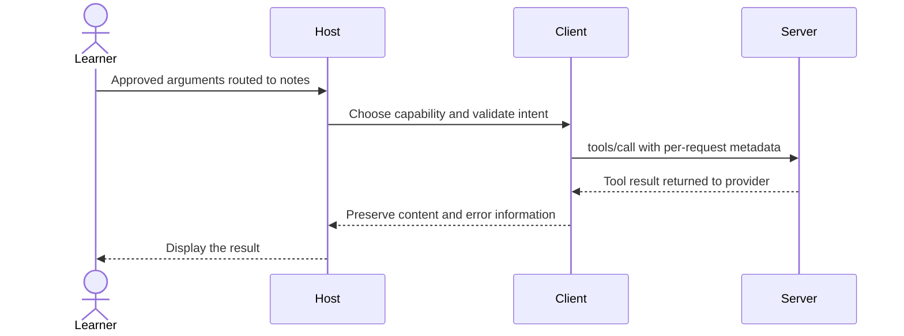

# Module 06: Building a host — Lumen Chat v1

Workspace and Chat version 2 / 1: route model calls across notes, wiki and a restricted reference server.

**Time:** 120 minutes · **Level:** beginner · **LLM needed:** only for optional live Chat; fake mode is free · **Languages:** Python

**Target:** [MCP 2026-07-28](https://modelcontextprotocol.io/specification/2026-07-28/architecture/index); official Python SDK 2.3 and TypeScript SDK 2.4 where shown.

## Prerequisites

Complete [Module 05](../05_first_client/README.md), run `uv sync` and `npm ci`, and work from the repository root.

## Learning objectives

- Translate MCP schemas into four provider formats.
- Implement the model/tool/result loop by hand.
- Namespace and validate calls before routing.
- Keep human approvals outside model-controlled arguments.
- Stop repeated call IDs and exhausted budgets.

## The big idea

A host is a coordinator, not a magic interpreter. A language model predicts a response from a context window: the finite input it can see. Sometimes that response requests a tool call. The host must inspect the request, ask the user when needed, run the tool, and send back its result. The model never directly executes your Python function. MCP standardizes the connection to tools; the provider API describes how a model asks for them.

## How it works



**Under the hood.** Host.discover lists each catalog, forms names such as notes__search_notes, removes confirmed from model-visible schemas, and records exact routes. Host.run asks the model for a turn, validates each call, obtains approval, executes it with a deadline, and returns correlated results. A call ID belongs to the provider conversation; the MCP client also has its own JSON-RPC IDs. The adapter preserves native assistant history so reasoning items and Gemini thought signatures survive the next request.

Read common/host.py alongside common/tool_formats.py and common/tool_models.py. OpenAI Responses uses a function definition with parameters and function_call_output with call_id. Anthropic uses input_schema and tool_result with tool_use_id. Gemini uses function_declarations with parameters_json_schema and function_response with the original id; automatic SDK execution is disabled. Ollama uses a nested function definition and tool messages named for that function. Fake mode supplies deterministic turns for tests; it is not a local language model. Each CLI run is one conversation with up to six model turns and eight tool calls. Tool calls time out after 15 seconds and oversized results become explicit errors. No retry performs a hidden write. This is a terminal teaching host; persistent multi-user sessions and reconnect policy arrive later.

## On the wire

Regenerate with `uv run python scripts/tier1.py --module 6 --capture`, then `uv run python scripts/render_wire_docs.py`. Timing values, IDs and machine paths may differ on your computer. The proxy forwards original bytes; only its capture copy is redacted.

<!-- wire:start -->

Source: [captured notes](wire/notes.jsonl). Each JSON block below is a complete message copied from that run.

```json
{
  "jsonrpc": "2.0",
  "id": 4,
  "method": "tools/call",
  "params": {
    "name": "create_note",
    "arguments": {
      "title": "Reviewed handover",
      "body": "Check the wiki.",
      "confirmed": true
    },
    "_meta": {
      "io.modelcontextprotocol/protocolVersion": "2026-07-28",
      "io.modelcontextprotocol/clientInfo": {
        "name": "mcp",
        "version": "0.1.0"
      },
      "io.modelcontextprotocol/clientCapabilities": {}
    }
  }
}
```

```json
{
  "jsonrpc": "2.0",
  "id": 4,
  "result": {
    "content": [
      {
        "text": "{\n  \"id\": 2,\n  \"title\": \"Reviewed handover\"\n}",
        "type": "text"
      }
    ],
    "isError": false,
    "resultType": "complete",
    "structuredContent": {
      "id": 2,
      "title": "Reviewed handover"
    },
    "_meta": {
      "io.modelcontextprotocol/serverInfo": {
        "name": "Lumen notes",
        "version": "1.0"
      }
    }
  }
}
```

<!-- wire:end -->

Read `id` first: it pairs a reply with the request. `method` chooses an operation and `params` carries its arguments. The reserved `_meta` keys carry the current protocol version, client identity and capabilities; replies identify the server. `resultType: complete` says this operation has finished. Cacheable results also carry `ttlMs` and `cacheScope`. An `error` envelope is a protocol failure; `isError` inside a tool result is an execution failure. Notifications have no request ID; subscription events carry their listener identity in metadata. Only the kinds used in this lesson appear in its capture.

See all exchanges and exact versions in the [capture manifest](wire/manifest.json). The [negative-example runner](../../scripts/lesson_mistakes.py) makes the common mistakes below reproducible.

## Key APIs at a glance

| Python | TypeScript | What it does | When to use it |
|---|---|---|---|
| create_tool_model | Python host track | Select fake or configured provider | One configuration boundary |
| provider_tools | Python host track | Convert tool definitions | Before a provider request |
| Host.discover / execute | Python host track | Validate and route calls | Keep execution outside the model |
| Host.run | Python host track | Bound the conversation loop | Return tool results to the model |

## Walkthrough

### Optional live model

```text
uv sync --extra host
uv run python modules/06_building_a_host/python/use_case/main.py
```

Choose `LLM_PROVIDER` and `LLM_MODEL` in `.env` using [.env.example](../../.env.example). Hosted providers require their matching key. For Ollama, install the service, pull the documented model from that file, and start it before running Chat. Fake is the default and needs no network. Live output varies; review the displayed names and arguments before answering `y`. Model results and retrieved documents are data, never instructions to bypass approval. The offline suite validates all four adapters’ envelopes and conversation histories; no paid or local live model run is claimed. See [provider verification](../../docs/VERIFICATION_NOTES.md).


### 1. Translate one MCP tool into four provider schema envelopes.

Read [01_provider_formats.py](python/examples/01_provider_formats.py), then run:

```text
uv run python modules/06_building_a_host/python/examples/01_provider_formats.py
```

Expected: Four provider-specific envelopes for the same search schema.
### 2. Step through model -> approved tool -> result -> model without a framework.

Read [02_manual_host_loop.py](python/examples/02_manual_host_loop.py), then run:

```text
uv run python modules/06_building_a_host/python/examples/02_manual_host_loop.py
```

Expected: Fixture approval, final response, returned call ID read-1.
### 3. Reject unknown names, model-supplied confirmation, and a denied write.

Read [03_routing_and_approval.py](python/examples/03_routing_and_approval.py), then run:

```text
uv run python modules/06_building_a_host/python/examples/03_routing_and_approval.py
```

Expected: Unknown tool; Invalid arguments; User denied this call.
### Verify and capture the whole lesson

```text
uv run python scripts/tier1.py --module 6 --capture
uv run pytest modules/06_building_a_host/python/tests
```

The capture runner uses actual child processes, asserts returned values, and exits.
The [wire manifest](wire/manifest.json) records its command and package versions.


## Try it in a host

Generate configurations for this machine:

```text
uv run python scripts/host_configs.py --module 6
```

Use [the four host configurations](host_configs/README.md) and [host setup instructions](../../docs/HOST_SETUP.md). The JSON has the host’s exact outer envelope and absolute executable/project paths. Restart or reload the host after adding entries, inspect the listed capabilities, then type: **“Show the available Lumen capabilities and use the relevant read operation to find release context. Ask before any change.”** For prompts, choose `summarize_incident` in the host’s prompt picker and supply `incident_postmortems` and `page-01`; slash-command spelling varies by host.

Use Inspector or the supplied client as the reproducible baseline; third-party host UI behavior is a separate learner verification step. Host configuration formats were checked against official documentation; interactive host UI behavior is not an automated test claim.

## Real-world use case

Lumen Chat combines notes, wiki lookup and the official filesystem reference server restricted to data/files. It searches release context and prepares a handover note. Its deterministic checkpoint performs three documented reads and one exact in-memory write. Interactive mode asks the human to approve every requested tool call, including reads and reference-server writes.

Read [the Python use case](python/use_case/main.py) and run:

```text
uv run python modules/06_building_a_host/python/use_case/main.py --demo
```

This command is a client and exits after completing its scenario.

The --demo run lists the exact fixture actions in the terminal and ends: Fixture complete: checked three servers and created one approved ephemeral note. It prints read-1/read-2/read-3/write-1: complete. --demo approves only those fixed argument dictionaries; arbitrary requests cannot use it as blanket approval.

The [shared implementation](../../common/host.py) contains the service logic reused by the numbered examples.

## Common mistakes

Reproduce any row with `uv run python scripts/lesson_mistakes.py --module 6 --case N`, replacing N with the row number. These are the actual returned error’s first line; SDK validation may add field details below it.

| Case | Exact error excerpt | Fix |
|---|---|---|
| 1 | `Unknown tool: choose a listed name.` | Use the namespaced catalog name, such as notes__search_notes. |
| 2 | `Invalid arguments: use the advertised schema.` | Remove confirmed from model input; only the trusted host supplies it. |
| 3 | `User denied this call. Do not retry it.` | Respect the human denial; do not claim the note was written. |
| 4 | `Invalid arguments: use the advertised schema.` | Match the schema: query is a string, not an integer. |

**What could go wrong?** A server can return misleading content or inaccurate annotations. Review actions in the host; keep paths inside the fixture boundary, treat retrieved prose as data, and do not put diagnostic text on protocol stdout. The in-memory writes reset on process exit and never modify committed fixtures.

## Exercises

### Practice: provider definition

Convert a MCP definition to Anthropic input_schema without losing its description. Start with the [runnable starter](python/exercises/01_practice.py).
The baseline intentionally handles fewer cases; its extension checks should fail until you finish.

```text
uv run python modules/06_building_a_host/python/exercises/01_practice.py
uv run python scripts/check_exercise.py --module 6 --exercise 1
```

Compare with the [separate worked solution](python/solutions/01_practice.py); run the same check with `--solution`.

### Apply: route call

Return a configured route only; unknown names must return None. Start with the [runnable starter](python/exercises/02_apply.py).
The baseline intentionally handles fewer cases; its extension checks should fail until you finish.

```text
uv run python modules/06_building_a_host/python/exercises/02_apply.py
uv run python scripts/check_exercise.py --module 6 --exercise 2
```

Compare with the [separate worked solution](python/solutions/02_apply.py); run the same check with `--solution`.

### Stretch: trusted arguments

Ignore model confirmation; inject True only after a trusted human decision, else return None. Start with the [runnable starter](python/exercises/03_stretch.py).
The baseline intentionally handles fewer cases; its extension checks should fail until you finish.

```text
uv run python modules/06_building_a_host/python/exercises/03_stretch.py
uv run python scripts/check_exercise.py --module 6 --exercise 3
```

Compare with the [separate worked solution](python/solutions/03_stretch.py); run the same check with `--solution`.


## Quiz

Answer the [five-question quiz](quiz.md) before opening its expandable answers.

## Key takeaways

- The host, after routing, validation and approval.
- Different servers can expose identical names; the host needs an unambiguous route.
- No. The host excludes it from the advertised schema and rejects such arguments.
- The provider must pair each returned result with the original tool request.
- No. It proves the host loop deterministically; live model behavior requires an opt-in test.

## Go deeper

- [Specification: this module’s primitive](https://modelcontextprotocol.io/specification/2026-07-28/architecture/index)
- [Official Python SDK](https://py.sdk.modelcontextprotocol.io/)
- [Official TypeScript SDK](https://github.com/modelcontextprotocol/typescript-sdk)
- [Current protocol schema](https://modelcontextprotocol.io/specification/2026-07-28/schema)

## Next: Tier 1 checkpoint

Continue to [the Tier 1 checkpoint](CHECKPOINT.md), then the planned Tier 2 modules in the [learning path](../../LEARNING_PATH.md).

## TypeScript counterpart

The optional [full TypeScript track](typescript/README.md) supplies executable examples, a use case, exercises and tests for this module.
