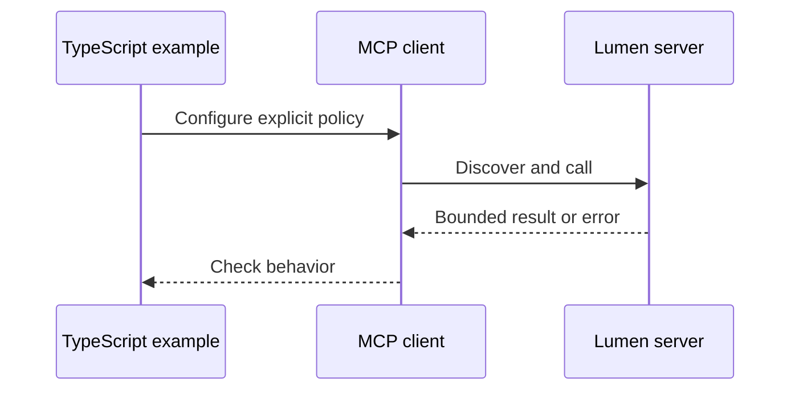

# TypeScript 06: Build a host

Run a bounded model loop; proposals remain separate from human authorization. These are the TypeScript counterparts to [Module 06](../README.md). Read that lesson's explanation, diagram and quiz first; this page records language-specific behavior.

## Prerequisites

From the root: `npm ci`. Node 24 or 26 is required. The pinned official MCP SDK is 2.4.0; the protocol is 2026-07-28. No model key is needed.

## Learning objectives

- Execute each case and explain its observable assertion.
- Identify the boundary enforced by the server or host.
- Make a controlled change and demonstrate its failing regression.

## The big idea

Run a bounded model loop; proposals remain separate from human authorization. The language changes syntax and library choices; the peer still sees the same JSON-RPC contract. A deterministic fixture is an integration check, not a measured model-quality claim.

## How it works



## On the wire

[Actual TypeScript traffic](../../bonus/B1_typescript_track/wire/notes.jsonl), [form retries](../../bonus/B1_typescript_track/wire/forms.jsonl), and [Tasks](../../bonus/B1_typescript_track/wire/tasks.jsonl) share the current envelope. [Regeneration manifest](../../bonus/B1_typescript_track/wire/manifest.json). Captures are shared by capability, not duplicated to imply a separate capture of an in-memory assertion.

## Key APIs at a glance

| Python | TypeScript | Purpose |
|---|---|---|
| MCPServer | McpServer | Register local behavior |
| Client | Client | Request/validate protocol results |
| Context | ctx.mcpReq | Cancellation, input state and notifications |
| gateway/host helpers | CourseHost, Gateway, Connection | Keep execution policy outside model proposals |

## Walkthrough

- `01_model_loop.ts`: run `node --import tsx modules/06_building_a_host/typescript/examples/01_model_loop.ts`; expect `status: PASS`.
- `02_approval.ts`: run `node --import tsx modules/06_building_a_host/typescript/examples/02_approval.ts`; expect `status: PASS`.
- `03_provider_shapes.ts`: run `node --import tsx modules/06_building_a_host/typescript/examples/03_provider_shapes.ts`; expect `status: PASS`.

The executable contracts live in [advanced_lessons.ts](../../../common/typescript/advanced_lessons.ts); follow the module-number branch to the focused implementation it invokes. This avoids copying the same host/security logic into every example.

Run the complete three-server terminal host:

```text
node --import tsx common/typescript/chat.ts
node --import tsx common/typescript/chat.ts --live
```

The first command uses a fixture model and exits after an approved notes read. The second loads the shared `.env`, asks for your question and requests terminal approval for each exact call. Set `LLM_PROVIDER` to `openai`, `anthropic`, `gemini` or `ollama`, and choose `LLM_MODEL`; hosted providers also need their named API key. There is no hardcoded model or implicit network call.

[llm.ts](../../../common/typescript/llm.ts) implements the native HTTP tool loop for all four providers. It preserves call IDs and native assistant blocks, including reasoning/thought signatures. [schemas.ts](../../../common/typescript/schemas.ts) expands bounded local schema references and removes host-only `confirmed` before exposing tools to the model. Host validation rejects unknown properties and model-supplied confirmation before asking the user. Six turns, eight calls, 16,000 result characters, 60-second provider requests and a 256 KB response cap bound the loop. Provider errors do not echo credentials or prompts.

Tests inject provider HTTP responses and perform actual MCP calls. They verify protocol shape and correlation; they do not establish live model quality. API references: [OpenAI Responses](https://developers.openai.com/api/docs/guides/function-calling), [Anthropic](https://platform.claude.com/docs/en/agents-and-tools/tool-use/define-tools), [Gemini](https://ai.google.dev/gemini-api/docs/function-calling), [Ollama](https://docs.ollama.com/capabilities/tool-calling).

## Try it in a host

Use the [B1 host configs](../../bonus/B1_typescript_track/host_configs/vscode.json), replacing the absolute repository path. Ask "Find release notes." The fixed `notes` profile starts with protocol-only stdout. The `forms` profile asks for a bulletin decision; the `workflow` profile reads and drafts without publishing.

## Real-world use case

Run `node --import tsx modules/06_building_a_host/typescript/use_case/main.ts`. Expect three passing cases. In a company, keep the same boundary checks while replacing the synthetic data source and setting an explicitly reviewed identity policy.

## Common mistakes

- `Unknown lesson`: use a listed module and part 1–3.
- `User declined`: the host decision was false; do not silently retry a write.
- `Review the current catalog first`: discover and review before executing.
- `Invalid issuer, audience or expiry`: verify the configured resource and issuer; never weaken checks to make a token pass.

## Exercises

Run `node --import tsx scripts/check-ts-extension-exercise.ts 6 1` (or 2/3). Initially it reports a deliberate mismatch; use `--solution` to verify the answer.

1. **Practice — tool_namespace:** Accept exactly two safe server/tool names joined by a double underscore. Run exercise 1 against the independent positive and negative cases in `common/typescript/exercise_contracts.ts`.
2. **Apply:** require a nonempty reviewed fingerprint, exact equality with the current fingerprint, and explicit approval. Test a changed catalog and a declined decision.
3. **Stretch:** consume page cursors until `undefined`, count pages, reject repeats and stop at 20 pages. An empty/incomplete sequence is an error. Apply it to discovery before exposing a model catalog.

## Quiz

Use the [module quiz](../quiz.md), then explain which assertions above support your answers. B1's [cross-language quiz](../../bonus/B1_typescript_track/quiz.md) checks API and runtime differences.

## Key takeaways

- The wire contract is language independent.
- Types do not replace runtime validation.
- Capability discovery is separate from approval.
- Finite budgets make failures visible.
- A local fake model cannot measure live model accuracy.

## Go deeper

[Official TypeScript SDK](https://github.com/modelcontextprotocol/typescript-sdk), [current specification](https://modelcontextprotocol.io/specification/2026-07-28).

## Next

Return to the [full track index](../../bonus/B1_typescript_track/README.md).
