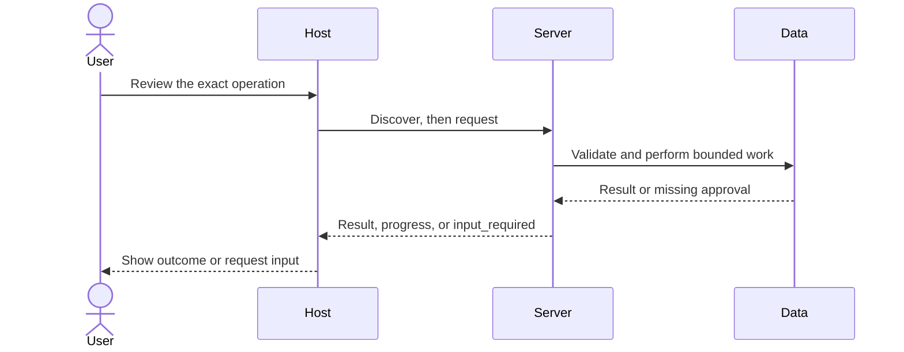

# Module 07: Servers over real data

**Time:** 150 minutes · **Level:** intermediate · **Languages:** Python · **LLM needed:** no; optional direct generation only

**Target:** MCP 2026-07-28, Python SDK 2.3, TypeScript SDK 2.4. Commands run from the repository root on Windows, macOS, or Linux.

## Prerequisites

Complete [Module 06](../06_building_a_host/README.md). Install the HTTP and host extras, including the local mock and approval page:

```text
uv sync --frozen --extra http --extra host
npm ci
```

No model keys are needed for any default example. Server commands wait for a client; client demos print results and exit.

## Learning objectives

- Implement validated issue CRUD with transactions.
- Keep SQL structure separate from user values.
- Bound query execution, row counts, and API responses.
- Return pagination links and read them with a client.
- Wrap a local API and explicitly opt in to Open-Meteo.

## The big idea

An MCP server is like a service desk in front of a records room. A request asks the clerk for a specific action; it does not hand the visitor a master key. Here, validated tools select named SQL queries, bind values separately, and return a bounded page. Writes happen only in a disposable copy after the host confirms the exact operation. A resource link acts like a page reference: it points to more data without forcing every row into the model context.

## How it works



The database copy is in memory, created with SQLite backup from a read-only source. Its lifetime is the server lifetime. The lab uses one connection on the event loop and tiny bounded transactions; production workloads should use an asynchronous driver or a bounded connection pool. Foreign keys are enabled. Delete removes dependent comments and labels in the same transaction. Analytics uses mode=ro, query_only, a fixed SELECT, parameters, LIMIT+1, and a progress-handler deadline. This is an allow-list of one named query, not an arbitrary SQL console. API calls have a five-second overall deadline, a transport timeout, no redirects, and a 64 KB response bound.

## On the wire

Regenerate real captures with `uv run python scripts/tier2.py --module 7 --capture`, then run `uv run python scripts/render_wire_docs.py`. The [capture manifest](wire/manifest.json) records the command and SDK versions. Ephemeral state and progress tokens are diagnostic data, never reusable credentials. Captures are local test traffic.

<!-- wire:start -->

Source: [captured python_main](wire/python_main.jsonl). Each JSON block below is a complete message copied from that run.

```json
{
  "jsonrpc": "2.0",
  "id": 3,
  "method": "tools/call",
  "params": {
    "name": "read_issue",
    "arguments": {
      "issue_id": 1
    },
    "_meta": {
      "io.modelcontextprotocol/protocolVersion": "2026-07-28",
      "io.modelcontextprotocol/clientInfo": {
        "name": "mcp",
        "version": "0.1.0"
      },
      "io.modelcontextprotocol/clientCapabilities": {}
    }
  }
}
```

```json
{
  "jsonrpc": "2.0",
  "id": 3,
  "result": {
    "content": [
      {
        "text": "{\n  \"id\": 1,\n  \"project_id\": 1,\n  \"title\": \"Service ownership: work item 1\",\n  \"status\": \"in_progress\",\n  \"priority\": \"medium\",\n  \"assignee_id\": 14,\n  \"created_at\": \"2026-01-02\"\n}",
        "type": "text"
      }
    ],
    "isError": false,
    "resultType": "complete",
    "structuredContent": {
      "id": 1,
      "project_id": 1,
      "title": "Service ownership: work item 1",
      "status": "in_progress",
      "priority": "medium",
      "assignee_id": 14,
      "created_at": "2026-01-02"
    },
    "_meta": {
      "io.modelcontextprotocol/serverInfo": {
        "name": "Lumen issues",
        "version": ""
      }
    }
  }
}
```

```json
{
  "jsonrpc": "2.0",
  "id": 10,
  "method": "resources/read",
  "params": {
    "uri": "analytics://usage/2025-08-01/2/2",
    "_meta": {
      "io.modelcontextprotocol/protocolVersion": "2026-07-28",
      "io.modelcontextprotocol/clientInfo": {
        "name": "mcp",
        "version": "0.1.0"
      },
      "io.modelcontextprotocol/clientCapabilities": {}
    }
  }
}
```

```json
{
  "jsonrpc": "2.0",
  "id": 10,
  "result": {
    "cacheScope": "private",
    "contents": [
      {
        "mimeType": "text/plain",
        "text": "{\"rows\": [{\"day\": \"2025-08-03\", \"active_users\": 1065, \"signups\": 28, \"requests\": 5956, \"mrr_cents\": 10050000}, {\"day\": \"2025-08-04\", \"active_users\": 1097, \"signups\": 15, \"requests\": 11605, \"mrr_cents\": 10075000}], \"truncated\": true, \"next_offset\": 4}",
        "uri": "analytics://usage/2025-08-01/2/2"
      }
    ],
    "resultType": "complete",
    "ttlMs": 0,
    "_meta": {
      "io.modelcontextprotocol/serverInfo": {
        "name": "Lumen issues",
        "version": ""
      }
    }
  }
}
```

<!-- wire:end -->

## Key APIs at a glance

| Python | TypeScript | What it does | When to use |
|---|---|---|---|

| IssueInput / bound SQL | Module 10 remoteWorkspace | Validate writes | Before touching data |
| readonly_database / usage_page | B1 counterpart planned | Limit reads | For analytics |
| httpx2.AsyncClient / ASGITransport | B1 counterpart planned | Wrap a REST API | For mock or opt-in live calls |

## Walkthrough

### 01_issue_crud

Start the issue server. Read issue 1, create a confirmed issue, retry the same operation key, update it, and delete it. The key prevents another insert; a deleted issue retains its receipt.

```text
uv run python modules/07_real_data/python/examples/01_issue_crud.py
```

### 02_readonly_analytics

Start the analytics server. Request two rows and follow its resource link. The SQL is fixed; dates, limits, and offsets are parameters. Fetching one extra row detects truncation.

```text
uv run python modules/07_real_data/python/examples/02_readonly_analytics.py
```

### 03_rest_wrapper

Start the API wrapper. project_details calls a real FastAPI app through an in-process HTTP transport. Unknown projects fail. weather refuses external access until allow_network is true.

```text
uv run python modules/07_real_data/python/examples/03_rest_wrapper.py
```

### Verify all interactions

```text
uv run python scripts/tier2.py --module 7
uv run python modules/07_real_data/python/use_case/main.py
```

Expected: `PASS Module 07`. A failed assertion is a failed lesson check; it is not silently ignored.

## Try it in a host

Generate paths for your checkout with `uv run python scripts/host_configs.py --module 7`. Copy the relevant entries into your existing host configuration. See [host setup](../../docs/HOST_SETUP.md); the committed [VS Code example](host_configs/vscode.json) is a reference for the original checkout.

Ask: “Inspect the available Lumen tools, read the context, and show me the exact arguments before any write.” For form and URL input, use the included Lumen Chat v2; third-party host support varies.

```text
uv run python -m common.chat_v2 --demo
```

The demo permits only the documented synthetic calls, closes issues 1 and 2 in a disposable copy, and uses a fake model. Omit --demo for interactive approval and your configured provider. Host configuration formats were checked against documentation; no third-party GUI validation is claimed.

## Real-world use case

Lumen Workspace v3 combines issue operations and analytics. Run python/use_case/main.py to create, retry, update, and delete an issue, then follow a usage page link. The committed 400-issue and 365-day databases remain unchanged.

Implementation: [use case](python/use_case/main.py).

## Common mistakes

| Reproduce | Expected symptom and fix |
|---|---|

| Create without confirmed=true | Confirmation error; approve the exact write in the host first. |
| Use a title containing SQL syntax | It is stored as a literal value; never repair this by interpolating strings. |
| Request limit=999 | Bounds error; use 1–50 and follow next_offset. |
| Call weather without allow_network | Explicit opt-in error; inspect coordinates and opt in only for a live demo. |

The integration checks deliberately cover denial, malformed input, and disconnects. Read the asserted failures in [Tier 2 tests](../../tests/test_tier2.py).

## Exercises

### Practice: Clamp requested pages to 1–50 rows.

Edit [the runnable starter](python/exercises/01_page_limit.py), replacing `# YOUR CODE HERE`. It handles a narrower case and should fail at least one extension check.

```text
uv run python scripts/check_exercise.py --module 7 --exercise 1
uv run python scripts/check_exercise.py --module 7 --exercise 1 --solution
```

<details><summary>Hint and worked solution</summary>

Inspect the boundary cases in [exercise contracts](python/tests/exercise_cases.json), then compare [the solution](python/solutions/01_page_limit.py).

</details>

### Apply: Return SQL and a separate parameter list; never interpolate the title.

Edit [the runnable starter](python/exercises/02_query_parameters.py), replacing `# YOUR CODE HERE`. It handles a narrower case and should fail at least one extension check.

```text
uv run python scripts/check_exercise.py --module 7 --exercise 2
uv run python scripts/check_exercise.py --module 7 --exercise 2 --solution
```

<details><summary>Hint and worked solution</summary>

Inspect the boundary cases in [exercise contracts](python/tests/exercise_cases.json), then compare [the solution](python/solutions/02_query_parameters.py).

</details>

### Stretch: Return the next offset only when the fetched extra row proves more data exists.

Edit [the runnable starter](python/exercises/03_page_cursor.py), replacing `# YOUR CODE HERE`. It handles a narrower case and should fail at least one extension check.

```text
uv run python scripts/check_exercise.py --module 7 --exercise 3
uv run python scripts/check_exercise.py --module 7 --exercise 3 --solution
```

<details><summary>Hint and worked solution</summary>

Inspect the boundary cases in [exercise contracts](python/tests/exercise_cases.json), then compare [the solution](python/solutions/03_page_cursor.py).

</details>

## Quiz

Answer the [quiz](quiz.md) before expanding its answers.

## Key takeaways

- Implement validated issue CRUD with transactions.
- Keep SQL structure separate from user values.
- Bound query execution, row counts, and API responses.
- Return pagination links and read them with a client.
- Wrap a local API and explicitly opt in to Open-Meteo.

## Go deeper

- [Open-Meteo forecast API and parameters](https://open-meteo.com/en/docs)

- [Official reference for this module](https://py.sdk.modelcontextprotocol.io/servers/tools/)
- [Current specification](https://modelcontextprotocol.io/specification/2026-07-28/architecture/index)
- [Migration guide: deprecated and legacy behavior](../../docs/MIGRATING_FROM_OLDER_VERSIONS.md)
- [Verification notes](../../docs/VERIFICATION_NOTES.md)

## Next

Continue to [Module 08](../08_server_utilities/README.md).
