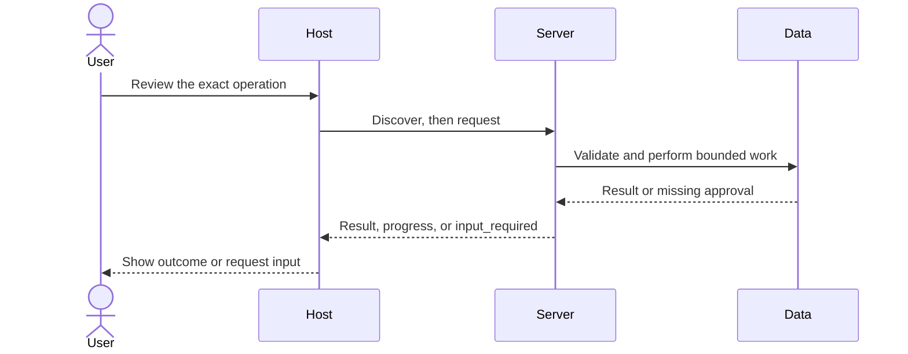

# Module 08: Server utilities: context, lifetime, progress
> After this module you can report progress, cancel work and close server-owned resources.

**Time:** ~105 min · **Level:** intermediate · **Languages:** Python · **LLM needed:** no; optional direct generation only

**Target:** MCP 2026-07-28, Python SDK 2.3, TypeScript SDK 2.4. Commands run from the repository root on Windows, macOS, or Linux.

**Workspace and Chat version 3 / 1:** Report progress, cancel work and close server-owned resources.

**Spec sections:** [Current specification](https://modelcontextprotocol.io/specification/2026-07-28).

[TypeScript companion](typescript/README.md) covers the native cases and API differences.

## Prerequisites

Complete [Module 07](../07_real_data/README.md). Install the HTTP and host extras, including the local mock and approval page:

```text
uv sync --frozen --extra http --extra host
npm ci
```

No model keys are needed for any default example. Server commands wait for a client; client demos print results and exit.

## Learning objectives

- Own database connections with lifespan.
- Use request-scoped progress tokens.
- Cancel work cooperatively and observe cleanup.
- Walk catalog cursors through empty pages.
- Complete arguments without invoking a model.

## The big idea

A report request is like a kitchen order. The restaurant opens its equipment once, tracks each order separately, and clears the work station when an order finishes or is cancelled. Lifespan owns shared dependencies; request context identifies the current job. Progress tells a waiting client that work is advancing. Cancellation asks the server to stop, but cleanup still belongs in a finally block.

## How it works



The report simulates four sections and aggregates all fixture issues. The quarter is a report label, not a real date filter. ctx.report_progress uses the caller's progress token. No token means no progress notifications. asyncio cancellation reaches awaited work; the finally block releases active work accounting. A five-second deadline bounds the report even if the client never cancels. For larger database operations use a cancellable worker/driver rather than blocking the event loop. Python logging writes to stderr. Protocol logging is Deprecated; the current lesson uses application diagnostics, with telemetry deferred to its later module. A cursor is opaque: only next_cursor=None ends enumeration, not an empty resources array.

## On the wire

Regenerate real captures with `uv run python scripts/tier2.py --module 8 --capture`, then run `uv run python scripts/render_wire_docs.py`. The [capture manifest](wire/manifest.json) records the command and SDK versions. Ephemeral state and progress tokens are diagnostic data, never reusable credentials. Captures are local test traffic.

<!-- wire:start -->

Source: [captured python_main](wire/python_main.jsonl). Each JSON block below is a complete message copied from that run.

```json
{
  "jsonrpc": "2.0",
  "id": 3,
  "method": "tools/call",
  "params": {
    "name": "quarterly_report",
    "arguments": {},
    "_meta": {
      "io.modelcontextprotocol/protocolVersion": "2026-07-28",
      "io.modelcontextprotocol/clientInfo": {
        "name": "mcp",
        "version": "0.1.0"
      },
      "io.modelcontextprotocol/clientCapabilities": {},
      "progressToken": "[REDACTED]"
    }
  }
}
```

```json
{
  "jsonrpc": "2.0",
  "id": 3,
  "result": {
    "content": [
      {
        "text": "{\n  \"quarter\": \"Q1\",\n  \"scope\": \"all fixture issues (simulated report)\",\n  \"counts\": [\n    {\n      \"status\": \"closed\",\n      \"count\": 149\n    },\n    {\n      \"status\": \"in_progress\",\n      \"count\": 135\n    },\n    {\n      \"status\": \"open\",\n      \"count\": 116\n    }\n  ]\n}",
        "type": "text"
      }
    ],
    "isError": false,
    "resultType": "complete",
    "structuredContent": {
      "quarter": "Q1",
      "scope": "all fixture issues (simulated report)",
      "counts": [
        {
          "status": "closed",
          "count": 149
        },
        {
          "status": "in_progress",
          "count": 135
        },
        {
          "status": "open",
          "count": 116
        }
      ]
    },
    "_meta": {
      "io.modelcontextprotocol/serverInfo": {
        "name": "Lumen reports",
        "version": ""
      }
    }
  }
}
```

```json
{
  "jsonrpc": "2.0",
  "method": "notifications/progress",
  "params": {
    "progressToken": "[REDACTED]",
    "progress": 1,
    "total": 4,
    "message": "Q1: section 1"
  }
}
```

```json
{
  "jsonrpc": "2.0",
  "method": "notifications/progress",
  "params": {
    "progressToken": "[REDACTED]",
    "progress": 2,
    "total": 4,
    "message": "Q1: section 2"
  }
}
```

<!-- wire:end -->

## Key APIs at a glance

| Python | TypeScript | What it does | When to use |
|---|---|---|---|

| Context.request_context | ServerContext.mcpReq | Inspect current work | Inside a handler |
| lifespan async context | Application-owned state | Open/close dependencies | At application boundaries |
| report_progress / task.cancel | mcpReq.notify / signal | Progress and cancellation | For longer work |
| client.complete / next_cursor | completable / nextCursor | Bounded discovery | Before user selection |

## Walkthrough

### 01_context_lifespan

Start the report server. report_status exposes active work and the issue count from the connection opened during lifespan. All database handlers run on its event loop.

```text
uv run python modules/08_server_utilities/python/examples/01_context_lifespan.py
```

### 02_progress_cancel

The client collects four progress updates, cancels a second report, and polls active work until cleanup finishes. An absolute deadline remains independent of progress.

```text
uv run python modules/08_server_utilities/python/examples/02_progress_cancel.py
```

### 03_pages_completion

Walk a catalog with an empty middle page, then complete Q against report_brief. Expect Index and Bulletin, then Q1 through Q4.

```text
uv run python modules/08_server_utilities/python/examples/03_pages_completion.py
```

### Verify all interactions

```text
uv run python scripts/tier2.py --module 8
uv run python modules/08_server_utilities/python/use_case/main.py
```

Expected: `PASS Module 08`. A failed assertion is a failed lesson check; it is not silently ignored.

## Try it in a host

Generate paths for your checkout with `uv run python scripts/host_configs.py --module 8`. Copy the relevant entries into your existing host configuration. See [host setup](../../docs/HOST_SETUP.md); the committed [VS Code example](host_configs/vscode.json) is a reference for the original checkout.

Ask: “Inspect the available Lumen tools, read the context, and show me the exact arguments before any write.” For form and URL input, use the included Lumen Chat v2; third-party host support varies.

```text
uv run python -m common.chat_v2 --demo
```

The demo permits only the documented synthetic calls, closes issues 1 and 2 in a disposable copy, and uses a fake model. Omit --demo for interactive approval and your configured provider. Host configuration formats were checked against documentation; no third-party GUI validation is claimed.

## Real-world use case

Generate a quarterly report for Lumen. The use case verifies its progress and cancellation, then completes quarter labels. The report explicitly says its scope covers all synthetic issues so a learner does not mistake the timing simulation for financial analysis.

Implementation: [use case](python/use_case/main.py).

## Common mistakes

| Reproduce | Expected symptom and fix |
|---|---|

| Call quarterly_report with delay=2 | Delay error; use a value from zero to one second. |
| Stop listing when resources is empty | You lose the final page; inspect next_cursor instead. |
| Reset the timeout after every progress message | A noisy server can run forever; retain an absolute deadline. |
| Print diagnostics to server stdout | JSON framing breaks; use logging or stderr. |

The integration checks deliberately cover denial, malformed input, and disconnects. Read the asserted failures in [Tier 2 tests](../../tests/test_tier2.py).

## Exercises

### Practice: Convert completed work to bounded integer percentage, including a zero total.

Edit [the runnable starter](python/exercises/01_progress.py), replacing `# YOUR CODE HERE`. It handles a narrower case and should fail at least one extension check.

```text
uv run python scripts/check_exercise.py --module 8 --exercise 1
uv run python scripts/check_exercise.py --module 8 --exercise 1 --solution
```

<details><summary>Hint and worked solution</summary>

Inspect the boundary cases in [exercise contracts](python/tests/exercise_cases.json), then compare [the solution](python/solutions/01_progress.py).

</details>

### Apply: Flatten resource pages, preserving values after an empty page.

Edit [the runnable starter](python/exercises/02_empty_pages.py), replacing `# YOUR CODE HERE`. It handles a narrower case and should fail at least one extension check.

```text
uv run python scripts/check_exercise.py --module 8 --exercise 2
uv run python scripts/check_exercise.py --module 8 --exercise 2 --solution
```

<details><summary>Hint and worked solution</summary>

Inspect the boundary cases in [exercise contracts](python/tests/exercise_cases.json), then compare [the solution](python/solutions/02_empty_pages.py).

</details>

### Stretch: Stop at the deadline; progress never extends the absolute budget.

Edit [the runnable starter](python/exercises/03_deadlines.py), replacing `# YOUR CODE HERE`. It handles a narrower case and should fail at least one extension check.

```text
uv run python scripts/check_exercise.py --module 8 --exercise 3
uv run python scripts/check_exercise.py --module 8 --exercise 3 --solution
```

<details><summary>Hint and worked solution</summary>

Inspect the boundary cases in [exercise contracts](python/tests/exercise_cases.json), then compare [the solution](python/solutions/03_deadlines.py).

</details>

## Quiz

Answer the [quiz](quiz.md) before expanding its answers.

## Key takeaways

- Own database connections with lifespan.
- Use request-scoped progress tokens.
- Cancel work cooperatively and observe cleanup.
- Walk catalog cursors through empty pages.
- Complete arguments without invoking a model.

## Go deeper

- [Official reference for this module](https://py.sdk.modelcontextprotocol.io/handlers/progress/)
- [Current specification](https://modelcontextprotocol.io/specification/2026-07-28/architecture/index)
- [Migration guide: deprecated and legacy behavior](../../docs/MIGRATING_FROM_OLDER_VERSIONS.md)
- [Verification notes](../../docs/VERIFICATION_NOTES.md)

## Next

Continue to [Module 09](../09_elicitation_sampling_roots/README.md).

## TypeScript counterpart

The optional [full TypeScript track](typescript/README.md) supplies executable examples, a use case, exercises and tests for this module.
