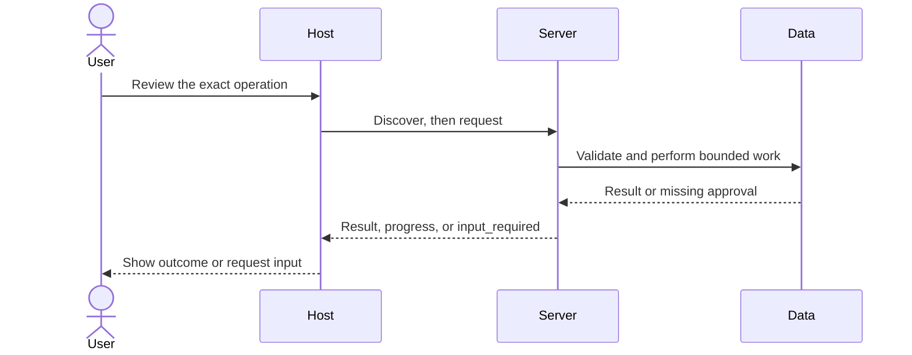

# Module 09: Asking the user: request and retry

**Time:** 135 minutes · **Level:** intermediate · **Languages:** Python · **LLM needed:** no; optional direct generation only

**Target:** MCP 2026-07-28, Python SDK 2.3, TypeScript SDK 2.4. Commands run from the repository root on Windows, macOS, or Linux.

## Prerequisites

Complete [Module 08](../08_server_utilities/README.md). Install the HTTP and host extras, including the local mock and approval page:

```text
uv sync --frozen --extra http --extra host
npm ci
```

No model keys are needed for any default example. Server commands wait for a client; client demos print results and exit.

## Learning objectives

- Return and handle InputRequiredResult.
- Validate accept, decline, cancel, and malformed forms.
- Bind short-lived, one-use state to the exact operation.
- Separate URL acknowledgement from browser completion.
- Use configured paths and direct provider calls with human consent.

## The big idea

Imagine a clerk returning an unsigned form. The original request is paused as a result that describes the missing input. The host shows that form to the user, then retries the same operation with the answer and an opaque continuation. The model does not sign the form. A browser-based approval is a separate visit: saying “I opened the page” cannot prove that the user actually approved the action there.

## How it works



Clients advertise both input modes on each request; the server refuses to elicit a mode the client does not support. Human deliberation is outside the network timeout, while every network round remains bounded. The server stores a random continuation in RetryLedger and the Python SDK also seals its request state. Retried tool arguments must match the stored binding; expiry, replay, unexpected response keys, and malformed boolean content fail before effects. A failed or denied attempt consumes the continuation. The ledger has a pending-request bound. This local lab has one trusted OS user; multi-user remote services must additionally bind grants to authenticated principals. The URL page uses a short-lived opaque bearer URL, Host and Origin checks, and no-referrer policy. It is a consent fixture, not an OAuth implementation. URL mode keeps credential entry outside MCP in real integrations. Sampling and roots are Deprecated: direct provider helpers and configured canonical directory boundaries are the current track. See the migration guide for historical traffic analysis.

## On the wire

Regenerate real captures with `uv run python scripts/tier2.py --module 9 --capture`, then run `uv run python scripts/render_wire_docs.py`. The [capture manifest](wire/manifest.json) records the command and SDK versions. Ephemeral state and progress tokens are diagnostic data, never reusable credentials. Captures are local test traffic.

<!-- wire:start -->

Source: [captured python_main](wire/python_main.jsonl). Each JSON block below is a complete message copied from that run.

```json
{
  "jsonrpc": "2.0",
  "id": 9,
  "method": "tools/call",
  "params": {
    "name": "bulk_close",
    "arguments": {
      "issue_ids": [
        1,
        2
      ]
    },
    "_meta": {
      "io.modelcontextprotocol/protocolVersion": "2026-07-28",
      "io.modelcontextprotocol/clientInfo": {
        "name": "mcp",
        "version": "0.1.0"
      },
      "io.modelcontextprotocol/clientCapabilities": {
        "elicitation": {
          "form": {},
          "url": {}
        }
      }
    }
  }
}
```

```json
{
  "jsonrpc": "2.0",
  "id": 9,
  "result": {
    "inputRequests": {
      "decision": {
        "method": "elicitation/create",
        "params": {
          "message": "Close these synthetic issues: [1, 2]?",
          "mode": "form",
          "requestedSchema": {
            "properties": {
              "approve": {
                "title": "Approve",
                "type": "boolean"
              }
            },
            "required": [
              "approve"
            ],
            "type": "object"
          }
        }
      }
    },
    "requestState": "v1.qOnaw7LWs7D5aAHsFlq96m2bAtxcKk6Nw4wisPGG-3jCHZyPyb7jcbfh0Y5Z_hY_LsUwEOjfDEkkfv9IaKxazfoBNP4XcGWr-hZ6ANZsOLPC_Y25gkveaxOyhqyeVucxyhmAEt2Y_TymLS7S-j9ezeWoTA74IH_Ml-ZDVYdKgQtJSwWdW4F24HnfMILw4IzoO_sB2cOKTgpLBuvcgls1Jq0j2PvB1WAZndADvgKORRUCCQKOhSnFTbUSPnggvgARab0SE0dCLYbcseX0D9Or-uCBcw",
    "resultType": "input_required",
    "_meta": {
      "io.modelcontextprotocol/serverInfo": {
        "name": "Lumen input",
        "version": ""
      }
    }
  }
}
```

```json
{
  "jsonrpc": "2.0",
  "id": 10,
  "method": "tools/call",
  "params": {
    "inputResponses": {
      "decision": {
        "action": "decline"
      }
    },
    "requestState": "v1.qOnaw7LWs7D5aAHsFlq96m2bAtxcKk6Nw4wisPGG-3jCHZyPyb7jcbfh0Y5Z_hY_LsUwEOjfDEkkfv9IaKxazfoBNP4XcGWr-hZ6ANZsOLPC_Y25gkveaxOyhqyeVucxyhmAEt2Y_TymLS7S-j9ezeWoTA74IH_Ml-ZDVYdKgQtJSwWdW4F24HnfMILw4IzoO_sB2cOKTgpLBuvcgls1Jq0j2PvB1WAZndADvgKORRUCCQKOhSnFTbUSPnggvgARab0SE0dCLYbcseX0D9Or-uCBcw",
    "name": "bulk_close",
    "arguments": {
      "issue_ids": [
        1,
        2
      ]
    },
    "_meta": {
      "io.modelcontextprotocol/protocolVersion": "2026-07-28",
      "io.modelcontextprotocol/clientInfo": {
        "name": "mcp",
        "version": "0.1.0"
      },
      "io.modelcontextprotocol/clientCapabilities": {
        "elicitation": {
          "form": {},
          "url": {}
        }
      }
    }
  }
}
```

```json
{
  "jsonrpc": "2.0",
  "id": 10,
  "result": {
    "content": [
      {
        "text": "{\n  \"outcome\": \"decline\",\n  \"closed\": []\n}",
        "type": "text"
      }
    ],
    "isError": false,
    "resultType": "complete",
    "structuredContent": {
      "outcome": "decline",
      "closed": []
    },
    "_meta": {
      "io.modelcontextprotocol/serverInfo": {
        "name": "Lumen input",
        "version": ""
      }
    }
  }
}
```

<!-- wire:end -->

## Key APIs at a glance

| Python | TypeScript | What it does | When to use |
|---|---|---|---|

| InputRequiredResult | InputRequiredResult (later counterpart) | Request missing input | Before effects |
| ctx.input_responses / request_state | inputResponses / requestState | Read a continuation | On retry |
| HostV2 / InteractiveClient | B1 counterpart planned | Keep input outside model | At the host boundary |
| safe_path / create_model | Configured path / direct provider | Replace deprecated features | For files and generation |

## Walkthrough

### 01_form_retry

A fixed demo closes synthetic issues 1 and 2 after an explicit input_required round. The normal Chat UI asks a human; only this published fixture auto-accepts.

```text
uv run python modules/09_elicitation_sampling_roots/python/examples/01_form_retry.py
```

### 02_url_retry

A separate local HTTP approval action completes a synthetic export. The demo simulates the browser POST; the real Chat flow prints a page URL for the user.

```text
uv run python modules/09_elicitation_sampling_roots/python/examples/02_url_retry.py
```

### 03_files_and_model

Read one wiki page inside a configured directory and summarize with FakeModel. --live uses the existing provider helper only after a separate terminal confirmation.

```text
uv run python modules/09_elicitation_sampling_roots/python/examples/03_files_and_model.py
```

### Verify all interactions

```text
uv run python scripts/tier2.py --module 9
uv run python modules/09_elicitation_sampling_roots/python/use_case/main.py
```

Expected: `PASS Module 09`. A failed assertion is a failed lesson check; it is not silently ignored.

## Try it in a host

Generate paths for your checkout with `uv run python scripts/host_configs.py --module 9`. Copy the relevant entries into your existing host configuration. See [host setup](../../docs/HOST_SETUP.md); the committed [VS Code example](host_configs/vscode.json) is a reference for the original checkout.

Ask: “Inspect the available Lumen tools, read the context, and show me the exact arguments before any write.” For form and URL input, use the included Lumen Chat v2; third-party host support varies.

```text
uv run python -m common.chat_v2 --demo
```

The demo permits only the documented synthetic calls, closes issues 1 and 2 in a disposable copy, and uses a fake model. Omit --demo for interactive approval and your configured provider. Host configuration formats were checked against documentation; no third-party GUI validation is claimed.

## Real-world use case

Lumen Chat v2 gathers wiki and usage context, asks before closing issues 1 and 2, then shows report progress. The module use case also summarizes the reviewed synthetic wiki page with FakeModel. Live generation remains optional and separately confirmed. Path resolution rejects traversal and escaping symlinks; the fixture tree assumes no concurrent attacker edits.

Implementation: [use case](python/use_case/main.py).

## Common mistakes

| Reproduce | Expected symptom and fix |
|---|---|

| Return approve="true" as a string | Strict boolean validation fails; submit a JSON boolean. |
| Retry with a different issue list | The binding fails; ask again for the new operation. |
| Reuse a consumed or expired continuation | Start a new request; do not silently approve again. |
| Accept URL mode without browser completion | The export stays blocked; complete the local page first. |

The integration checks deliberately cover denial, malformed input, and disconnects. Read the asserted failures in [Tier 2 tests](../../tests/test_tier2.py).

## Exercises

### Practice: Approve only accept plus a real boolean true; reject strings.

Edit [the runnable starter](python/exercises/01_form_decision.py), replacing `# YOUR CODE HERE`. It handles a narrower case and should fail at least one extension check.

```text
uv run python scripts/check_exercise.py --module 9 --exercise 1
uv run python scripts/check_exercise.py --module 9 --exercise 1 --solution
```

<details><summary>Hint and worked solution</summary>

Inspect the boundary cases in [exercise contracts](python/tests/exercise_cases.json), then compare [the solution](python/solutions/01_form_decision.py).

</details>

### Apply: A URL accept must also have a completed out-of-band grant.

Edit [the runnable starter](python/exercises/02_url_completion.py), replacing `# YOUR CODE HERE`. It handles a narrower case and should fail at least one extension check.

```text
uv run python scripts/check_exercise.py --module 9 --exercise 2
uv run python scripts/check_exercise.py --module 9 --exercise 2 --solution
```

<details><summary>Hint and worked solution</summary>

Inspect the boundary cases in [exercise contracts](python/tests/exercise_cases.json), then compare [the solution](python/solutions/02_url_completion.py).

</details>

### Stretch: Reject changed issue lists and expired continuations; assume one-use storage is separate.

Edit [the runnable starter](python/exercises/03_retry_binding.py), replacing `# YOUR CODE HERE`. It handles a narrower case and should fail at least one extension check.

```text
uv run python scripts/check_exercise.py --module 9 --exercise 3
uv run python scripts/check_exercise.py --module 9 --exercise 3 --solution
```

<details><summary>Hint and worked solution</summary>

Inspect the boundary cases in [exercise contracts](python/tests/exercise_cases.json), then compare [the solution](python/solutions/03_retry_binding.py).

</details>

## Quiz

Answer the [quiz](quiz.md) before expanding its answers.

## Key takeaways

- Return and handle InputRequiredResult.
- Validate accept, decline, cancel, and malformed forms.
- Bind short-lived, one-use state to the exact operation.
- Separate URL acknowledgement from browser completion.
- Use configured paths and direct provider calls with human consent.

## Go deeper

- [Official reference for this module](https://modelcontextprotocol.io/specification/2026-07-28/basic/patterns/mrtr)
- [Current specification](https://modelcontextprotocol.io/specification/2026-07-28/architecture/index)
- [Migration guide: deprecated and legacy behavior](../../docs/MIGRATING_FROM_OLDER_VERSIONS.md)
- [Verification notes](../../docs/VERIFICATION_NOTES.md)

## Next

Continue to [Module 10](../10_streamable_http/README.md).
