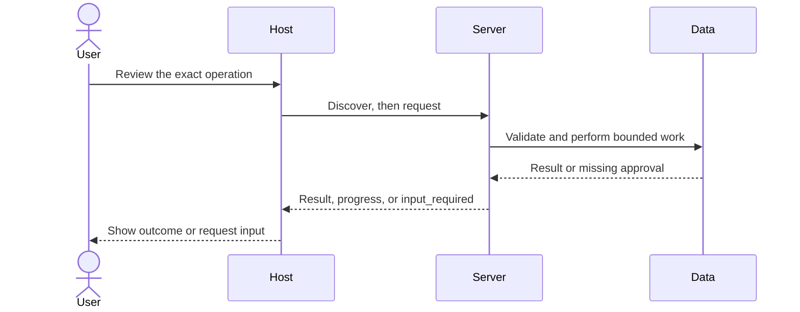

# Module 10: Streamable HTTP [TS]

**Time:** 120 minutes · **Level:** intermediate · **Languages:** Python and TypeScript · **LLM needed:** no; optional direct generation only

**Target:** MCP 2026-07-28, Python SDK 2.3, TypeScript SDK 2.4. Commands run from the repository root on Windows, macOS, or Linux.

## Prerequisites

Complete [Module 09](../09_elicitation_sampling_roots/README.md). Install the HTTP and host extras, including the local mock and approval page:

```text
uv sync --frozen --extra http --extra host
npm ci
```

No model keys are needed for any default example. Server commands wait for a client; client demos print results and exit.

## Learning objectives

- Serve MCP through ASGI and a Node HTTP adapter.
- Validate Origin, Host, and mirrored request headers.
- Consume JSON and request-scoped SSE.
- Reissue subscriptions and refetch state after a disconnect.
- Keep application state outside per-request factories.

## The big idea

Stdio is a dedicated pipe to a child process. HTTP is a service counter that several clients can visit. Each request carries its own protocol metadata; the reply may arrive as one JSON object or as a stream of progress events followed by a result. A dropped connection leaves uncertainty about a write. A stable operation key lets the client ask again without creating a second issue.

## How it works



The current protocol uses one POST endpoint. Mcp-Method mirrors method; Mcp-Name mirrors the tool/prompt name or resource URI. x-mcp-header on the region schema maps to Mcp-Param-Region. The SDK validates decoded headers against the body, including Unicode sentinel encoding. Header routing labels are not authenticated identities. CORS permits only http://localhost:3000 and is separate from Host/Origin validation. HTTP disconnect cancels work on that response stream; stdio uses a cancellation notification. Subscriptions are POST streams with an acknowledgement. Reconnect means reissue and refetch; this revision promises no missed-event replay. The TypeScript factory creates a server per request, so its database and event bus live outside the factory. Multiple workers require shared durable data, receipts, and pub/sub; this loopback lesson uses one worker. Authentication and public deployment belong to later modules.

## On the wire

Regenerate real captures with `uv run python scripts/tier2.py --module 10 --capture`, then run `uv run python scripts/render_wire_docs.py`. The [capture manifest](wire/manifest.json) records the command and SDK versions. Ephemeral state and progress tokens are diagnostic data, never reusable credentials. Captures are local test traffic.

<!-- wire:start -->

Source: [captured python_http](wire/python_http.jsonl). Each JSON block below is a complete message copied from that run.

```json
{
  "jsonrpc": "2.0",
  "id": "listen-1",
  "method": "subscriptions/listen",
  "params": {
    "notifications": {
      "resourceSubscriptions": [
        "workspace://review"
      ]
    },
    "_meta": {
      "io.modelcontextprotocol/protocolVersion": "2026-07-28",
      "io.modelcontextprotocol/clientInfo": {
        "name": "mcp",
        "version": "0.1.0"
      },
      "io.modelcontextprotocol/clientCapabilities": {}
    }
  }
}
```

```json
{
  "jsonrpc": "2.0",
  "id": 16,
  "method": "tools/call",
  "params": {
    "name": "route_region",
    "arguments": {
      "region": "Hello, 世界"
    },
    "_meta": {
      "io.modelcontextprotocol/protocolVersion": "2026-07-28",
      "io.modelcontextprotocol/clientInfo": {
        "name": "mcp",
        "version": "0.1.0"
      },
      "io.modelcontextprotocol/clientCapabilities": {}
    }
  }
}
```

```json
{
  "jsonrpc": "2.0",
  "id": 16,
  "result": {
    "content": [
      {
        "text": "{\n  \"region\": \"Hello, 世界\"\n}",
        "type": "text"
      }
    ],
    "isError": false,
    "resultType": "complete",
    "_meta": {
      "io.modelcontextprotocol/serverInfo": {
        "name": "Lumen remote workspace",
        "version": ""
      }
    }
  }
}
```

```json
{
  "jsonrpc": "2.0",
  "method": "notifications/progress",
  "params": {
    "progressToken": "[REDACTED]",
    "progress": 1,
    "total": 4,
    "message": "Q1: section 1"
  }
}
```

```json
{
  "jsonrpc": "2.0",
  "method": "notifications/progress",
  "params": {
    "progressToken": "[REDACTED]",
    "progress": 2,
    "total": 4,
    "message": "Q1: section 2"
  }
}
```

<!-- wire:end -->

## Key APIs at a glance

| Python | TypeScript | What it does | When to use |
|---|---|---|---|

| streamable_http_app | createMcpHandler | Build the endpoint | Application startup |
| TransportSecuritySettings | Host/Origin adapter | Constrain incoming requests | Before dispatch |
| Field json_schema_extra | z.string().meta | Bind a parameter header | Tool schema declaration |
| client.listen | client.listen | Subscribe and reissue | After reconnect |

## Walkthrough

### 01_http_server

Start the remote workspace on 127.0.0.1:8000. It exposes issues, wiki pages, report progress, and a header-bound region tool.

```text
uv run python modules/10_streamable_http/python/examples/01_http_server.py
```

```text
npm exec tsx -- modules/10_streamable_http/typescript/examples/01_http_server.ts
```

### 02_headers_and_origin

Launch a temporary server and deliberately send bad Origin, Host, method, name, and parameter headers. Expect 403, 421, and 400 respectively.

```text
uv run python modules/10_streamable_http/python/examples/02_headers_and_origin.py
```

```text
npm exec tsx -- modules/10_streamable_http/typescript/examples/02_headers_and_origin.ts
```

### 03_stream_recovery

Open a subscription, publish a review, close it, then open a new subscription and refetch. Retry the same issue creation with the same operation key.

```text
uv run python modules/10_streamable_http/python/examples/03_stream_recovery.py
```

```text
npm exec tsx -- modules/10_streamable_http/typescript/examples/03_stream_recovery.ts
```

Use `--json` on the Python server to demonstrate single-object replies. Use the default streaming mode for report progress. The capture set includes both modes.

### Verify all interactions

```text
uv run python scripts/tier2.py --module 10
uv run python modules/10_streamable_http/python/use_case/main.py
```

Expected: `PASS Module 10`. A failed assertion is a failed lesson check; it is not silently ignored.

## Try it in a host

Generate paths for your checkout with `uv run python scripts/host_configs.py --module 10`. Copy the relevant entries into your existing host configuration. See [host setup](../../docs/HOST_SETUP.md); the committed [VS Code example](host_configs/vscode.json) is a reference for the original checkout.

Start the HTTP server first. The remote entries use a URL; the desktop reference uses stdio until remote support is verified for that host. Ask: “Read the engineering handover wiki page and show issue 1.”

```text
uv run python -m common.chat_v2 --demo
```

The demo permits only the documented synthetic calls, closes issues 1 and 2 in a disposable copy, and uses a fake model. Omit --demo for interactive approval and your configured provider. Host configuration formats were checked against documentation; no third-party GUI validation is claimed.

## Real-world use case

Lumen Workspace v4 serves wiki and issues over HTTP. Run the Python or TypeScript use case to test it. Keep a server running, then run Lumen Chat v2 with --http http://127.0.0.1:8000/mcp: wiki and reports use HTTP while notes, analytics, and interactive issue confirmation use local stdio services.

```text
uv run python -m common.chat_v2 --demo --http http://127.0.0.1:8000/mcp
```

## Common mistakes

| Reproduce | Expected symptom and fix |
|---|---|

| Use an unapproved Origin | 403; configure an exact trusted browser origin. |
| Use a Host outside the loopback allow-list | 421; use the address the server actually bound. |
| Send a Mcp-Name or parameter header different from the body | 400 HeaderMismatch; fetch current tools/list and mirror the schema correctly. |
| Retry a write with a new operation key after losing the response | You risk another insert; retry the original key or query its recorded outcome. |

The integration checks deliberately cover denial, malformed input, and disconnects. Read the asserted failures in [Tier 2 tests](../../tests/test_tier2.py).

## Exercises

### Practice: Accept absent Origin or exactly the configured browser origin.

Edit [the runnable starter](python/exercises/01_origin.py), replacing `# YOUR CODE HERE`. It handles a narrower case and should fail at least one extension check.

```text
uv run python scripts/check_exercise.py --module 10 --exercise 1
uv run python scripts/check_exercise.py --module 10 --exercise 1 --solution
```

<details><summary>Hint and worked solution</summary>

Inspect the boundary cases in [exercise contracts](python/tests/exercise_cases.json), then compare [the solution](python/solutions/01_origin.py).

</details>

TypeScript: [starter](typescript/exercises/01_origin.ts) and [solution](typescript/solutions/01_origin.ts). Run `npm exec tsx -- scripts/check-exercise.ts 10 1 --solution`.

### Apply: Encode Unicode, edge whitespace, controls, and sentinel-shaped text as UTF-8 base64.

Edit [the runnable starter](python/exercises/02_header_encoding.py), replacing `# YOUR CODE HERE`. It handles a narrower case and should fail at least one extension check.

```text
uv run python scripts/check_exercise.py --module 10 --exercise 2
uv run python scripts/check_exercise.py --module 10 --exercise 2 --solution
```

<details><summary>Hint and worked solution</summary>

Inspect the boundary cases in [exercise contracts](python/tests/exercise_cases.json), then compare [the solution](python/solutions/02_header_encoding.py).

</details>

TypeScript: [starter](typescript/exercises/02_header_encoding.ts) and [solution](typescript/solutions/02_header_encoding.ts). Run `npm exec tsx -- scripts/check-exercise.ts 10 2 --solution`.

### Stretch: Retry a read, or a write with a server-enforced operation key; a lost response proves no outcome.

Edit [the runnable starter](python/exercises/03_retry_policy.py), replacing `# YOUR CODE HERE`. It handles a narrower case and should fail at least one extension check.

```text
uv run python scripts/check_exercise.py --module 10 --exercise 3
uv run python scripts/check_exercise.py --module 10 --exercise 3 --solution
```

<details><summary>Hint and worked solution</summary>

Inspect the boundary cases in [exercise contracts](python/tests/exercise_cases.json), then compare [the solution](python/solutions/03_retry_policy.py).

</details>

TypeScript: [starter](typescript/exercises/03_retry_policy.ts) and [solution](typescript/solutions/03_retry_policy.ts). Run `npm exec tsx -- scripts/check-exercise.ts 10 3 --solution`.

## Quiz

Answer the [quiz](quiz.md) before expanding its answers.

## Key takeaways

- Serve MCP through ASGI and a Node HTTP adapter.
- Validate Origin, Host, and mirrored request headers.
- Consume JSON and request-scoped SSE.
- Reissue subscriptions and refetch state after a disconnect.
- Keep application state outside per-request factories.

## Go deeper

- [Official reference for this module](https://modelcontextprotocol.io/specification/2026-07-28/basic/transports/streamable-http)
- [Current specification](https://modelcontextprotocol.io/specification/2026-07-28/architecture/index)
- [Migration guide: deprecated and legacy behavior](../../docs/MIGRATING_FROM_OLDER_VERSIONS.md)
- [Verification notes](../../docs/VERIFICATION_NOTES.md)

## Next

Tier 2 checkpoint complete. Phase 5 begins Module 11, authentication and authorization; it remains planned. Return to the [learning path](../../LEARNING_PATH.md).
