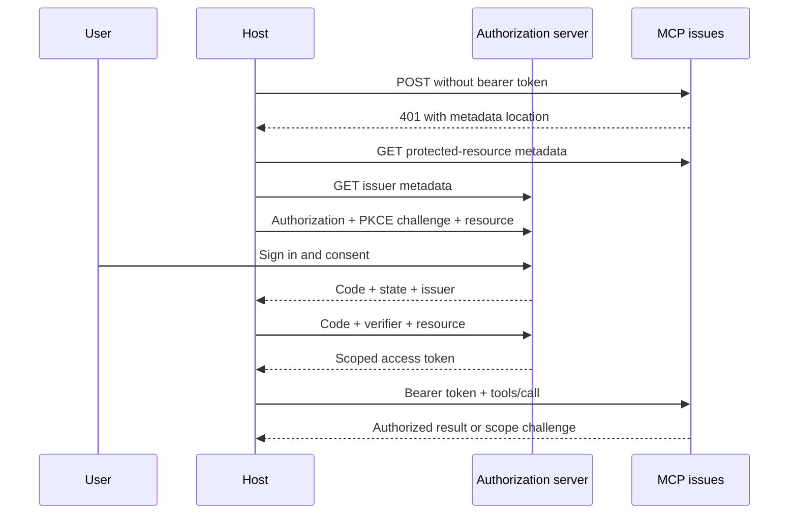

# Module 11: Authorization with OAuth 2.1
> After this module you can authenticate a client with OAuth and reject incorrect audiences and scopes.

**Time:** ~210 min · **Level:** intermediate to advanced · **Languages:** Python · **LLM needed:** no

**Target:** MCP 2026-07-28; official Python SDK 2.3. Commands run from the repository root on Windows, macOS or Linux.

**Workspace and Chat version 5 / 2:** Authenticate a client with oauth and reject incorrect audiences and scopes.

**Spec sections:** [Current specification](https://modelcontextprotocol.io/specification/2026-07-28).

[TypeScript companion](typescript/README.md) covers the native cases and API differences.

## Prerequisites

Complete [Module 10](../10_streamable_http/README.md). Install the frozen HTTP, auth and observability extras. Docker is required only for the explicit Keycloak/container checks.

```text
uv sync --frozen --extra http --extra host --extra auth --extra observability
npm ci
```

All default examples use synthetic data and local processes. No model key is required.

## Learning objectives

- Trace resource discovery to an identity provider.
- Compare reviewed metadata documents with a pre-registered public client.
- Use PKCE and bind the redirect to its issuer.
- Reject bad signatures, audience, issuer, expiry and scopes.
- Connect secured issues to Chat and Inspector.

## The big idea

OAuth is a visitor badge system. The identity provider checks the visitor and issues a badge. The MCP server checks which building and rooms that badge opens. The host carries it, but cannot expand its permissions. Authentication establishes who signed in; authorization decides what that identity may do. A bearer token is usable by whoever holds it, so keep it out of URLs, prompts and logs. PKCE ties an authorization code to the client that started the visit.

## How it works



The code lives in [token verification](../../common/auth_tokens.py), [the resource server](../../common/secured_issues.py), and [the OAuth client](../../common/oauth_client.py). A JWT is a signed claim set, not an encrypted secret. Decoding it without verifying its signature is useful only for inspection. Our verifier fixes RS256, the configured issuer and resource URL, requires expiry/subject/time claims, and obtains keys only from the configured JWKS endpoint. It does not follow token-supplied URLs. Its 60-second key cache favors a small, explicit teaching implementation; production needs coordinated refresh, rotation and outage behavior.

The SDK publishes Protected Resource Metadata and authenticates bearer tokens through `TokenVerifier` and `AuthSettings`. The course gate checks write permissions from the bounded request body, so a forged `Mcp-Name` cannot change the policy. The SDK still checks headers against the body. Missing/invalid credentials return 401; insufficient scopes return 403 and `WWW-Authenticate` scope guidance. A read token cannot delete an issue. An authorized write also needs the host's confirmation. That boolean models a trusted local host, not a server-verifiable human approval service.

The SDK OAuth client performs discovery, creates S256 PKCE values, stores pending state/issuer and exchanges the code. `MemoryStorage` holds an issuer-bound pre-registration and tokens for one connection. There is no refresh grant in the synthetic fixture: after expiry, authorize again. The browser path uses an exact registered loopback callback copied into the terminal; no callback listener is left running.

For a new client relationship, a Client ID Metadata Document identifies the client with its HTTPS document URL. Example 01 validates a local example document and compares registration choices; it does **not** fetch or publish that illustrative URL. Production retrieval needs HTTPS, redirect restrictions, size limits and SSRF protections. The local realm uses pre-registration. Dynamic Client Registration is **Deprecated** and confined to the [migration comparison](../../docs/MIGRATING_FROM_OLDER_VERSIONS.md).

## On the wire

These excerpts come from real SDK traffic. Re-record with `uv run python scripts/tier3.py --module 11 --capture`, then run `uv run python scripts/render_wire_docs.py`. Captures redact bearer credentials. HTTP metadata rows are separate from JSON-RPC messages. Do not run capture regeneration concurrently with snapshot/document tests.

<!-- wire:start -->

Source: [captured python_http](wire/python_http.jsonl). Each JSON block below is a complete message copied from that run.

```json
{
  "jsonrpc": "2.0",
  "id": 1,
  "method": "server/discover",
  "params": {
    "_meta": {
      "io.modelcontextprotocol/protocolVersion": "2026-07-28",
      "io.modelcontextprotocol/clientInfo": {
        "name": "mcp",
        "version": "0.1.0"
      },
      "io.modelcontextprotocol/clientCapabilities": {}
    }
  }
}
```

```json
{
  "jsonrpc": "2.0",
  "id": 1,
  "result": {
    "cacheScope": "private",
    "capabilities": {
      "prompts": {
        "listChanged": true
      },
      "resources": {
        "listChanged": true,
        "subscribe": true
      },
      "tools": {
        "listChanged": true
      }
    },
    "resultType": "complete",
    "supportedVersions": [
      "2026-07-28"
    ],
    "ttlMs": 0,
    "_meta": {
      "io.modelcontextprotocol/serverInfo": {
        "name": "Lumen secured issues",
        "version": ""
      }
    }
  }
}
```

```json
{
  "jsonrpc": "2.0",
  "id": 3,
  "method": "tools/call",
  "params": {
    "name": "read_issue",
    "arguments": {
      "issue_id": 1
    },
    "_meta": {
      "io.modelcontextprotocol/protocolVersion": "2026-07-28",
      "io.modelcontextprotocol/clientInfo": {
        "name": "mcp",
        "version": "0.1.0"
      },
      "io.modelcontextprotocol/clientCapabilities": {}
    }
  }
}
```

```json
{
  "jsonrpc": "2.0",
  "id": 3,
  "result": {
    "content": [
      {
        "text": "{\n  \"id\": 1,\n  \"project_id\": 1,\n  \"title\": \"Service ownership: work item 1\",\n  \"status\": \"in_progress\",\n  \"priority\": \"medium\",\n  \"assignee_id\": 14,\n  \"created_at\": \"2026-01-02\"\n}",
        "type": "text"
      }
    ],
    "isError": false,
    "resultType": "complete",
    "structuredContent": {
      "id": 1,
      "project_id": 1,
      "title": "Service ownership: work item 1",
      "status": "in_progress",
      "priority": "medium",
      "assignee_id": 14,
      "created_at": "2026-01-02"
    },
    "_meta": {
      "io.modelcontextprotocol/serverInfo": {
        "name": "Lumen secured issues",
        "version": ""
      }
    }
  }
}
```

<!-- wire:end -->

## Key APIs at a glance

| Python | TypeScript counterpart / concept | What it does | When to use it |
|---|---|---|---|
| `OAuthClientProvider` | OAuth client auth provider | Discovery, PKCE, state and issuer validation | HTTP host login |
| `AuthSettings` / `TokenVerifier` | HTTP auth middleware and verifier | Check every request token | Resource server |
| `AccessToken.resource` | Verified token audience | Bind token to this MCP endpoint | Prevent token reuse elsewhere |
| `WWW-Authenticate` | Same HTTP header | Advertise metadata or needed scopes | 401 / 403 recovery |

The TypeScript column names the corresponding concept; runnable TypeScript companions for these modules are planned for bonus B1.

## Walkthrough

### 1. Discovery Registration

```text
uv run python modules/11_authorization/python/examples/01_discovery_registration.py
```

Expected: PASS metadata discovery; reviewed CIMD document; pre-registration priority. Read [the example](python/examples/01_discovery_registration.py), then follow its shared helper.

### 2. Pkce And Tokens

```text
uv run python modules/11_authorization/python/examples/02_pkce_and_tokens.py
```

Expected: PASS OAuth: discovery, SDK PKCE, Chat, issuer/audience/expiry/scope, approved write. Read [the example](python/examples/02_pkce_and_tokens.py), then follow its shared helper.

### 3. Local Auth

```text
uv run python modules/11_authorization/python/examples/03_local_auth.py
```

Expected: Secured Lumen Chat read completed. Then PASS secured Chat read. Read [the example](python/examples/03_local_auth.py), then follow its shared helper.

## Try it in a host

Start Keycloak and the secured server using [the auth deployment guide](../../deployment/auth/README.md), then run example 03 with `--keycloak`. A browser login uses only the synthetic account. The script routes the fixed prompt **Read Lumen issue 1** through the existing Chat host loop with exact-read approval. It does not enable arbitrary writes or a live model.

Run `uv run python scripts/host_configs.py --module 11` for checkout-specific configs. [VS Code](host_configs/vscode.json), [Claude Code](host_configs/claude-code.json), and [Cursor](host_configs/cursor.json) point to loopback HTTP. Their OAuth UI must support configuring the pre-registered client ID and exact redirect; adapt the realm's exact callback to that host's documented value before login. Do not enable unrestricted registration to make a host connect. The Desktop JSON intentionally contains no stdio fallback: stdio bypasses HTTP OAuth. Follow [host setup](../../docs/HOST_SETUP.md) for connector support and use Chat/Inspector when local OAuth is unsupported.

For Inspector UI, run `npm run inspector`, select Streamable HTTP and `http://127.0.0.1:8001/mcp`. Use its OAuth settings with pre-registered client ID `lumen-chat`; register the exact callback displayed by that installed UI in Keycloak before signing in. The fixed course callback belongs to Chat. Inspector CLI smoke obtains a 120-second synthetic token and lists tools; it tests authenticated MCP, not the browser login UI. No bearer is committed to host configs.

Host configuration formats are supplied; no GUI interaction is claimed by the automated checks. Check [verification notes](../../docs/VERIFICATION_NOTES.md) for the actual tested environments.

## Real-world use case

Workspace version **5** secures the existing issue CRUD tools. Read and write scopes are distinct; issue data remains a disposable in-memory copy of the committed fixture. Run `uv run python modules/11_authorization/python/use_case/main.py` for the self-contained offline acceptance case. Run `python/use_case/server.py` only after starting Keycloak for the persistent local endpoint. The main provider is Keycloak; [the synthetic authority](../../common/auth_fixture.py) exists solely to make offline failure tests deterministic and does not authenticate real people.

## Common mistakes

| Reproduce | Observable symptom | Fix |
|---|---|---|
| Use a token with another audience | 401 invalid_token | Use the exact protected resource URL in authorization and exchange. |
| Delete with a read-only token | 403 insufficient_scope | Obtain additional consent and retain existing scopes; never edit token claims. |
| Use a wildcard or different callback | Authorization request rejected | Register and compare the exact callback URL. |
| Use `Client(server)` to test auth | Unauthenticated in-memory call works | Test actual HTTP; the direct client bypasses middleware. |
| Start resource server before Keycloak | 401 / issuer connection failure | Start Compose and check its discovery document; tokens are not hardcoded. |

## Exercises

### 1. Practice

Combine prior scopes and a scope challenge without duplicates. Start with [the runnable baseline](python/exercises/01_practice.py). The baseline intentionally fails some [shared cases](python/tests/exercise_cases.json); extend it without changing those cases. Compare the [separate solution](python/solutions/01_practice.py) after trying.

```text
uv run python scripts/check_exercise.py --module 11 --exercise 1
uv run python scripts/check_exercise.py --module 11 --exercise 1 --solution
```

### 2. Apply

Match the exact issuer recorded before redirect; missing or changed issuer fails. Start with [the runnable baseline](python/exercises/02_apply.py). The baseline intentionally fails some [shared cases](python/tests/exercise_cases.json); extend it without changing those cases. Compare the [separate solution](python/solutions/02_apply.py) after trying.

```text
uv run python scripts/check_exercise.py --module 11 --exercise 2
uv run python scripts/check_exercise.py --module 11 --exercise 2 --solution
```

### 3. Stretch

After signature verification, require the intended audience, unexpired claims and required scopes. Start with [the runnable baseline](python/exercises/03_stretch.py). The baseline intentionally fails some [shared cases](python/tests/exercise_cases.json); extend it without changing those cases. Compare the [separate solution](python/solutions/03_stretch.py) after trying.

```text
uv run python scripts/check_exercise.py --module 11 --exercise 3
uv run python scripts/check_exercise.py --module 11 --exercise 3 --solution
```

## Quiz

Answer the [seven questions with expandable answers](quiz.md) before reading their explanations.

## Key takeaways

- HTTP OAuth and local stdio credentials have different trust boundaries.
- Signature verification is only one part of token validation.
- PKCE, state and issuer binding address different attacks.
- Scopes and human approval are separate requirements.
- Prefer reviewed metadata or pre-registration; keep bearer tokens out of outputs.

## Go deeper

- [MCP authorization](https://modelcontextprotocol.io/specification/2026-07-28/basic/authorization/index)
- [Keycloak MCP setup](https://www.keycloak.org/securing-apps/mcp-authz-server)
- [Python SDK authorization](https://py.sdk.modelcontextprotocol.io/run/authorization/)

## Next

Continue to [Module 12: security](../12_security/README.md).

## TypeScript counterpart

The optional [full TypeScript track](typescript/README.md) supplies executable examples, a use case, exercises and tests for this module.
