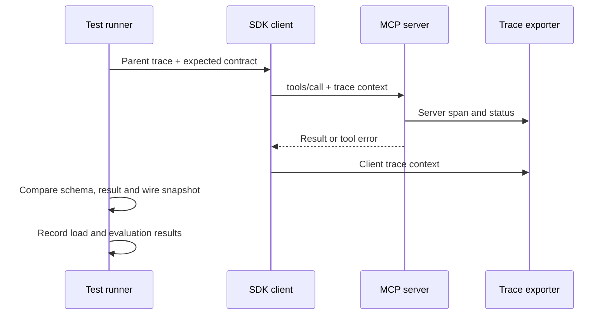

# Module 13: Testing, debugging and observability

**Time:** 210 minutes · **Level:** intermediate to advanced · **Language:** Python · **LLM needed:** no

**Target:** MCP 2026-07-28; official Python SDK 2.3. Workspace version **5**, Chat version **2** with an authenticated connection. Commands run from the repository root on Windows, macOS or Linux.

> **Outcome:** Test SDK handlers in memory and verify tool contracts.

## Prerequisites

Complete [Module 12](../12_security/README.md). Install the frozen HTTP, auth and observability extras. Docker is required only for the explicit Keycloak/container checks.

```text
uv sync --frozen --extra http --extra host --extra auth --extra observability
npm ci
```

All default examples use synthetic data and local processes. No model key is required.

## Learning objectives

- Test SDK handlers in memory and verify tool contracts.
- Regenerate semantic snapshots from real stdio traffic.
- Diagnose stdout contamination with exact errors and Inspector.
- Export trace spans without sensitive arguments or results.
- Measure bounded HTTP load and distinguish fixture scores from model evaluation.

## The big idea

Tests are rehearsal, wire captures are recordings, and traces are the production call sheet. Each answers a different question. A tool can pass a direct unit test yet fail when a stray print corrupts its transport. A successful model answer can hide a denied or unnecessary tool call. Build evidence at each boundary and state exactly what each measurement covers.

## How it works



[The quality helpers](../../common/quality.py) test notes without a model, then test the emitted wire in a separate process. In-memory calls are quick and useful for behavior, but bypass HTTP auth and framing. Contract assertions check required fields and invalid input. The [shared Tier 3 tests](../../tests/test_tier3.py) regenerate the stdio capture into a temporary directory and compare [call_snapshot.json](python/tests/call_snapshot.json). Normalization excludes capture timing, request IDs and metadata; it retains tool names, arguments, content, structured outputs and error results. Separate repository tests verify current protocol envelopes and exact README excerpts.

For Python/TypeScript parity, run `npm run check` along with `uv run pytest`. The delivered notes and HTTP counterparts share the same fixture semantics and have behavior tests in earlier modules. Module 13 does not claim to add a second complete TypeScript implementation; that remains planned for B1. Fake model tests exercise routing and approval deterministically. The fixture model is not evidence that a real provider obeys the same policy.

The SDK already emits server spans. Example 03 installs an in-memory exporter, opens a parent span and verifies real tool spans share its trace ID, including an error span. The stdio use-case installs a JSON stderr exporter with an allow-list of span fields. A production OTLP exporter can send spans to your collector instead; configure its endpoint deliberately and review exported fields. No external collector runs in the default lab. Trace IDs correlate activity, not identity or authorization.

The load example starts a local authenticated issue server and performs 20 short client operations with concurrency 4. Reported p50/p95 include connection setup, discovery and a tool call, not only handler time. Requests are bounded to 100 and concurrency to 8. A request error fails the run rather than silently disappearing from the latency sample. These figures demonstrate measurement; they are not capacity estimates for a deployed system.

The evaluation reads all 30 rows of `data/eval/tool_selection.jsonl` and compares exact names and arguments. Every row is an issue-read task. The deterministic parser scores 30/30; a deliberately empty selector scores 0/30. This checks the harness, not LLM usability. A serious model evaluation needs diverse held-out requests, similar tool names, write denials, argument accuracy, injection attempts, repeated runs and cost/latency reporting. The fixture name `issues_get` is retained as the evaluation label; the actual MCP server exposes `read_issue`.

Protocol logging is **Deprecated**. The [migration guide](../../docs/MIGRATING_FROM_OLDER_VERSIONS.md) contains the isolated historical API and captured notification for comparison. Current code sends diagnostic logs to stderr and uses OpenTelemetry for tracing.

## On the wire

These excerpts come from real SDK traffic. Re-record with `uv run python scripts/tier3.py --module 13 --capture`, then run `uv run python scripts/render_wire_docs.py`. Captures redact bearer credentials. HTTP metadata rows are separate from JSON-RPC messages. Do not run capture regeneration concurrently with snapshot/document tests.

<!-- wire:start -->

Source: [captured python_main](wire/python_main.jsonl). Each JSON block below is a complete message copied from that run.

```json
{
  "jsonrpc": "2.0",
  "id": 3,
  "method": "tools/call",
  "params": {
    "name": "search_notes",
    "arguments": {},
    "_meta": {
      "io.modelcontextprotocol/protocolVersion": "2026-07-28",
      "io.modelcontextprotocol/clientInfo": {
        "name": "mcp",
        "version": "0.1.0"
      },
      "io.modelcontextprotocol/clientCapabilities": {},
      "traceparent": "00-ba798b5c2d2cede52476f2d3ccb29c2b-aa4b69c16ca0c66a-03"
    }
  }
}
```

```json
{
  "jsonrpc": "2.0",
  "id": 3,
  "result": {
    "content": [
      {
        "text": "{\n  \"id\": 1,\n  \"title\": \"Release handover\",\n  \"body\": \"Review the release checklist.\",\n  \"tags\": [\n    \"release\"\n  ]\n}",
        "type": "text"
      }
    ],
    "isError": false,
    "resultType": "complete",
    "structuredContent": {
      "result": [
        {
          "id": 1,
          "title": "Release handover",
          "body": "Review the release checklist.",
          "tags": [
            "release"
          ]
        }
      ]
    },
    "_meta": {
      "io.modelcontextprotocol/serverInfo": {
        "name": "Lumen notes",
        "version": "1.0"
      }
    }
  }
}
```

<!-- wire:end -->

## Key APIs at a glance

| Python | TypeScript counterpart / concept | What it does | When to use it |
|---|---|---|---|
| `Client(server)` | In-memory transport pair | Direct handler contracts | Fast unit tests |
| `ScriptedModel` | Fake model turns | Predictable routing and approvals | Offline host tests |
| `TracerProvider` + exporter | OpenTelemetry provider/exporter | Collect SDK spans | Debug and measure requests |
| `call_snapshot` | Normalized capture comparison | Detect semantic wire changes | Regression tests |

The TypeScript column names the corresponding concept; runnable TypeScript companions for these modules are planned for bonus B1.

## Walkthrough

### 1. Inmemory Contracts

```text
uv run python modules/13_testing_observability/python/examples/01_inmemory_contracts.py
```

Expected: PASS {'contracts': 'passed', 'tools': 3}. Read [the example](python/examples/01_inmemory_contracts.py), then follow its shared helper.

### 2. Inspector Stdout

```text
uv run python modules/13_testing_observability/python/examples/02_inspector_stdout.py
```

Expected: PASS Module 13; Protocol stdout contains non-JSON text; then PASS stdio smoke. Read [the example](python/examples/02_inspector_stdout.py), then follow its shared helper.

### 3. Traces Load Eval

```text
uv run python modules/13_testing_observability/python/examples/03_traces_load_eval.py
```

Expected: 20 requests, concurrency 4, errors 0; baseline 30/30; PASS shared trace. Latencies vary.. Read [the example](python/examples/03_traces_load_eval.py), then follow its shared helper.

To measure a real model's proposed calls, configure a provider as described in
[Module 06](../06_building_a_host/README.md), then explicitly opt in:

```text
uv run python modules/13_testing_observability/python/examples/03_traces_load_eval.py --live --limit 5
```

This may incur provider charges (or use local Ollama). It compares issue-read and
wiki-search proposals with expected names and arguments, reports errors and elapsed
time, and never executes the proposed tools. Default CI does not run it. Expand the
dataset before interpreting this narrow score as general tool usability.

## Try it in a host

Generate configs with `uv run python scripts/host_configs.py --module 13` and ask **Search notes for release**. The protocol result remains on stdout while JSON span events appear in the server's stderr log. [The VS Code configuration](host_configs/vscode.json) includes the observability extra; other host configs are alongside it.

CLI: `npm run inspector -- --cli uv run python modules/13_testing_observability/python/use_case/server.py --protocol-era modern --method tools/list`. UI: `npm run inspector -- uv run python modules/13_testing_observability/python/use_case/server.py`. Connect, list tools, call `search_notes`, then call `create_note` with an empty title and observe the tool error. Run `uv run python scripts/inspector_smoke.py` for all registered servers, including authenticated HTTP. On this Windows/Node combination the earlier HTTP Inspector shutdown issue may recur; Linux CI is the HTTP Inspector check, while direct SDK tests cover Windows.

Host configuration formats are supplied; no GUI interaction is claimed by the automated checks. Check [verification notes](../../docs/VERIFICATION_NOTES.md) for the actual tested environments.

## Real-world use case

`uv run python modules/13_testing_observability/python/use_case/main.py` exercises the traced stdio server. The complete [Tier 3 checkpoint](../../checkpoints/03_security/README.md) combines auth failures, catalog/injection boundaries, snapshots, exercise solutions and the filled security checklist. CI runs the full course on the supported Python and Node matrix; dedicated Linux jobs exercise Keycloak, Inspector and container isolation.

## Common mistakes

| Reproduce | Observable symptom | Fix |
|---|---|---|
| Add `print("debug")` in a server | Protocol stdout contains non-JSON text | Move the diagnostic to stderr; example 02 reproduces this in an isolated child. |
| Only test through `Client(server)` | Transport/auth bug reaches deployment | Add subprocess, actual HTTP and Inspector tests. |
| Normalize entire result bodies away | Snapshots pass after behavior changes | Exclude only declared unstable fields and retain error/result payloads. |
| Export raw tool arguments | Secrets appear in telemetry | Use an exporter field allow-list and test it. |
| Call the deterministic score model accuracy | A misleading 100% claim | Label the baseline and measure a real model separately. |

## Exercises

### 1. Practice

Accept only JSON-RPC object lines on protocol stdout, not arbitrary JSON or debug text. Start with [the runnable baseline](python/exercises/01_practice.py). The baseline intentionally fails some [shared cases](python/tests/exercise_cases.json); extend it without changing those cases. Compare the [separate solution](python/solutions/01_practice.py) after trying.

```text
uv run python scripts/check_exercise.py --module 13 --exercise 1
uv run python scripts/check_exercise.py --module 13 --exercise 1 --solution
```

### 2. Apply

Score exact tool name AND arguments; empty evaluations return zero. Start with [the runnable baseline](python/exercises/02_apply.py). The baseline intentionally fails some [shared cases](python/tests/exercise_cases.json); extend it without changing those cases. Compare the [separate solution](python/solutions/02_apply.py) after trying.

```text
uv run python scripts/check_exercise.py --module 13 --exercise 2
uv run python scripts/check_exercise.py --module 13 --exercise 2 --solution
```

### 3. Stretch

Summarize timings without dropping failures; errors remain visible and input order is irrelevant. Start with [the runnable baseline](python/exercises/03_stretch.py). The baseline intentionally fails some [shared cases](python/tests/exercise_cases.json); extend it without changing those cases. Compare the [separate solution](python/solutions/03_stretch.py) after trying.

```text
uv run python scripts/check_exercise.py --module 13 --exercise 3
uv run python scripts/check_exercise.py --module 13 --exercise 3 --solution
```

## Quiz

Answer the [seven questions with expandable answers](quiz.md) before reading their explanations.

## Key takeaways

- Test each boundary with the tool that can observe it.
- Keep protocol stdout exclusively for JSON-RPC.
- Snapshots must preserve meaningful behavior.
- Collect trace context and status without raw secrets.
- Report evaluation and load limitations alongside scores.

## Go deeper

- [SDK testing](https://py.sdk.modelcontextprotocol.io/get-started/testing/)
- [Inspector CLI](https://modelcontextprotocol.io/docs/2026-07-28/tools/inspector/cli)
- [SDK tracing](https://py.sdk.modelcontextprotocol.io/run/opentelemetry/)

## Next

Complete the [Tier 3 checkpoint](../../checkpoints/03_security/README.md). Module 14 and Tier 4 remain planned for Phase 6.

## TypeScript counterpart

The optional [full TypeScript track](typescript/README.md) supplies executable examples, a use case, exercises and tests for this module.
