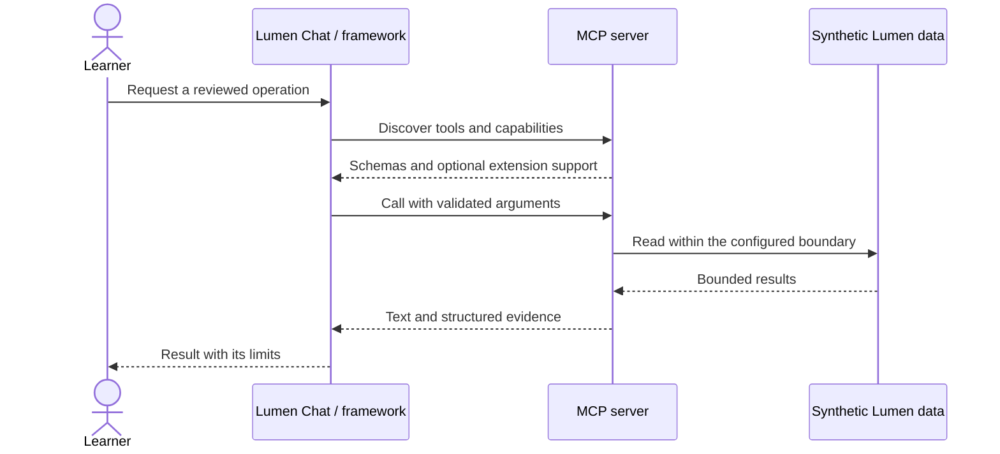

# Module 14: Designing tools that models use well
> After this module you can compare a 25-tool endpoint mirror with six task-oriented tools.

**Time:** ~135 min · **Level:** Advanced · **LLM needed:** Optional · **Languages:** Python (plus browser JavaScript for the App)

**Target:** MCP 2026-07-28 and official Python SDK 2.3.0. Commands run from the repository root on Windows, macOS and Linux.
**Spec sections:** [Tools specification](https://modelcontextprotocol.io/specification/2026-07-28/server/tools) · [Caching](https://modelcontextprotocol.io/specification/2026-07-28/server/utilities/caching) · [Python SDK](https://py.sdk.modelcontextprotocol.io/)

**Workspace and Chat version 5 / 2:** Compare a 25-tool endpoint mirror with six task-oriented tools.

[TypeScript companion](typescript/README.md) covers the native cases and API differences.

## Prerequisites

Complete [Module 13](../13_testing_observability/README.md). Install the locked course environment:

```text
uv sync --frozen --all-extras
npm ci
```

The default route needs no API keys. Servers use synthetic data. Framework adapters are an optional install extra; Module 15 needs it. The [verification notes](../../docs/VERIFICATION_NOTES.md) distinguish automated checks from manual host and live-model checks.

## Learning objectives

- Compare a 25-tool endpoint mirror with six task-oriented tools.
- Design bounded parameters, concise output and actionable errors.
- Refresh a changing tool catalog without treating a cached name as permission.
- Measure completed tasks and separate deterministic checks from live-model evidence.

## The big idea

A tool catalog is a menu. A menu with 25 kitchen operations asks diners to know how the kitchen works. A menu of six complete dishes makes common requests easier to express. This is a design hypothesis, not a guarantee: a specialized model may handle a large catalog well, and a broad tool can hide dangerous choices.

The baseline has five operations for each of five tables: list, get, count, fields and find. The redesign exposes search, an issue brief, weekly triage, a draft, project totals and employee workload. Both read the same synthetic database. A draft is returned text; nothing is posted. Measure completed tasks before claiming the redesign improves model performance.

## How it works



The model sees names, descriptions and JSON Schema, not Python implementation. Describe when to choose a tool, what each argument means, and what a result represents. `limit` is restricted to 1–20; `after` is the last returned stable ID. The next cursor is absent at the end. `mode="concise"` avoids comments and ownership fields until needed.

The comparison uses six fixed issue IDs and scores exact returned IDs/statuses. The deterministic planner reads the actual tool result. Both designs should complete all six cases; catalog characters and call counts are separate measurements. Characters are not tokenizer counts. `--live` runs the same cases through `common.llm` with identical budgets. Repeat live trials and inspect failures before drawing conclusions. A smaller menu alone proves no accuracy gain.

The catalog example removes `team_load`, then requests `cache_mode="refresh"`. Earlier subscription lessons explain notifications; a production host should invalidate on change and also recover from missed notifications.

## On the wire

These messages were recorded from the actual stdio server, not written as examples. Requests carry the current protocol and client capabilities in `_meta`. Match IDs to find each response. The tool call names the operation; structuredContent carries data, while isError distinguishes a recoverable tool failure.

```text
uv run python scripts/tier4.py --module 14 --capture
uv run python scripts/render_wire_docs.py
```

<!-- wire:start -->

Source: [captured python_main](wire/python_main.jsonl). Each JSON block below is a complete message copied from that run.

```json
{
  "jsonrpc": "2.0",
  "id": 3,
  "method": "tools/call",
  "params": {
    "name": "triage_week",
    "arguments": {},
    "_meta": {
      "io.modelcontextprotocol/protocolVersion": "2026-07-28",
      "io.modelcontextprotocol/clientInfo": {
        "name": "mcp",
        "version": "0.1.0"
      },
      "io.modelcontextprotocol/clientCapabilities": {
        "elicitation": {
          "form": {},
          "url": {}
        }
      }
    }
  }
}
```

```json
{
  "jsonrpc": "2.0",
  "id": 3,
  "result": {
    "content": [
      {
        "text": "{\n  \"week_start\": \"2026-07-13\",\n  \"total\": 14,\n  \"active\": 7,\n  \"high_priority_ids\": [\n    197,\n    397,\n    399\n  ],\n  \"fixture_note\": \"Synthetic work items; no separate bug type is stored.\"\n}",
        "type": "text"
      }
    ],
    "isError": false,
    "resultType": "complete",
    "structuredContent": {
      "week_start": "2026-07-13",
      "total": 14,
      "active": 7,
      "high_priority_ids": [
        197,
        397,
        399
      ],
      "fixture_note": "Synthetic work items; no separate bug type is stored."
    },
    "_meta": {
      "io.modelcontextprotocol/serverInfo": {
        "name": "Lumen task tools",
        "version": "6.0"
      }
    }
  }
}
```

<!-- wire:end -->

## Key APIs at a glance

| Python API | TypeScript / browser API | What it does | When to use it |
|---|---|---|---|
| `MCPServer.add_tool` | Official server tool registration | Derives an advertised schema | Register reviewed operations |
| `Client.list_tools(cache_mode="refresh")` | Client catalog refresh | Refetches definitions | Catalog changes |
| `Host.run` + `create_tool_model` | `CourseHost.run` + `createModel`, via [designEvaluation](../../common/typescript/tool_design.ts) | Runs the measured tool loop | Controlled comparisons |

## Walkthrough

### 01 api mirror

Discover the 25 actual endpoint tools and read an issue. Read [the script](python/examples/01_api_mirror.py), then run:

```text
uv run python modules/14_tool_design/python/examples/01_api_mirror.py
```

Expected: `PASS mirror`.

### 02 task tools

Read two pages and fetch detailed information only when needed. Read [the script](python/examples/02_task_tools.py), then run:

```text
uv run python modules/14_tool_design/python/examples/02_task_tools.py
```

Expected: `PASS pages`.

### 03 measure change

Compare completion, catalog size and dynamic catalog refresh. Read [the script](python/examples/03_measure_change.py), then run:

```text
uv run python modules/14_tool_design/python/examples/03_measure_change.py
```

Expected: `PASS dynamic catalog refreshed`.

For a paid or local model trial, configure both variables in `.env` and add `--live --limit 3` to example 03. The default comparison is a fixture check; no live accuracy claim is included.

Both language tracks use the same completion rule: the final answer must be a JSON object with exactly `id` and `status`, the ID must be a number matching the requested issue (not a string or boolean), and the status must match the fixture. At least one tool call must have completed and none may have failed. Correct guesses without a tool call, extra properties, malformed answers and exhausted budgets do not count. The [shared replay cases](../../tests/fixtures/tool_evaluation.json) test this contract against both catalogs in both languages.

Missing or invalid live-model configuration exits with a short message and `Run uv run python scripts/check_env.py for setup help.` It does not print a stack trace or echo configuration values. Configure the provider, model and required key, or omit `--live` to use the offline fixture.

## Try it in a host

Generate absolute paths for your own checkout:

```text
uv run python scripts/host_configs.py --module 14
```

Copy the generated server entry into your existing host configuration. Examples for [VS Code](host_configs/vscode.json), [Cursor](host_configs/cursor.json), [Claude Code](host_configs/claude-code.json) and [Claude Desktop](host_configs/claude-desktop.json) are committed for this checkout; regenerate them after cloning. See [host setup](../../docs/HOST_SETUP.md) for placement and current feature limits.

Inspect the same server independently:

```text
npm run inspector -- --cli uv run python modules/14_tool_design/python/use_case/server.py --method tools/list
```

Ask: "Show the status of issue 1; then summarize work items for the week starting July 13, 2026."

## Real-world use case

The Lumen team wants a compact tool catalog that people and models can use accurately. The implementation separates transport, business functions and policy, so each can be checked independently.

```text
uv run python modules/14_tool_design/python/use_case/main.py
```

Expected: both deterministic designs complete six cases, with a 25-versus-6 tool comparison. The committed dataset is historical and synthetic; "this week" in the exercise means July 13–19, 2026.

**What could go wrong?** An oversized result or an ambiguous tool can consume the model budget. This server bounds pages, keeps operations read-only and gives recovery guidance. A small fixture does not represent every real task.

## Common mistakes

| Exact diagnostic | Trigger and fix |
|---|---|
| `Issue not found. Use search_issues and choose an ID from its results.` | Call issue_brief with -1; first search and choose an existing ID. |
| `Evaluation limit must be an integer from 1 to 6.` | Use --limit 1 through 6, not zero or an unbounded batch. Setup guidance follows this message. |
| `Choose a real LLM_PROVIDER and LLM_MODEL for --live.` | Set both variables in .env, or omit --live. |
| `Use week_start as an ISO date, for example 2026-07-13.` | Use YYYY-MM-DD; the fixture window is July 13–19. |

## Exercises

Run each starter first; it implements a smaller working behavior. The shared tests describe the extension to implement. Intentional starter failures are excluded from the main test suite.

1. **Practice:** Project an issue into concise or detailed output; never include unknown secret fields. [Starter](python/exercises/01_practice.py) · [Solution](python/solutions/01_practice.py).
2. **Apply:** Return a bounded page and its next ID only when additional records exist. [Starter](python/exercises/02_apply.py) · [Solution](python/solutions/02_apply.py).
3. **Stretch:** Build a deterministic tool-name catalog: distinct names, sorted, with an optional prefix. [Starter](python/exercises/03_stretch.py) · [Solution](python/solutions/03_stretch.py).

```text
uv run python scripts/check_exercise.py --module 14 --exercise 1
uv run python scripts/check_exercise.py --module 14 --exercise 1 --solution
```

Inspect [the captured exchange](wire/python_main.jsonl) while working: find a tool name, input arguments and returned evidence. Explain how your solution preserves that contract.

## Quiz

Try the [seven-question quiz](quiz.md) before opening its expandable answers.

## Key takeaways

- Compare a 25-tool endpoint mirror with six task-oriented tools.
- Design bounded parameters, concise output and actionable errors.
- Refresh a changing tool catalog without treating a cached name as permission.
- Measure completed tasks and separate deterministic checks from live-model evidence.
- State the limits of your evidence; an offline fixture is not a live-model or GUI check.

## Go deeper

[Tools specification](https://modelcontextprotocol.io/specification/2026-07-28/server/tools) · [Caching](https://modelcontextprotocol.io/specification/2026-07-28/server/utilities/caching) · [Python SDK](https://py.sdk.modelcontextprotocol.io/)

## Next

[Module 15](../15_agent_frameworks/README.md)

## TypeScript counterpart

The optional [full TypeScript track](typescript/README.md) supplies executable examples, a use case, exercises and tests for this module.
