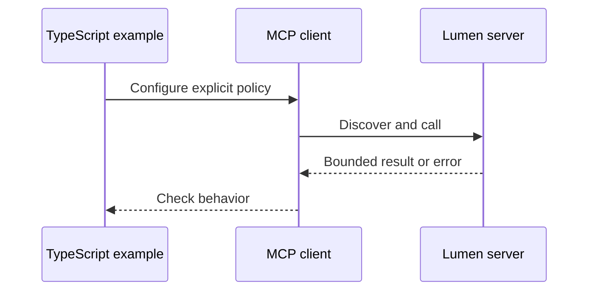

# TypeScript 14: Tool design

Compare actual 25-tool and six-tool catalogs, concise/detail results and measured retrieval. These are the TypeScript counterparts to [Module 14](../README.md). Read that lesson's explanation, diagram and quiz first; this page records language-specific behavior.

## Prerequisites

From the root: `npm ci`. Node 24 or 26 is required. The pinned official MCP SDK is 2.4.0; the protocol is 2026-07-28. No model key is needed.

## Learning objectives

- Execute each case and explain its observable assertion.
- Identify the boundary enforced by the server or host.
- Make a controlled change and demonstrate its failing regression.

## The big idea

Compare actual 25-tool and six-tool catalogs, concise/detail results and measured retrieval. The language changes syntax and library choices; the peer still sees the same JSON-RPC contract. A deterministic fixture is an integration check, not a measured model-quality claim.

## How it works



## On the wire

[Actual TypeScript traffic](../../bonus/B1_typescript_track/wire/notes.jsonl), [form retries](../../bonus/B1_typescript_track/wire/forms.jsonl), and [Tasks](../../bonus/B1_typescript_track/wire/tasks.jsonl) share the current envelope. [Regeneration manifest](../../bonus/B1_typescript_track/wire/manifest.json). Captures are shared by capability, not duplicated to imply a separate capture of an in-memory assertion.

## Key APIs at a glance

| Python | TypeScript | Purpose |
|---|---|---|
| MCPServer | McpServer | Register local behavior |
| Client | Client | Request/validate protocol results |
| Context | ctx.mcpReq | Cancellation, input state and notifications |
| gateway/host helpers | CourseHost, Gateway, Connection | Keep execution policy outside model proposals |

## Walkthrough

- `01_endpoint_mirror.ts`: run `node --import tsx modules/14_tool_design/typescript/examples/01_endpoint_mirror.ts`; expect `status: PASS`.
- `02_task_tools.ts`: run `node --import tsx modules/14_tool_design/typescript/examples/02_task_tools.ts`; expect `status: PASS`.
- `03_evaluation.ts`: run `node --import tsx modules/14_tool_design/typescript/examples/03_evaluation.ts`; expect JSON with `completed: 6`, `calls: 6` for both catalogs and `mode: "deterministic plumbing only"`.

The executable contracts live in [advanced_lessons.ts](../../../common/typescript/advanced_lessons.ts); follow the module-number branch to the focused implementation it invokes. This avoids copying the same host/security logic into every example.

Compare actual native catalogs over identical `issues.db` data: [mirror_server.ts](mirror_server.ts) registers 25 endpoint tools; [task_tools_server.ts](task_tools_server.ts) registers six workflow tools. Inspect the first with `npm run inspector -- --cli node --import tsx modules/14_tool_design/typescript/mirror_server.ts --protocol-era modern --method tools/list`. Replace `mirror_server.ts` with `task_tools_server.ts` for the workflow catalog.

The first example asserts the 25-tool inventory. The second calls the six-tool server, compares concise and detailed issue evidence and checks an actionable invalid-ID failure. The third runs both catalogs through `CourseHost.run`, checks the final JSON ID/status against SQLite evidence, and reports catalog characters, completion, tool calls, elapsed seconds and per-case outcomes. Each case has four model turns and four tool calls. The offline model reads the actual MCP result before answering. These fixture measurements check the plumbing; they do not establish model quality. [tool_design.ts](../../../common/typescript/tool_design.ts) is the full implementation. [Mirror capture](../../bonus/B1_typescript_track/wire/mirror.jsonl), [workflow capture](../../bonus/B1_typescript_track/wire/task_tools.jsonl).

For an actual model comparison, set `LLM_PROVIDER`, `LLM_MODEL` and the provider key in your root `.env` as described in [environment setup](../../../.env.example), then opt in:

```bash
node --import tsx modules/14_tool_design/typescript/examples/03_evaluation.ts --live --limit 3
```

`--limit` accepts 1–6 and selects the same prefix of `[1, 13, 55, 112, 239, 400]` for both catalogs. OpenAI, Anthropic, Gemini and Ollama use the shared native provider adapters. Each case gets a fresh conversation and the same prompt and budgets. Failed requests, malformed answers, tool errors and exhausted budgets count as failed cases; provider error text is not included in results. A guessed answer without a tool call is not a completion. Repeat the run with the same model/settings and save the JSON before interpreting differences; six cases and one trial are weak evidence. CI exercises the live route with injected provider responses without making paid requests.

## Try it in a host

Use the [B1 host configs](../../bonus/B1_typescript_track/host_configs/vscode.json), replacing the absolute repository path. Ask "Find release notes." The fixed `notes` profile starts with protocol-only stdout. The `forms` profile asks for a bulletin decision; the `workflow` profile reads and drafts without publishing.

## Real-world use case

Run `node --import tsx modules/14_tool_design/typescript/use_case/main.ts`. Expect three passing cases. In a company, keep the same boundary checks while replacing the synthetic data source and setting an explicitly reviewed identity policy.

## Common mistakes

- `Unknown lesson`: use a listed module and part 1–3.
- `User declined`: the host decision was false; do not silently retry a write.
- `Review the current catalog first`: discover and review before executing.
- `Invalid issuer, audience or expiry`: verify the configured resource and issuer; never weaken checks to make a token pass.

## Exercises

Run `node --import tsx scripts/check-ts-extension-exercise.ts 14 1` (or 2/3). Initially it reports a deliberate mismatch; use `--solution` to verify the answer.

1. **Practice — description:** Require a trimmed nonempty tool description of at most 500 characters. Run exercise 1 against the independent positive and negative cases in `common/typescript/exercise_contracts.ts`.
2. **Apply:** require a nonempty reviewed fingerprint, exact equality with the current fingerprint, and explicit approval. Test a changed catalog and a declined decision.
3. **Stretch:** consume page cursors until `undefined`, count pages, reject repeats and stop at 20 pages. An empty/incomplete sequence is an error. Apply it to discovery before exposing a model catalog.

## Quiz

Use the [module quiz](../quiz.md), then explain which assertions above support your answers. B1's [cross-language quiz](../../bonus/B1_typescript_track/quiz.md) checks API and runtime differences.

## Key takeaways

- The wire contract is language independent.
- Types do not replace runtime validation.
- Capability discovery is separate from approval.
- Finite budgets make failures visible.
- A local fake model cannot measure live model accuracy.

## Go deeper

[Official TypeScript SDK](https://github.com/modelcontextprotocol/typescript-sdk), [current specification](https://modelcontextprotocol.io/specification/2026-07-28).

## Next

Return to the [full track index](../../bonus/B1_typescript_track/README.md).
