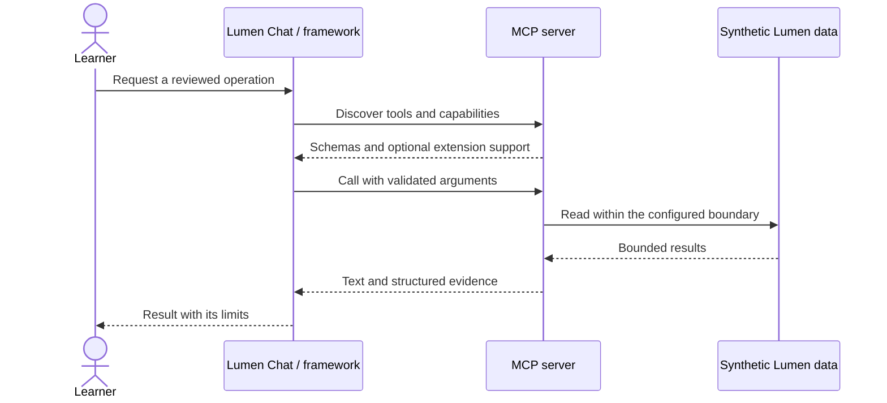

# Module 15: MCP with agent frameworks and model APIs
> After this module you can run the same MCP triage task in three actual framework runtimes.

**Time:** ~180 min · **Level:** Advanced · **LLM needed:** Optional · **Languages:** Python (plus browser JavaScript for the App)

**Target:** MCP 2026-07-28 and official Python SDK 2.3.0. Commands run from the repository root on Windows, macOS and Linux.
**Spec sections:** [OpenAI integration](https://developers.openai.com/api/docs/guides/agents/integrations-observability) · [LangChain MCP](https://docs.langchain.com/oss/python/langchain/mcp) · [Pydantic MCP](https://pydantic.dev/docs/ai/mcp/client/) · [Strands MCP](https://strandsagents.com/latest/documentation/docs/user-guide/concepts/tools/mcp-tools/) · [ADK MCP](https://adk.dev/tools-custom/mcp-tools/) · [Claude SDK](https://code.claude.com/docs/en/agent-sdk/mcp)

**Workspace and Chat version 5 / 2:** Run the same mcp triage task in three actual framework runtimes.

[TypeScript companion](typescript/README.md) covers the native cases and API differences.

## Prerequisites

Complete [Module 14](../14_tool_design/README.md). Install the locked course environment:

```text
uv sync --frozen --all-extras
npm ci
```

The default route needs no API keys. Servers use synthetic data. Framework adapters are an optional install extra; Module 15 needs it. The [verification notes](../../docs/VERIFICATION_NOTES.md) distinguish automated checks from manual host and live-model checks.

## Learning objectives

- Run the same MCP triage task in three actual framework runtimes.
- Connect Strands, ADK and Claude through their native MCP integrations.
- Explain which process owns the model loop, approvals and connection lifetime.
- Build current remote-MCP requests without confusing them with local function calling.

## The big idea

A framework is a coordinator around the model/tool loop you built in Module 06. MCP still transports schemas and results. The framework decides how to retain messages, call the model, run tools and stop. Changing frameworks should not require rewriting Lumen's server.

Think of six different dispatch desks calling the same workshop. Their paperwork differs; the work-order protocol stays the same. Here, three desks run the complete triage-and-draft workflow with deterministic planners. The others demonstrate native connections and calls. These tests prove integration, not model reasoning quality.

## How it works



An adapter converts the MCP catalog to a framework's tool objects. OpenAI Agents owns a Runner loop; LangGraph owns a two-node state graph; Pydantic AI owns an Agent loop. Their local model fixtures select two tools and consume the real returned evidence. Only `triage_week` and `draft_status` are offered to the agent examples. All six server tools are read-only, so the deterministic walkthrough does not approve writes.

The requested `langchain-mcp-adapters` 0.3.2 requires MCP v1. The current replacement is `langchain.mcp.MCPAdapter` (beta). Pydantic AI now exposes `MCPToolset`, replacing older server-specific classes. Both adapters use **third-party FastMCP** internally; the Lumen server uses official `mcp.server.MCPServer`. OpenAI Agents supports the pinned SDK directly.

Strands 1.62.0 caps MCP below 2.2, so its locked client environment uses MCP 2.1.1 and launches the course's 2.3.0 server with the main Python executable. ADK's telemetry ceiling conflicts with this course's tracing extra, so ADK also has a separate lock. No dependency constraints are overridden. See [the environment notes](../../frameworks/README.md).

Remote model APIs make the provider the MCP client. A localhost address is then the provider's localhost, not yours. OpenAI Responses can return approval requests; this example never accepts them automatically. Anthropic uses an explicitly disabled-by-default toolset with two permitted reads. Gemini Interactions uses a `mcp_server` tool and an allow-list. Hosted revision support and actual model access require a live check against your deployed endpoint.

## On the wire

These messages were recorded from the actual stdio server, not written as examples. Requests carry the current protocol and client capabilities in `_meta`. Match IDs to find each response. The tool call names the operation; structuredContent carries data, while isError distinguishes a recoverable tool failure.

```text
uv run python scripts/tier4.py --module 15 --capture
uv run python scripts/render_wire_docs.py
```

<!-- wire:start -->

Source: [captured python_main](wire/python_main.jsonl). Each JSON block below is a complete message copied from that run.

```json
{
  "jsonrpc": "2.0",
  "id": 3,
  "method": "tools/call",
  "params": {
    "name": "triage_week",
    "arguments": {},
    "_meta": {
      "io.modelcontextprotocol/protocolVersion": "2026-07-28",
      "io.modelcontextprotocol/clientInfo": {
        "name": "mcp",
        "version": "0.1.0"
      },
      "io.modelcontextprotocol/clientCapabilities": {
        "elicitation": {
          "form": {},
          "url": {}
        }
      }
    }
  }
}
```

```json
{
  "jsonrpc": "2.0",
  "id": 3,
  "result": {
    "content": [
      {
        "text": "{\n  \"week_start\": \"2026-07-13\",\n  \"total\": 14,\n  \"active\": 7,\n  \"high_priority_ids\": [\n    197,\n    397,\n    399\n  ],\n  \"fixture_note\": \"Synthetic work items; no separate bug type is stored.\"\n}",
        "type": "text"
      }
    ],
    "isError": false,
    "resultType": "complete",
    "structuredContent": {
      "week_start": "2026-07-13",
      "total": 14,
      "active": 7,
      "high_priority_ids": [
        197,
        397,
        399
      ],
      "fixture_note": "Synthetic work items; no separate bug type is stored."
    },
    "_meta": {
      "io.modelcontextprotocol/serverInfo": {
        "name": "Lumen task tools",
        "version": "6.0"
      }
    }
  }
}
```

<!-- wire:end -->

## Key APIs at a glance

| Python API | TypeScript / browser API | What it does | When to use it |
|---|---|---|---|
| `MCPServerStdio` + `Runner.run` | OpenAI Agents MCP client | Manages a server connection and agent loop | OpenAI Agents example |
| `MCPAdapter` + `StateGraph` | `Client.callTool` + `StateGraph` in [frameworkDemo](../../common/typescript/frameworks.ts) | Adapts tools and runs graph nodes | LangGraph workflow |
| `MCPToolset` + `FunctionModel` | Pydantic AI is Python-only; the [native track](typescript/README.md) teaches OpenAI Agents, LangChain and LangGraph | Runs Pydantic AI with a local fixture | Reproducible integration tests |

## Walkthrough

### 01 agents and langgraph

Run two actual framework workflows with local deterministic models. Read [the script](python/examples/01_agents_and_langgraph.py), then run:

```text
uv run python modules/15_agent_frameworks/python/examples/01_agents_and_langgraph.py
```

Expected: `PASS agents / PASS langgraph`.

### 02 strands and pydantic

Run Pydantic AI; add --strands for the isolated native adapter. Read [the script](python/examples/02_strands_and_pydantic.py), then run:

```text
uv run python modules/15_agent_frameworks/python/examples/02_strands_and_pydantic.py
```

Expected: `PASS pydantic`.

### 03 adk and claude

Connect Claude SDK without a model prompt; add --adk for its native adapter. Read [the script](python/examples/03_adk_and_claude.py), then run:

```text
uv run python modules/15_agent_frameworks/python/examples/03_adk_and_claude.py
```

Expected: `connected`.

### 04 remote model apis

Print current remote request shapes without contacting their illustrative URL. Read [the script](python/examples/04_remote_model_apis.py), then run:

```text
uv run python modules/15_agent_frameworks/python/examples/04_remote_model_apis.py
```

Expected: `PASS request construction only`.

Install the isolated clients with `uv sync --frozen --project frameworks/strands` and `uv sync --frozen --project frameworks/adk`. Then add `--strands` to example 02 or `--adk` to example 03. Their subprocesses use the main environment to run the unchanged MCP server. Example 03 sends no model prompt unless you add `--live`. Example 04 only constructs requests unless `--live --url <your-reviewed-HTTPS-endpoint>` is supplied.

| Integration | Verified default behavior | Model execution |
|---|---|---|
| OpenAI Agents 0.24.0 | Native MCP plus Runner loop | Local fixture |
| LangChain 1.4.7 / LangGraph 1.2.18 | Current beta adapter plus two-node graph | Deterministic graph |
| Pydantic AI 2.63.0 | MCPToolset plus Agent loop | FunctionModel fixture |
| Strands 1.62.0 | Native adapter lists/calls tools in isolated environment | No Bedrock call |
| ADK 2.13.0 | Native McpToolset calls tools in isolated environment | No Gemini call |
| Claude Agent SDK 0.2.175 | Local CLI reports connected and lists tools | Explicit --live only |
| Hosted model APIs | Request construction and SDK shape checks | Requires deployed endpoint and keys |

The framework versions above were checked on October 30, 2026. The [remote API sources](../../docs/VERIFICATION_NOTES.md) define each provider's separate approval and authentication contract.

## Try it in a host

Generate absolute paths for your own checkout:

```text
uv run python scripts/host_configs.py --module 15
```

Copy the generated server entry into your existing host configuration. Examples for [VS Code](host_configs/vscode.json), [Cursor](host_configs/cursor.json), [Claude Code](host_configs/claude-code.json) and [Claude Desktop](host_configs/claude-desktop.json) are committed for this checkout; regenerate them after cloning. See [host setup](../../docs/HOST_SETUP.md) for placement and current feature limits.

Inspect the same server independently:

```text
npm run inspector -- --cli uv run python modules/15_agent_frameworks/python/use_case/server.py --method tools/list
```

Ask: "Triage the synthetic work items for July 13–19, 2026 and draft a status update. Do not publish."

## Real-world use case

The Lumen team wants one weekly triage workflow that survives a framework change. The implementation separates transport, business functions and policy, so each can be checked independently.

```text
uv run python modules/15_agent_frameworks/python/use_case/main.py
```

Expected: three framework runs produce: Week 2026-07-13: 14 work items; 7 active; 3 high priority.. The committed dataset is historical and synthetic; "this week" in the exercise means July 13–19, 2026.

**What could go wrong?** A framework might expose extra tools or retry a write. The examples restrict agent tools to two reads, use no real publishing action and keep model traffic opt-in.

## Common mistakes

| Exact diagnostic | Trigger and fix |
|---|---|
| `Install the adapters with uv sync --extra frameworks.` | Install the main framework extra before running example 01 or 02. |
| `A provider cannot reach your localhost MCP server.` | Use a reviewed public HTTPS deployment for the hosted connector. |
| `Claude SDK MCP connection did not become ready.` | Run the server directly, inspect its stderr, and check local process-launch permissions. |
| `Replace the illustrative .example address before --live.` | Supply --url for your actual deployed endpoint; default mode only builds requests. |

## Exercises

Run each starter first; it implements a smaller working behavior. The shared tests describe the extension to implement. Intentional starter failures are excluded from the main test suite.

1. **Practice:** Allow only the two reviewed read tools; wildcard names must not grant access. [Starter](python/exercises/01_practice.py) · [Solution](python/solutions/01_practice.py).
2. **Apply:** Reject remote endpoints with HTTP, credentials, a query, or a fragment. [Starter](python/exercises/02_apply.py) · [Solution](python/solutions/02_apply.py).
3. **Stretch:** Normalize structured tool results and text JSON without losing the published flag. [Starter](python/exercises/03_stretch.py) · [Solution](python/solutions/03_stretch.py).

```text
uv run python scripts/check_exercise.py --module 15 --exercise 1
uv run python scripts/check_exercise.py --module 15 --exercise 1 --solution
```

Inspect [the captured exchange](wire/python_main.jsonl) while working: find a tool name, input arguments and returned evidence. Explain how your solution preserves that contract.

## Quiz

Try the [seven-question quiz](quiz.md) before opening its expandable answers.

## Key takeaways

- Run the same MCP triage task in three actual framework runtimes.
- Connect Strands, ADK and Claude through their native MCP integrations.
- Explain which process owns the model loop, approvals and connection lifetime.
- Build current remote-MCP requests without confusing them with local function calling.
- State the limits of your evidence; an offline fixture is not a live-model or GUI check.

## Go deeper

[OpenAI integration](https://developers.openai.com/api/docs/guides/agents/integrations-observability) · [LangChain MCP](https://docs.langchain.com/oss/python/langchain/mcp) · [Pydantic MCP](https://pydantic.dev/docs/ai/mcp/client/) · [Strands MCP](https://strandsagents.com/latest/documentation/docs/user-guide/concepts/tools/mcp-tools/) · [ADK MCP](https://adk.dev/tools-custom/mcp-tools/) · [Claude SDK](https://code.claude.com/docs/en/agent-sdk/mcp)

## Next

[Module 16](../16_composition/README.md)

## TypeScript counterpart

The optional [full TypeScript track](typescript/README.md) supplies executable examples, a use case, exercises and tests for this module.
