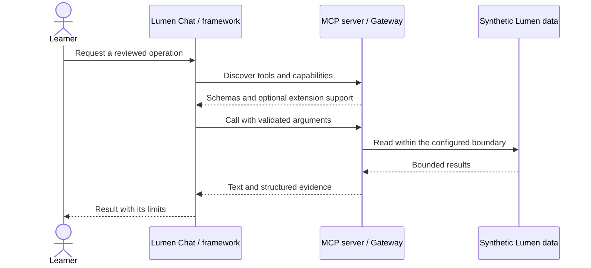

# Module 16: Composition: the Lumen Gateway
> After this module you can expose seven fixed upstream servers through one namespaced catalog.

**Time:** ~150 min · **Level:** Advanced · **LLM needed:** Optional · **Languages:** Python (plus browser JavaScript for the App)

**Target:** MCP 2026-07-28 and official Python SDK 2.3.0. Commands run from the repository root on Windows, macOS and Linux.
**Spec sections:** [Architecture](https://modelcontextprotocol.io/specification/2026-07-28/architecture/index) · [Authorization](https://modelcontextprotocol.io/specification/2026-07-28/basic/authorization/index) · [Python SDK](https://py.sdk.modelcontextprotocol.io/)

**Workspace and Chat version 6 / 2:** Expose seven fixed upstream servers through one namespaced catalog.

[TypeScript companion](typescript/README.md) covers the native cases and API differences.

## Prerequisites

Complete [Module 15](../15_agent_frameworks/README.md). Install the locked course environment:

```text
uv sync --frozen --all-extras
npm ci
```

The default route needs no API keys. Servers use synthetic data. Framework adapters are an optional install extra; Module 15 needs it. The [verification notes](../../docs/VERIFICATION_NOTES.md) distinguish automated checks from manual host and live-model checks.

## Learning objectives

- Expose seven fixed upstream servers through one namespaced catalog.
- Enforce permission again at tool execution.
- Partition caches and quotas by a verified principal.
- Test OAuth, audience checks, isolation and failure boundaries.

## The big idea

A gateway is a reception desk for several departments. It can show a visitor only the services they may use, but it must check again when they request a service. A copied menu is not a pass.

Lumen Gateway combines notes, wiki, issues, analytics, calendar, reports and the redesigned workflow server. It forwards tools; resources and prompts remain available from their original servers, while the gateway adds its own dashboard resource. The fixed upstream map prevents a model from choosing arbitrary destinations. The lesson uses real in-memory MCP connections to keep tests inexpensive; production process isolation is a separate deployment decision.

## How it works



Every upstream tool gets `alias__name`. The gateway discovers schemas, validates arguments and uses the fixed alias map to dispatch. Lifespan management keeps clients open for the application lifetime and closes them on shutdown. The HTTP wrapper holds that lifetime across stateless requests.

A principal is the authenticated subject, not a model argument or an arbitrary header. HTTP uses the Module 11 verifier and requires `workspace:read`. Changing tools also require `workspace:write`; the upstream still requires exact confirmation. Stdio has one configured local learner identity. Per-user fixture data is not implemented: all permitted reads see the same synthetic company.

The private catalog cache key includes principal, scopes, policy revision and disabled aliases. Its two-second lifetime is an optimization. Calls refresh policy before forwarding. No incoming bearer token is copied to an upstream, and upstream requests run in a fresh Python context so authentication state is not inherited accidentally. Distributed deployment would use separate service credentials with their own audience.

A per-principal sliding window permits 60 calls per minute. Tool arguments and returned data are absent from audit records. Upstream reads have deadlines; discovery fails closed if a required upstream is unavailable. This teaching gateway does not retry writes, run several workers, or share caches across replicas. Split servers when ownership, credentials or failure domains differ; combine them when a single reviewed entry point simplifies access.

## On the wire

These messages were recorded from the actual stdio server, not written as examples. Requests carry the current protocol and client capabilities in `_meta`. Match IDs to find each response. The tool call names the operation; structuredContent carries data, while isError distinguishes a recoverable tool failure.

```text
uv run python scripts/tier4.py --module 16 --capture
uv run python scripts/render_wire_docs.py
```

<!-- wire:start -->

Source: [captured python_main](wire/python_main.jsonl). Each JSON block below is a complete message copied from that run.

```json
{
  "jsonrpc": "2.0",
  "id": 3,
  "method": "tools/call",
  "params": {
    "name": "workflow__triage_week",
    "arguments": {},
    "_meta": {
      "io.modelcontextprotocol/protocolVersion": "2026-07-28",
      "io.modelcontextprotocol/clientInfo": {
        "name": "mcp",
        "version": "0.1.0"
      },
      "io.modelcontextprotocol/clientCapabilities": {
        "elicitation": {
          "form": {},
          "url": {}
        },
        "extensions": {
          "io.modelcontextprotocol/tasks": {}
        }
      }
    }
  }
}
```

```json
{
  "jsonrpc": "2.0",
  "id": 3,
  "result": {
    "_meta": {
      "io.modelcontextprotocol/serverInfo": {
        "name": "Lumen task tools",
        "version": "6.0"
      }
    },
    "content": [
      {
        "type": "text",
        "text": "{\n  \"week_start\": \"2026-07-13\",\n  \"total\": 14,\n  \"active\": 7,\n  \"high_priority_ids\": [\n    197,\n    397,\n    399\n  ],\n  \"fixture_note\": \"Synthetic work items; no separate bug type is stored.\"\n}"
      }
    ],
    "structuredContent": {
      "week_start": "2026-07-13",
      "total": 14,
      "active": 7,
      "high_priority_ids": [
        197,
        397,
        399
      ],
      "fixture_note": "Synthetic work items; no separate bug type is stored."
    },
    "isError": false,
    "resultType": "complete"
  }
}
```

<!-- wire:end -->

## Key APIs at a glance

| Python API | TypeScript / browser API | What it does | When to use it |
|---|---|---|---|
| `MCPServer(middleware=...)` | Server request middleware | Routes and checks requests | Gateway policy boundary |
| `AsyncExitStack` + `Client` | Client lifetime management | Closes all upstream connections | Shared application startup/shutdown |
| `AuthSettings` + `JWTVerifier` | Bearer validation | Binds identity and audience | HTTP entry point |

## Walkthrough

### 01 server as client

Discover seven upstreams through the namespaced gateway. Read [the script](python/examples/01_server_as_client.py), then run:

```text
uv run python modules/16_composition/python/examples/01_server_as_client.py
```

Expected: `PASS namespaced tools`.

### 02 policy gateway

Exercise actual OAuth and invalid audience/origin failures. Read [the script](python/examples/02_policy_gateway.py), then run:

```text
uv run python modules/16_composition/python/examples/02_policy_gateway.py
```

Expected: `PASS OAuth gateway`.

### 03 cache isolation

Compare reader/editor visibility, then revoke a route. Read [the script](python/examples/03_cache_isolation.py), then run:

```text
uv run python modules/16_composition/python/examples/03_cache_isolation.py
```

Expected: `PASS stale catalog cannot authorize a revoked tool`.

## Try it in a host

Generate absolute paths for your own checkout:

```text
uv run python scripts/host_configs.py --module 16
```

Copy the generated server entry into your existing host configuration. Examples for [VS Code](host_configs/vscode.json), [Cursor](host_configs/cursor.json), [Claude Code](host_configs/claude-code.json) and [Claude Desktop](host_configs/claude-desktop.json) are committed for this checkout; regenerate them after cloning. See [host setup](../../docs/HOST_SETUP.md) for placement and current feature limits.

Inspect the same server independently:

```text
npm run inspector -- --cli uv run python modules/16_composition/python/use_case/server.py --method tools/list
```

Ask: "Use the workflow tools to draft the July 13 status update. Show only services I can use."

## Real-world use case

The Lumen team wants a single reviewed entry point with permission-aware discovery. The implementation separates transport, business functions and policy, so each can be checked independently.

```text
uv run python modules/16_composition/python/use_case/main.py
```

Expected: PASS Module 16, including denied writes and report lifecycle checks. The committed dataset is historical and synthetic; "this week" in the exercise means July 13–19, 2026.

**What could go wrong?** A cached menu might leak a higher-privilege user’s tools. Cache partitioning and execution-time permission checks are both required; upstream credentials must remain separate.

## Common mistakes

| Exact diagnostic | Trigger and fix |
|---|---|
| `Tool is not available to this principal.` | Refresh discovery and check verified scopes; a model-supplied role cannot fix this. |
| `Arguments do not match the advertised schema.` | Use the schema returned by the gateway, including bounds and confirmation fields. |
| `Gateway rate limit reached; retry after 60 seconds.` | Wait before another call; do not create extra identities to evade the limit. |
| `Upstream unavailable; retry this read later or inspect its logs.` | Check the upstream service and deadline; do not blindly retry a write. |

## Exercises

Run each starter first; it implements a smaller working behavior. The shared tests describe the extension to implement. Intentional starter failures are excluded from the main test suite.

1. **Practice:** Namespace a safe tool name; reject separators that could impersonate an alias. [Starter](python/exercises/01_practice.py) · [Solution](python/solutions/01_practice.py).
2. **Apply:** Require read permission, then require write permission for a changing tool. [Starter](python/exercises/02_apply.py) · [Solution](python/solutions/02_apply.py).
3. **Stretch:** Partition catalog keys by principal, distinct scopes and policy revision. [Starter](python/exercises/03_stretch.py) · [Solution](python/solutions/03_stretch.py).

```text
uv run python scripts/check_exercise.py --module 16 --exercise 1
uv run python scripts/check_exercise.py --module 16 --exercise 1 --solution
```

Inspect [the captured exchange](wire/python_main.jsonl) while working: find a tool name, input arguments and returned evidence. Explain how your solution preserves that contract.

## Quiz

Try the [seven-question quiz](quiz.md) before opening its expandable answers.

## Key takeaways

- Expose seven fixed upstream servers through one namespaced catalog.
- Enforce permission again at tool execution.
- Partition caches and quotas by a verified principal.
- Test OAuth, audience checks, isolation and failure boundaries.
- State the limits of your evidence; an offline fixture is not a live-model or GUI check.

## Go deeper

[Architecture](https://modelcontextprotocol.io/specification/2026-07-28/architecture/index) · [Authorization](https://modelcontextprotocol.io/specification/2026-07-28/basic/authorization/index) · [Python SDK](https://py.sdk.modelcontextprotocol.io/)

## Next

[Module 17](../17_extensions/README.md)

## TypeScript counterpart

The optional [full TypeScript track](typescript/README.md) supplies executable examples, a use case, exercises and tests for this module.
