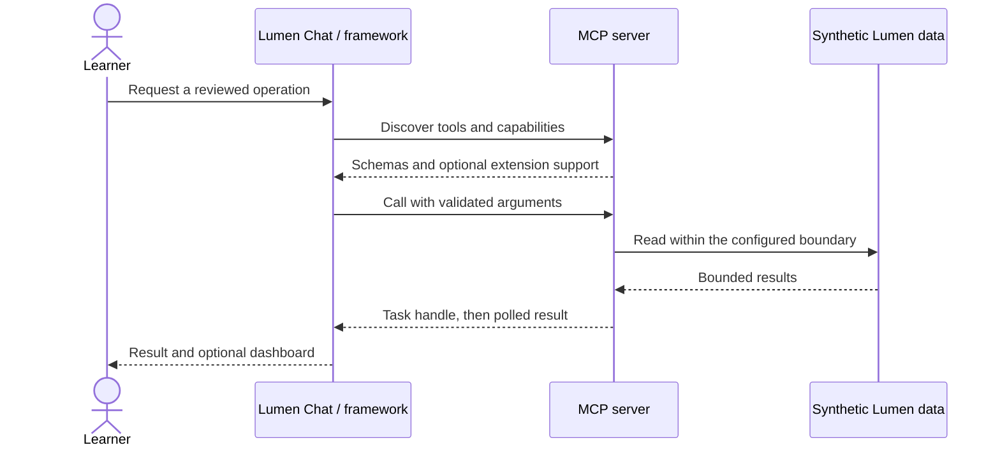

# Module 17: Official extensions: Tasks and MCP Apps
> After this module you can negotiate optional extensions on every request and provide a text fallback.

**Time:** 180 minutes · **Level:** Advanced · **LLM needed:** Optional · **Languages:** Python (plus browser JavaScript for the App)

**Workspace and Chat version 6 / 3:** durable reports and an interactive analytics App.
**Target:** MCP 2026-07-28 and official Python SDK 2.3.0. Commands run from the repository root on Windows, macOS and Linux.
**Spec sections:** [Extension framework](https://modelcontextprotocol.io/extensions/overview) · [Released Tasks specification](https://github.com/modelcontextprotocol/ext-tasks/blob/main/specification/2026-07-28/tasks.md) · [Apps specification and SDK](https://apps.extensions.modelcontextprotocol.io/api/) · [Python SDK](https://py.sdk.modelcontextprotocol.io/)

## Prerequisites

Complete [Module 16](../16_composition/README.md). Install the locked course environment:

```text
uv sync --frozen --all-extras
npm ci
```

The default route needs no API keys. Servers use synthetic data. Framework adapters are an optional install extra; Module 15 needs it. The [verification notes](../../docs/VERIFICATION_NOTES.md) distinguish automated checks from manual host and live-model checks.

## Learning objectives

- Negotiate optional extensions on every request and provide a text fallback.
- Create, poll, update and cancel durable report tasks.
- Distinguish protocol failure from a completed tool-level error.
- Serve an interactive dashboard with the official Apps bridge and constrained permissions.

## The big idea

An extension is an optional attachment to the protocol, identified by a namespaced string. Both parties advertise it; neither assumes that every host understands it. A task handle is a claim ticket: keep it, return later and ask whether the work is ready. An App is a small interface the host displays beside a tool result.

Tasks change how a result arrives. Apps change how a result is presented. They do not grant additional permission. Plain clients still receive a meaningful report or analytics result. A host must apply its usual approval rules to input requested by a task and its sandbox rules to HTML supplied by a server.

## How it works



The extension IDs are `io.modelcontextprotocol/tasks` and `io.modelcontextprotocol/ui`. The released Tasks schema is pinned to 2026-07-28; extension maturity and a schema's released status are separate facts. The Python SDK supplies extension registration and result-claim hooks but no packaged Tasks receiver, so this course implements the released wire shapes through those public hooks.

Task creation is server-directed. A supported `tools/call` can return a flat `resultType: "task"` handle. `tasks/get` returns `resultType: "complete"` plus state. Completed tasks carry `result`; failed tasks carry a JSON-RPC `error`. A tool result with `isError: true` is still a **completed** task. `tasks/update` sends responses to outstanding input keys; `tasks/cancel` acknowledges a cooperative cancellation request. A completed task stays completed if cancellation arrives too late.

SQLite commits a handle before it is returned. The store binds each record to the principal, expires records after five minutes, and caps retained tasks at 100. Workers resume when a working task is polled after restart. This is a single-process demonstration, not a distributed durable queue. The simulated quarterly report labels all 400 issues; the quarter is not a date filter. Input keys are unique within each task, and repeated or stale responses are ignored.

An App-enabled tool carries `_meta.ui.resourceUri`, referencing `ui://lumen/analytics.html`. The resource MIME type is `text/html;profile=mcp-app`. Its self-contained JavaScript uses the official `App` bridge: the host sends a tool result, and Refresh calls the same read-only tool through the host. No external scripts, network destinations, camera, microphone or clipboard permissions are requested. Dynamic data is inserted with `textContent`, never HTML. The host must enforce its sandbox and CSP; metadata alone is not isolation.

## On the wire

These messages were recorded from the actual stdio server, not written as examples. Requests carry the current protocol and client capabilities in `_meta`. Match IDs to find each response. The handle is followed by tasks/get; tasks/update answers the details form; tasks/cancel acknowledges cancellation. The capture also contains the actual App HTML resource.

```text
uv run python scripts/tier4.py --module 17 --capture
uv run python scripts/render_wire_docs.py
```

<!-- wire:start -->

Source: [captured python_main](wire/python_main.jsonl). Each JSON block below is a complete message copied from that run.

```json
{
  "jsonrpc": "2.0",
  "id": 3,
  "method": "tools/call",
  "params": {
    "name": "quarterly_report",
    "arguments": {
      "ask_details": true
    },
    "_meta": {
      "io.modelcontextprotocol/protocolVersion": "2026-07-28",
      "io.modelcontextprotocol/clientInfo": {
        "name": "mcp",
        "version": "0.1.0"
      },
      "io.modelcontextprotocol/clientCapabilities": {
        "elicitation": {
          "form": {},
          "url": {}
        },
        "extensions": {
          "io.modelcontextprotocol/tasks": {}
        }
      }
    }
  }
}
```

```json
{
  "jsonrpc": "2.0",
  "id": 3,
  "result": {
    "resultType": "task",
    "taskId": "fptzWPKNuh_NQaeMVdACVFLwTTqNOVdK",
    "status": "working",
    "createdAt": "2026-10-30T16:10:32.443455+00:00",
    "lastUpdatedAt": "2026-10-30T16:10:32.443455+00:00",
    "ttlMs": 300000,
    "pollIntervalMs": 25,
    "_meta": {
      "io.modelcontextprotocol/serverInfo": {
        "name": "Lumen report and dashboard",
        "version": ""
      }
    }
  }
}
```

```json
{
  "jsonrpc": "2.0",
  "id": 4,
  "method": "tasks/get",
  "params": {
    "taskId": "fptzWPKNuh_NQaeMVdACVFLwTTqNOVdK",
    "_meta": {
      "io.modelcontextprotocol/protocolVersion": "2026-07-28",
      "io.modelcontextprotocol/clientInfo": {
        "name": "mcp",
        "version": "0.1.0"
      },
      "io.modelcontextprotocol/clientCapabilities": {
        "elicitation": {
          "form": {},
          "url": {}
        },
        "extensions": {
          "io.modelcontextprotocol/tasks": {}
        }
      }
    }
  }
}
```

```json
{
  "jsonrpc": "2.0",
  "id": 4,
  "result": {
    "resultType": "complete",
    "taskId": "fptzWPKNuh_NQaeMVdACVFLwTTqNOVdK",
    "status": "working",
    "createdAt": "2026-10-30T16:10:32.443455+00:00",
    "lastUpdatedAt": "2026-10-30T16:10:32.443455+00:00",
    "ttlMs": 300000,
    "pollIntervalMs": 25,
    "_meta": {
      "io.modelcontextprotocol/serverInfo": {
        "name": "Lumen report and dashboard",
        "version": ""
      }
    }
  }
}
```

```json
{
  "jsonrpc": "2.0",
  "id": 6,
  "method": "tasks/update",
  "params": {
    "taskId": "fptzWPKNuh_NQaeMVdACVFLwTTqNOVdK",
    "inputResponses": {
      "details-1": {
        "action": "accept",
        "content": {
          "include_details": true
        }
      }
    },
    "_meta": {
      "io.modelcontextprotocol/protocolVersion": "2026-07-28",
      "io.modelcontextprotocol/clientInfo": {
        "name": "mcp",
        "version": "0.1.0"
      },
      "io.modelcontextprotocol/clientCapabilities": {
        "elicitation": {
          "form": {},
          "url": {}
        },
        "extensions": {
          "io.modelcontextprotocol/tasks": {}
        }
      }
    }
  }
}
```

```json
{
  "jsonrpc": "2.0",
  "id": 6,
  "result": {
    "resultType": "complete",
    "_meta": {
      "io.modelcontextprotocol/serverInfo": {
        "name": "Lumen report and dashboard",
        "version": ""
      }
    }
  }
}
```

```json
{
  "jsonrpc": "2.0",
  "id": 9,
  "method": "tasks/cancel",
  "params": {
    "taskId": "X-OdkyW8A7tJ7Mtn-mEoF6D_SfvvySJS",
    "_meta": {
      "io.modelcontextprotocol/protocolVersion": "2026-07-28",
      "io.modelcontextprotocol/clientInfo": {
        "name": "mcp",
        "version": "0.1.0"
      },
      "io.modelcontextprotocol/clientCapabilities": {
        "elicitation": {
          "form": {},
          "url": {}
        },
        "extensions": {
          "io.modelcontextprotocol/tasks": {}
        }
      }
    }
  }
}
```

```json
{
  "jsonrpc": "2.0",
  "id": 9,
  "result": {
    "resultType": "complete",
    "_meta": {
      "io.modelcontextprotocol/serverInfo": {
        "name": "Lumen report and dashboard",
        "version": ""
      }
    }
  }
}
```

```json
{
  "jsonrpc": "2.0",
  "id": 5,
  "method": "tasks/get",
  "params": {
    "taskId": "fptzWPKNuh_NQaeMVdACVFLwTTqNOVdK",
    "_meta": {
      "io.modelcontextprotocol/protocolVersion": "2026-07-28",
      "io.modelcontextprotocol/clientInfo": {
        "name": "mcp",
        "version": "0.1.0"
      },
      "io.modelcontextprotocol/clientCapabilities": {
        "elicitation": {
          "form": {},
          "url": {}
        },
        "extensions": {
          "io.modelcontextprotocol/tasks": {}
        }
      }
    }
  }
}
```

```json
{
  "jsonrpc": "2.0",
  "id": 5,
  "result": {
    "resultType": "complete",
    "taskId": "fptzWPKNuh_NQaeMVdACVFLwTTqNOVdK",
    "status": "input_required",
    "createdAt": "2026-10-30T16:10:32.443455+00:00",
    "lastUpdatedAt": "2026-10-30T16:10:32.606148+00:00",
    "ttlMs": 300000,
    "pollIntervalMs": 25,
    "inputRequests": {
      "details-1": {
        "method": "elicitation/create",
        "params": {
          "mode": "form",
          "message": "Include counts by status in this synthetic report?",
          "requestedSchema": {
            "type": "object",
            "properties": {
              "include_details": {
                "type": "boolean"
              }
            },
            "required": [
              "include_details"
            ],
            "additionalProperties": false
          }
        }
      }
    },
    "_meta": {
      "io.modelcontextprotocol/serverInfo": {
        "name": "Lumen report and dashboard",
        "version": ""
      }
    }
  }
}
```

```json
{
  "jsonrpc": "2.0",
  "id": 7,
  "method": "tasks/get",
  "params": {
    "taskId": "fptzWPKNuh_NQaeMVdACVFLwTTqNOVdK",
    "_meta": {
      "io.modelcontextprotocol/protocolVersion": "2026-07-28",
      "io.modelcontextprotocol/clientInfo": {
        "name": "mcp",
        "version": "0.1.0"
      },
      "io.modelcontextprotocol/clientCapabilities": {
        "elicitation": {
          "form": {},
          "url": {}
        },
        "extensions": {
          "io.modelcontextprotocol/tasks": {}
        }
      }
    }
  }
}
```

```json
{
  "jsonrpc": "2.0",
  "id": 7,
  "result": {
    "resultType": "complete",
    "taskId": "fptzWPKNuh_NQaeMVdACVFLwTTqNOVdK",
    "status": "completed",
    "createdAt": "2026-10-30T16:10:32.443455+00:00",
    "lastUpdatedAt": "2026-10-30T16:10:32.894036+00:00",
    "ttlMs": 300000,
    "pollIntervalMs": 25,
    "result": {
      "resultType": "complete",
      "content": [
        {
          "type": "text",
          "text": "{\"quarter\": \"Q1\", \"scope\": \"all fixture issues (simulated report)\", \"total\": 400, \"counts\": {\"open\": 116, \"in_progress\": 135, \"closed\": 149}}"
        }
      ],
      "structuredContent": {
        "quarter": "Q1",
        "scope": "all fixture issues (simulated report)",
        "total": 400,
        "counts": {
          "open": 116,
          "in_progress": 135,
          "closed": 149
        }
      },
      "isError": false
    },
    "_meta": {
      "io.modelcontextprotocol/serverInfo": {
        "name": "Lumen report and dashboard",
        "version": ""
      }
    }
  }
}
```

<!-- wire:end -->

## Key APIs at a glance

| Python API | TypeScript / browser API | What it does | When to use it |
|---|---|---|---|
| `Extension` + `MethodBinding` | Extension request registration | Adds tasks/get, update and cancel | Tasks receiver |
| `ClientExtension` + `ResultClaim` | Tasks requester lifecycle | Resolves task handles | Chat task support |
| `Apps.tool` + `Apps.add_html_resource` | `App`, `ontoolresult`, `callServerTool` | Links tools and sandboxed UI | Analytics dashboard |

## Walkthrough

### 01 negotiate

Compare a plain result with automatic task resolution. Read [the script](python/examples/01_negotiate.py), then run:

```text
uv run python modules/17_extensions/python/examples/01_negotiate.py
```

Expected: `PASS plain fallback / PASS negotiated Tasks`.

### 02 report task

Run handle, polling, input, completion and cancellation exchanges. Read [the script](python/examples/02_report_task.py), then run:

```text
uv run python modules/17_extensions/python/examples/02_report_task.py
```

Expected: `PASS Module 17`.

### 03 analytics app

Inspect tool-to-UI linkage and the actual HTML resource. Read [the script](python/examples/03_analytics_app.py), then run:

```text
uv run python modules/17_extensions/python/examples/03_analytics_app.py
```

Expected: `PASS dashboard`.

## Try it in a host

Generate absolute paths for your own checkout:

```text
uv run python scripts/host_configs.py --module 17
```

Copy the generated server entry into your existing host configuration. Examples for [VS Code](host_configs/vscode.json), [Cursor](host_configs/cursor.json), [Claude Code](host_configs/claude-code.json) and [Claude Desktop](host_configs/claude-desktop.json) are committed for this checkout; regenerate them after cloning. See [host setup](../../docs/HOST_SETUP.md) for placement and current feature limits.

Inspect the same server independently:

```text
npm run inspector -- --cli uv run python modules/17_extensions/python/use_case/server.py --method tools/list
```

Ask: "Show the analytics dashboard, then prepare a detailed simulated quarterly report."

An ordinary terminal host displays text. A host that supports MCP Apps should render the dashboard and its Refresh button. Tasks also need host support; otherwise request the plain report with `ask_details=false`. See the [dated host support matrix](../../docs/PHASE_6_HOST_MATRIX.md). Successful resource retrieval is not proof that a particular GUI rendered it.

## Real-world use case

The Lumen team wants a report that survives disconnection and analytics that can be explored in the conversation. The implementation separates transport, business functions and policy, so each can be checked independently.

```text
uv run python modules/17_extensions/python/use_case/main.py
```

Expected: PASS Module 17, including polling, an input response and the dashboard resource. The committed dataset is historical and synthetic; "this week" in the exercise means July 13–19, 2026.

**What could go wrong?** A guessed handle could expose another user’s result, or an App could exfiltrate data. Handles are random and principal-bound; the App has no external origins or browser permissions, and the host must enforce those boundaries.

## Common mistakes

| Exact diagnostic | Trigger and fix |
|---|---|
| `Unknown or expired task.` | Use the original principal and a live handle; TTL expiry can remove results. |
| `Use quarter Q1–Q4 and a boolean ask_details.` | Use a valid quarter and JSON true/false instead of a string. |
| `include_details must be a boolean.` | Reply to details-1 with action accept and content.include_details true/false. |
| `Client did not declare required extension` | Add TasksClient and form elicitation support, or request the ordinary report fallback. |

## Exercises

Run each starter first; it implements a smaller working behavior. The shared tests describe the extension to implement. Intentional starter failures are excluded from the main test suite.

1. **Practice:** Negotiate Apps only when both sides advertise its ID and the client accepts its MIME type. [Starter](python/exercises/01_practice.py) · [Solution](python/solutions/01_practice.py).
2. **Apply:** Distinguish a completed tool error from a failed protocol operation. [Starter](python/exercises/02_apply.py) · [Solution](python/solutions/02_apply.py).
3. **Stretch:** Keep only outstanding input-response keys; stale responses are ignored. [Starter](python/exercises/03_stretch.py) · [Solution](python/solutions/03_stretch.py).

```text
uv run python scripts/check_exercise.py --module 17 --exercise 1
uv run python scripts/check_exercise.py --module 17 --exercise 1 --solution
```

Inspect [the captured exchange](wire/python_main.jsonl) while working: find the outstanding input key and resultType fields. Explain how your solution preserves that contract.

## Quiz

Try the [seven-question quiz](quiz.md) before opening its expandable answers.

## Key takeaways

- Negotiate optional extensions on every request and provide a text fallback.
- Create, poll, update and cancel durable report tasks.
- Distinguish protocol failure from a completed tool-level error.
- Serve an interactive dashboard with the official Apps bridge and constrained permissions.
- State the limits of your evidence; an offline fixture is not a live-model or GUI check.

## Go deeper

[Extension framework](https://modelcontextprotocol.io/extensions/overview) · [Released Tasks specification](https://github.com/modelcontextprotocol/ext-tasks/blob/main/specification/2026-07-28/tasks.md) · [Apps specification and SDK](https://apps.extensions.modelcontextprotocol.io/api/) · [Python SDK](https://py.sdk.modelcontextprotocol.io/)

## Next

[Tier 4 checkpoint](../../checkpoints/04_ecosystem/README.md). Module 18 packaging follows in Phase 7.

## TypeScript counterpart

The optional [full TypeScript track](typescript/README.md) supplies executable examples, a use case, exercises and tests for this module.
