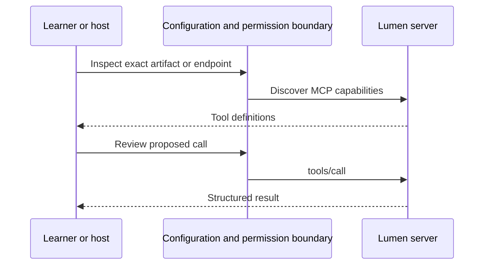

# Module 18: Packaging and distributing servers
> After this module you can build and inspect installable notes packages.

**Time:** ~105 min · **Level:** Advanced · **LLM needed:** No · **Languages:** Python + TypeScript packaging
**Spec sections:** [Tools](https://modelcontextprotocol.io/specification/2026-07-28/server/tools), [transports](https://modelcontextprotocol.io/specification/2026-07-28/basic/transports).
**Workspace and Chat version 3:** Workspace 6 gains packaging and distributing servers.

## Prerequisites

Complete [the previous module](../17_extensions/README.md). Use Python 3.12–3.14, Node 24/26 and frozen dependencies (`uv sync --all-extras`, `npm ci`). Run commands from the repository root in PowerShell or a POSIX terminal. MCP and JSON-RPC were introduced in Module 01, OAuth and scopes in Module 11. Docker is needed only for container rehearsals.

## Learning objectives

- Build a wheel and source distribution.
- Launch Python/npm packages outside the checkout.
- Validate an MCPB archive.
- Classify breaking tool changes.

## The big idea

A server that works in your checkout may depend on files that only exist on your machine. Packaging puts executable code and dependencies into a predictable delivery unit. Think of packing a lunch: a recipe is useful, but the recipient needs every ingredient. A Python wheel is an installable archive; an sdist contains source needed to build it. npm ships a tarball. An MCP Bundle adds a desktop installation manifest. A container includes the runtime too. These formats do not change MCP messages.

## How it works



Under the hood, packaging/discovery chooses an executable or endpoint; MCP starts when a client connects. Approval and authorization remain explicit. Captures show actual requests, not invented publication traffic.

## On the wire

Run `uv run python scripts/tier5.py --module 18 --capture`, then `uv run python scripts/render_wire_docs.py`. The request names the tool/arguments; the response returns actual synthetic data. Module 20 redacts authorization headers. Module 21 also records an older handshake.

<!-- wire:start -->

Source: [captured python_main](wire/python_main.jsonl). Each JSON block below is a complete message copied from that run.

```json
{
  "jsonrpc": "2.0",
  "id": 3,
  "method": "tools/call",
  "params": {
    "name": "search_notes",
    "arguments": {
      "query": "release"
    },
    "_meta": {
      "io.modelcontextprotocol/protocolVersion": "2026-07-28",
      "io.modelcontextprotocol/clientInfo": {
        "name": "mcp",
        "version": "0.1.0"
      },
      "io.modelcontextprotocol/clientCapabilities": {}
    }
  }
}
```

```json
{
  "jsonrpc": "2.0",
  "id": 3,
  "result": {
    "content": [
      {
        "text": "{\n  \"id\": 1,\n  \"title\": \"Release handover\",\n  \"body\": \"Review the release checklist.\",\n  \"tags\": [\n    \"release\"\n  ]\n}",
        "type": "text"
      }
    ],
    "isError": false,
    "resultType": "complete",
    "structuredContent": {
      "result": [
        {
          "id": 1,
          "title": "Release handover",
          "body": "Review the release checklist.",
          "tags": [
            "release"
          ]
        }
      ]
    },
    "_meta": {
      "io.modelcontextprotocol/serverInfo": {
        "name": "Lumen notes",
        "version": "1.0"
      }
    }
  }
}
```

<!-- wire:end -->

## Key APIs at a glance

| Python API | TypeScript API or equivalent | What it does | When to use it |
|---|---|---|---|
| artifacts() | npm pack / esbuild | Build shipping artifacts | Before release |
| Client(StdioServerParameters) | StdioClientTransport | Test installed entry | After build |
| make_server() | configuredNotesServer(readOnly) | Configure capabilities | Startup |

## Walkthrough

### 01 build artifacts

Build all four formats from shared sources.

```text
uv run python modules/18_packaging/python/examples/01_build_artifacts.py
```

Expected: `Four artifact inventories: wheel, sdist, npm, bundle`.

### 02 environment

Compare the capabilities exposed by read-only and writable configuration.

```text
uv run python modules/18_packaging/python/examples/02_environment.py
```

Expected: `true: search_notes; false: search_notes, create_note, tag_note`.

### 03 compatibility

Keep an existing search contract working after packaging.

```text
uv run python modules/18_packaging/python/examples/03_compatibility.py
```

Expected: `PASS existing search contract`.

### Build, install, inspect

```text
uv run python scripts/package_lab.py --prepare
uv run python scripts/package_lab.py
```

The first command allows dependency downloads; the second requires the cache and runs offline. Both print four artifact paths under `.runtime/packages/<content-hash>/` and `PASS installed uvx and npx packages outside checkout`. The helper launches `uvx --from <wheel> lumen-notes` and `npm exec --package <tarball> -- lumen-notes` (npm's npx-equivalent) from a temporary directory outside the repository. It selects the current Python interpreter and explicit uv cache on Windows.

Templates live in [distribution/python](../../distribution/python/pyproject.toml), [distribution/npm](../../distribution/npm/package.json) and [distribution/mcpb](../../distribution/mcpb/manifest.json). Build through the helper: it stages the shared Python sources into the sdist. Do not build the unstaged Python template directly. The npm executable is a self-contained Node bundle with a shebang. [common/packaging.py](../../common/packaging.py) inspects actual archive inventories for secrets, dependency directories and escaping paths.

`LUMEN_NOTES_READ_ONLY` defaults to `true`. Setting `false` exposes writes, each still requiring a reviewed `confirmed` argument. Environment variables configure a process; they are not a secret vault. Never put credentials in a manifest or command-line argument.

### Desktop bundle and Docker

MCPB manifest **0.3** is validated by **@anthropic-ai/mcpb 2.1.2**. The bundle uses `${__dirname}` for its Node executable and a boolean user configuration setting. Claude Desktop documents MCPB installation on macOS/Windows. Open the emitted `.mcpb` in a supporting desktop app, inspect the configuration, then search release notes. A manifest listing a platform does not prove every host supports it. CLI validation/packing is automated here; desktop installation remains a manual check.

```text
docker build -f distribution/notes.Dockerfile -t lumen-notes-course:1.0.0 .
docker run --rm -i --network none --read-only --cap-drop ALL lumen-notes-course:1.0.0
```

The second command waits for MCP on stdin; configure it as a host server command. Do not add `-t`, which allocates a terminal. The [Dockerfile](../../distribution/notes.Dockerfile) uses an unprivileged user and defaults to read-only notes.

### Learner-controlled TestPyPI rehearsal

Nothing is published by the examples. Choose an unused TestPyPI project name you control, edit the Python project metadata, increment its version, and rebuild. Create your own TestPyPI account/token. Review the exact wheel and sdist, then deliberately run `uv publish --publish-url https://test.pypi.org/legacy/ <wheel> <sdist>`, replacing the angle-bracket paths with those printed by the helper. Supply the token through local credential configuration (`UV_PUBLISH_TOKEN`), never source control. Do not upload the root course wheel.

TestPyPI is not a PyPI mirror. For an installation rehearsal, download your exact own wheel from TestPyPI, inspect it, then use that local wheel with `uvx --from <wheel> lumen-notes`, resolving dependencies from the normal configured index. Avoid indiscriminately combining indexes. The automated local wheel test needs no publishing credentials.

### Version the tool contract

Package version `1.0.0` is independent of the protocol revision. Removing a tool, renaming an argument, narrowing accepted values or adding required inputs can break callers: plan a major release. Adding optional inputs/tools generally allows a minor release. Documentation fixes can be patches, but hosts must still invalidate approval if a definition changes. Preserve fixtures for old calls, publish migration guidance, pin artifacts and never reuse a version for different bytes.


## Try it in a host

Generate paths for your checkout. The committed configs show the author's Windows paths; regenerate before using them.

```text
uv run python scripts/host_configs.py --module 18
```

| Host | Configuration |
|---|---|
| Claude Desktop | [JSON](host_configs/claude-desktop.json) |
| Claude Code | [JSON](host_configs/claude-code.json) |
| VS Code | [JSON](host_configs/vscode.json) |
| Cursor | [JSON](host_configs/cursor.json) |

Copy the generated entry into your existing configuration, preserving other servers. Ask “Search the notes for release”. These configs expose the lesson demo server; the v4 web host has its separate lumen-chat.json. Review permission dialogs. Config/docs support is distinct from a vendor GUI test; see [verification](../../docs/PHASE_7_VERIFICATION.md).

## Real-world use case

Lumen needs to distribute notes without copying a checkout. The examples reuse shared code and real MCP transports; synthetic data makes rehearsal reproducible.

```text
uv run python modules/18_packaging/python/use_case/main.py
```

Expected: `PASS Module 18`. This finite acceptance check exits; the walkthrough above gives the interactive build/deployment/browser commands. A company would supply its own package namespace, identities, storage and release policy before using business data.

**What could go wrong?** Archives can leak secrets or run installation code; inspect contents and source before executing.

## Common mistakes

| Error or status you will see | Fix |
|---|---|
| `LUMEN_NOTES_READ_ONLY must be true or false.` | Use literal true/false, not yes/0. |
| `No solution found when resolving tool dependencies` | Run --prepare once with network, then retain the same interpreter/cache. |
| `Confirmation required: review the title and body before creating.` | Review exact content before granting confirmed=true. |
| `Unexpected private, dependency-tree or escaping path in artifact.` | Remove unexpected files from the staged artifact and rebuild. |

## Exercises

Starters run but intentionally fail extension checks until implemented. These gaps are confined to learner exercises, not reference implementations.

**Practice:** Accept only true/false, ignoring case; return None for invalid settings. [Starter](python/exercises/01_env_bool.py) · [Solution](python/solutions/01_env_bool.py).

```text
uv run python scripts/check_exercise.py --module 18 --exercise 1
uv run python scripts/check_exercise.py --module 18 --exercise 1 --solution
```

**Apply:** Classify tool changes: removed or newly required inputs need major; additive optional inputs need minor; docs-only patch. [Starter](python/exercises/02_bump.py) · [Solution](python/solutions/02_bump.py).

```text
uv run python scripts/check_exercise.py --module 18 --exercise 2
uv run python scripts/check_exercise.py --module 18 --exercise 2 --solution
```

**Stretch:** Reject any archive member with traversal, absolute paths, or private environment/git files (Windows paths included). [Starter](python/exercises/03_inventory.py) · [Solution](python/solutions/03_inventory.py).

```text
uv run python scripts/check_exercise.py --module 18 --exercise 3
uv run python scripts/check_exercise.py --module 18 --exercise 3 --solution
```

## Quiz

The [seven-question quiz](quiz.md) is also included here. Answer before expanding.

### 1. Does a wheel include Python itself?

<details><summary>Answer</summary>

No. A compatible interpreter and declared dependencies are required.

</details>

### 2. Why inspect an sdist separately?

<details><summary>Answer</summary>

It must rebuild without references into the author checkout.

</details>

### 3. Does read-only=false approve writes?

<details><summary>Answer</summary>

No. It exposes tools; each mutation still needs confirmation.

</details>

### 4. Why launch outside the checkout?

<details><summary>Answer</summary>

To reveal accidental imports and file dependencies.

</details>

### 5. Is the package version the protocol revision?

<details><summary>Answer</summary>

No. Package semantic versioning and protocol negotiation are independent.

</details>

### 6. Does a valid MCPB prove desktop compatibility?

<details><summary>Answer</summary>

No. The intended host must support and test its format.

</details>

### 7. When is a package uploaded?

<details><summary>Answer</summary>

Only when the learner deliberately publishes with their own account.

</details>

## Key takeaways

- Verify the artifact or endpoint users will actually run.
- Keep identity, capability and permission separate.
- Make configuration explicit and keep credentials out of artifacts/logs.
- Bound failures and retain evidence before retrying or approving again.
- Rehearse with synthetic data before publishing or deploying real access.

## Go deeper

- [uv packaging](https://docs.astral.sh/uv/guides/package/)
- [MCPB manifest](https://github.com/modelcontextprotocol/mcpb/blob/main/MANIFEST.md)
- [TypeScript SDK](https://github.com/modelcontextprotocol/typescript-sdk)

## Next: Module 19

Continue to [Module 19](../19_registry/README.md).
