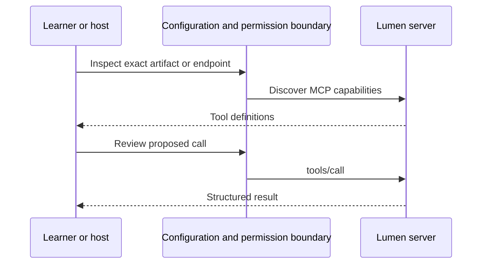

# Module 19: The MCP Registry and choosing servers safely
> After this module you can validate metadata and review a server before installation.

**Time:** ~75 min · **Level:** Advanced · **LLM needed:** No · **Languages:** Python
**Spec sections:** [Tools](https://modelcontextprotocol.io/specification/2026-07-28/server/tools), [transports](https://modelcontextprotocol.io/specification/2026-07-28/basic/transports).
**Workspace and Chat version 3:** Workspace 6 gains the mcp registry and choosing servers safely.

## Prerequisites

Complete [the previous module](../18_packaging/README.md). Use Python 3.12–3.14, Node 24/26 and frozen dependencies (`uv sync --all-extras`, `npm ci`). Run commands from the repository root in PowerShell or a POSIX terminal. MCP and JSON-RPC were introduced in Module 01, OAuth and scopes in Module 11. Docker is needed only for container rehearsals.

## Learning objectives

- Validate server.json against the official schema.
- Match package identity to a registry namespace.
- Traverse bounded registry pages.
- Explain ownership proof and an installation decision.

## The big idea

A registry is a directory, like a library catalog. It tells you where a title can be found, but does not turn every book into trusted advice. MCP registry metadata points to packages or remote endpoints. A client can query the official registry or a curated sub-registry, then apply its own selection policy. Namespace verification links a publisher to a name; it does not certify that the server is safe, correct or suitable for your data.

## How it works



Under the hood, packaging/discovery chooses an executable or endpoint; MCP starts when a client connects. Approval and authorization remain explicit. Captures show actual requests, not invented publication traffic.

## On the wire

Run `uv run python scripts/tier5.py --module 19 --capture`, then `uv run python scripts/render_wire_docs.py`. The request names the tool/arguments; the response returns actual synthetic data. Module 20 redacts authorization headers. Module 21 also records an older handshake.

<!-- wire:start -->

Source: [captured python_main](wire/python_main.jsonl). Each JSON block below is a complete message copied from that run.

```json
{
  "jsonrpc": "2.0",
  "id": 3,
  "method": "tools/call",
  "params": {
    "name": "search_notes",
    "arguments": {
      "query": "release"
    },
    "_meta": {
      "io.modelcontextprotocol/protocolVersion": "2026-07-28",
      "io.modelcontextprotocol/clientInfo": {
        "name": "mcp",
        "version": "0.1.0"
      },
      "io.modelcontextprotocol/clientCapabilities": {}
    }
  }
}
```

```json
{
  "jsonrpc": "2.0",
  "id": 3,
  "result": {
    "content": [
      {
        "text": "{\n  \"id\": 1,\n  \"title\": \"Release handover\",\n  \"body\": \"Review the release checklist.\",\n  \"tags\": [\n    \"release\"\n  ]\n}",
        "type": "text"
      }
    ],
    "isError": false,
    "resultType": "complete",
    "structuredContent": {
      "result": [
        {
          "id": 1,
          "title": "Release handover",
          "body": "Review the release checklist.",
          "tags": [
            "release"
          ]
        }
      ]
    },
    "_meta": {
      "io.modelcontextprotocol/serverInfo": {
        "name": "Lumen notes",
        "version": "1.0"
      }
    }
  }
}
```

<!-- wire:end -->

## Key APIs at a glance

| Python API | TypeScript API or equivalent | What it does | When to use it |
|---|---|---|---|
| validate_metadata() | JSON Schema validator | Check identity/shape | Before publication |
| list_registry() | fetch with cursor budget | Read metadata | Selection |
| namespace_owner() | package.json mcpName | Match identity | Ownership flow |

## Walkthrough

### 01 metadata

Validate the proposed notes entry.

```text
uv run python modules/19_registry/python/examples/01_metadata.py
```

Expected: `io.github.anandtopu/lumen-notes anandtopu 1.0.0`.

### 02 discovery

Follow opaque cursors across two fixture pages.

```text
uv run python modules/19_registry/python/examples/02_discovery.py
```

Expected: `Discovered 1 metadata entries; installed 0`.

### 03 review

Inspect a risky candidate without installing anything.

```text
uv run python modules/19_registry/python/examples/03_review.py
```

Expected: `four review flags; automatic_install_allowed False`.

### Validate locally first

[server.json](../../distribution/registry/server.json) names `io.github.anandtopu/lumen-notes` and npm artifact `@anandtopu/lumen-notes-course` version `1.0.0`. These are proposed identities, not a claim of publication or verified npm-account ownership. Replace them with names you control. Keep the package's `mcpName`, registry name and version consistent. The Python README contains an ownership marker for a future PyPI entry; this metadata currently lists npm only.

Registry schema **2025-12-11** is independent of MCP protocol **2026-07-28**. The local validator uses the vendored official schema without fetching remote references. It cannot prove publication or namespace ownership.

### Current publisher and intentional publication

```text
uv run python scripts/publisher_tool.py
```

This downloads **mcp-publisher v1.8.7** from the official GitHub release, verifies the published SHA-256 checksum, extracts only its expected executable, and runs version/help. It does not log in or publish. A checksum from the same origin detects corruption; it is not independent identity proof. `--validate-online` also invokes the publisher's validation command on the public metadata; it may contact the registry and reject an unpublished artifact. Fix reported issues rather than weakening validation.

For publication, first publish and inspect your own exact npm artifact. Then run the installed publisher's `login github`, prove your namespace as prompted, and deliberately run `publish distribution/registry/server.json`. Its registry selection comes from login context; do not assume `publish --registry` exists. DNS namespaces have a separate proof flow; follow the official reference. Keep publishing credentials out of server manifests and repository files.

### Discovery and sub-registries

```text
uv run python modules/19_registry/python/examples/02_discovery.py --live
```

This opt-in reads the official `/v0.1/servers` API: at most three pages, five requested entries per page, a 256 KB response budget and a ten-second timeout. Preserve opaque cursors and reject cycles. Encode the entire server name, including its slash, when requesting a version. Metadata remains untrusted input. The default fixture deliberately spans two pages; neither mode installs software.

A company sub-registry can curate an approved subset. Preserve original identity/version/provenance and attach local review evidence separately. Never translate a curated listing directly into permission to execute commands or send data.

Before installing a third-party server, inspect namespace and artifact ownership, source history/license, version/provenance, install scripts, dependencies/advisories, filesystem roots, network destinations, token scopes/storage, write/delete behavior, logging, maintenance and rollback. Test with synthetic data and minimal access. Listings, annotations, popularity and AI-generated descriptions are not authorization. Record why you approved a version; revisit approval when code or permissions change.


## Try it in a host

Generate paths for your checkout. The committed configs show the author's Windows paths; regenerate before using them.

```text
uv run python scripts/host_configs.py --module 19
```

| Host | Configuration |
|---|---|
| Claude Desktop | [JSON](host_configs/claude-desktop.json) |
| Claude Code | [JSON](host_configs/claude-code.json) |
| VS Code | [JSON](host_configs/vscode.json) |
| Cursor | [JSON](host_configs/cursor.json) |

Copy the generated entry into your existing configuration, preserving other servers. Ask “Search the notes for release”. These configs expose the lesson demo server; the v4 web host has its separate lumen-chat.json. Review permission dialogs. Config/docs support is distinct from a vendor GUI test; see [verification](../../docs/PHASE_7_VERIFICATION.md).

## Real-world use case

Lumen needs to make reviewed notes metadata discoverable. The examples reuse shared code and real MCP transports; synthetic data makes rehearsal reproducible.

```text
uv run python modules/19_registry/python/use_case/main.py
```

Expected: `PASS Module 19`. This finite acceptance check exits; the walkthrough above gives the interactive build/deployment/browser commands. A company would supply its own package namespace, identities, storage and release policy before using business data.

**What could go wrong?** Metadata can point to malicious code; discovery grants no execution permission.

## Common mistakes

| Error or status you will see | Fix |
|---|---|
| `Registry identity/version must match the package being published.` | Synchronize name, mcpName, npm identifier and version. |
| `This example uses io.github.<owner>/<server>.` | Use the documented namespace and your own owner. |
| `Invalid or repeated registry cursor.` | Stop traversal and investigate the response. |
| `Registry traversal exceeded three pages.` | Narrow the query or deliberately design a larger bounded traversal. |

## Exercises

Starters run but intentionally fail extension checks until implemented. These gaps are confined to learner exercises, not reference implementations.

**Practice:** Require matching nonempty registry identity and package mcpName. [Starter](python/exercises/01_identity.py) · [Solution](python/solutions/01_identity.py).

```text
uv run python scripts/check_exercise.py --module 19 --exercise 1
uv run python scripts/check_exercise.py --module 19 --exercise 1 --solution
```

**Apply:** Reject repeated or oversized cursors and stop after three pages; empty cursor means done. [Starter](python/exercises/02_cursor.py) · [Solution](python/solutions/02_cursor.py).

```text
uv run python scripts/check_exercise.py --module 19 --exercise 2
uv run python scripts/check_exercise.py --module 19 --exercise 2 --solution
```

**Stretch:** Allow a reviewed installation only when identity, source and requested permissions are approved and an exact version is pinned. [Starter](python/exercises/03_install_policy.py) · [Solution](python/solutions/03_install_policy.py).

```text
uv run python scripts/check_exercise.py --module 19 --exercise 3
uv run python scripts/check_exercise.py --module 19 --exercise 3 --solution
```

## Quiz

The [seven-question quiz](quiz.md) is also included here. Answer before expanding.

### 1. What does the registry store?

<details><summary>Answer</summary>

Metadata pointing to packages or remote endpoints.

</details>

### 2. Does namespace proof audit code?

<details><summary>Answer</summary>

No. It establishes control of a name.

</details>

### 3. Why use a 2025 schema with a 2026 protocol?

<details><summary>Answer</summary>

Registry schema versions and MCP protocol revisions are independent.

</details>

### 4. Does local validation prove an artifact exists?

<details><summary>Answer</summary>

No. Publication and ownership checks are separate.

</details>

### 5. What should a sub-registry preserve?

<details><summary>Answer</summary>

Original identity, exact version and provenance, with separate local review evidence.

</details>

### 6. Why reject repeated cursors?

<details><summary>Answer</summary>

To stop a broken endpoint from causing an endless traversal.

</details>

### 7. Does this discovery code install results?

<details><summary>Answer</summary>

No. It returns metadata only.

</details>

## Key takeaways

- Verify the artifact or endpoint users will actually run.
- Keep identity, capability and permission separate.
- Make configuration explicit and keep credentials out of artifacts/logs.
- Bound failures and retain evidence before retrying or approving again.
- Rehearse with synthetic data before publishing or deploying real access.

## Go deeper

- [Registry quickstart](https://modelcontextprotocol.io/registry/quickstart)
- [Publisher CLI](https://github.com/modelcontextprotocol/registry/blob/main/docs/reference/cli/commands.md)
- [Registry API](https://github.com/modelcontextprotocol/registry/blob/main/docs/reference/api/official-registry-api.md)

## Next: Module 20

Continue to [Module 20](../20_deployment/README.md).
