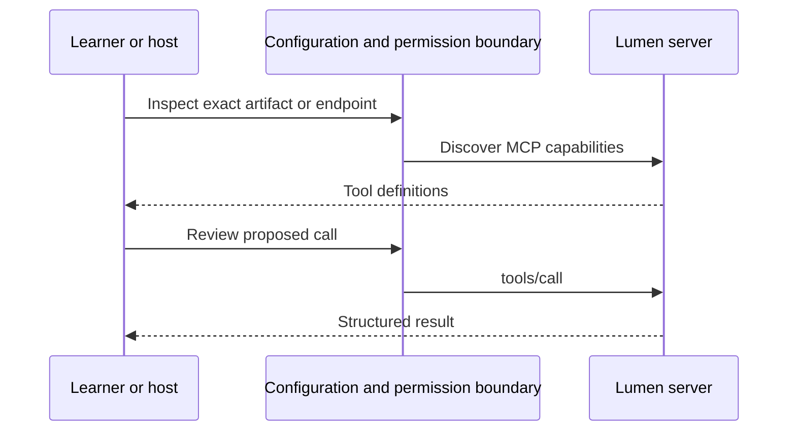

# Module 20: Deploying remote servers
> After this module you can run secured issues behind a local reverse proxy and tear it down.

**Time:** ~150 min · **Level:** Advanced · **LLM needed:** No · **Languages:** Python
**Spec sections:** [Tools](https://modelcontextprotocol.io/specification/2026-07-28/server/tools), [transports](https://modelcontextprotocol.io/specification/2026-07-28/basic/transports).
**Workspace and Chat version 3:** Workspace 6 gains deploying remote servers.

## Prerequisites

Complete [the previous module](../19_registry/README.md). Use Python 3.12–3.14, Node 24/26 and frozen dependencies (`uv sync --all-extras`, `npm ci`). Run commands from the repository root in PowerShell or a POSIX terminal. MCP and JSON-RPC were introduced in Module 01, OAuth and scopes in Module 11. Docker is needed only for container rehearsals.

## Learning objectives

- Build the issues container.
- Run Keycloak, issues and a reverse proxy locally.
- Verify public token audiences across internal networks.
- Explain limits and scaling boundaries.
- Remove running lab resources.

## The big idea

A reverse proxy is the reception desk in front of a service. It accepts public connections and forwards them to an internal worker. The worker must still verify who is calling and what they may do. Containers make the worker reproducible; they do not supply authorization, durable storage or cost limits. This lab publishes only loopback ports, so you can rehearse the full path without a cloud account. Public issuer and audience values identify the service even when its internal routing names differ.

## How it works



Under the hood, packaging/discovery chooses an executable or endpoint; MCP starts when a client connects. Approval and authorization remain explicit. Captures show actual requests, not invented publication traffic.

## On the wire

Run `uv run python scripts/tier5.py --module 20 --capture`, then `uv run python scripts/render_wire_docs.py`. The request names the tool/arguments; the response returns actual synthetic data. Module 20 redacts authorization headers. Module 21 also records an older handshake.

<!-- wire:start -->

Source: [captured python_main](wire/python_main.jsonl). Each JSON block below is a complete message copied from that run.

```json
{
  "jsonrpc": "2.0",
  "id": 3,
  "method": "tools/call",
  "params": {
    "name": "read_issue",
    "arguments": {
      "issue_id": 1
    },
    "_meta": {
      "io.modelcontextprotocol/protocolVersion": "2026-07-28",
      "io.modelcontextprotocol/clientInfo": {
        "name": "mcp",
        "version": "0.1.0"
      },
      "io.modelcontextprotocol/clientCapabilities": {}
    }
  }
}
```

```json
{
  "jsonrpc": "2.0",
  "id": 3,
  "result": {
    "content": [
      {
        "text": "{\n  \"id\": 1,\n  \"project_id\": 1,\n  \"title\": \"Service ownership: work item 1\",\n  \"status\": \"in_progress\",\n  \"priority\": \"medium\",\n  \"assignee_id\": 14,\n  \"created_at\": \"2026-01-02\"\n}",
        "type": "text"
      }
    ],
    "isError": false,
    "resultType": "complete",
    "structuredContent": {
      "id": 1,
      "project_id": 1,
      "title": "Service ownership: work item 1",
      "status": "in_progress",
      "priority": "medium",
      "assignee_id": 14,
      "created_at": "2026-01-02"
    },
    "_meta": {
      "io.modelcontextprotocol/serverInfo": {
        "name": "Lumen secured issues",
        "version": ""
      }
    }
  }
}
```

<!-- wire:end -->

## Key APIs at a glance

| Python API | TypeScript API or equivalent | What it does | When to use it |
|---|---|---|---|
| JWTVerifier | Token-verification middleware | Verify issuer/audience | Every protected call |
| Operations | Shared limiter when scaling | Bound per-user traffic | After identity verification |
| make_app(hosts=...) | Exact authority validation | Check Host/Origin | Behind a proxy |

## Walkthrough

### 01 public url

Reject a public plaintext endpoint.

```text
uv run python modules/20_deployment/python/examples/01_public_url.py
```

Expected: `Public endpoints require HTTPS; HTTP is loopback-only.`.

### 02 rate budget

Spend and expire two per-principal requests.

```text
uv run python modules/20_deployment/python/examples/02_rate_budget.py
```

Expected: `PASS per-principal budget and expiry`.

### 03 health and auth

Exercise production middleware over actual loopback HTTP.

```text
uv run python modules/20_deployment/python/examples/03_health_and_auth.py
```

Expected: `PASS health, unauthorized rejection, authenticated issue read`.

### Complete local stack

Use Docker Desktop with Linux containers on Windows/macOS, or Docker Engine with Compose on Linux. Stop the earlier auth-only lab because both use ports 8080/8001.

```text
docker compose -f deployment/auth/compose.yaml down
docker compose -f deployment/compose.yaml up --build -d --wait --wait-timeout 120
uv run python scripts/keycloak_check.py --deployed
docker compose -f deployment/compose.yaml ps
```

Expected: `PASS deployed web host` and `PASS Keycloak: discovery, PKCE, resource audience, SDK scope step-up, write`. This uses only the synthetic learner account. The public issuer is `http://127.0.0.1:8080/realms/lumen`; the resource audience is `http://127.0.0.1:8001/mcp`. The container fetches keys from `http://keycloak:8080/.../certs` but validates the **public** issuer and audience. Tokens cannot select their key endpoint.

The [Compose file](../../deployment/compose.yaml), [issues Dockerfile](../../deployment/issues.Dockerfile) and [proxy config](../../deployment/nginx.conf) form the complete stack. It pins Keycloak **26.8.1**, NGINX **1.30.6-alpine3.24** and Python **3.12.13** tags. Review immutable image digests for a real release. Only loopback ports are published. HTTP, Keycloak `start-dev`, and fixture credentials are local development settings. Do not expose this Compose configuration publicly.

### Operational boundaries

The resource validates exact public Host, allowed Origin, token signature/issuer/audience/expiry and operation scopes. NGINX applies edge rate/body limits, preserves MCP and Authorization headers, disables buffering, and drops forwarding headers the application does not trust. The app allows 120 requests/minute per **verified** subject, keeps at most 1,000 active subject windows, and returns 429 with Retry-After. Caller-supplied user headers confer no identity.

`/healthz` is liveness; internal `/readyz` becomes available after application/database startup. Neither proves Keycloak is healthy: the authenticated probe checks that. Internal `/metrics` counts status codes, and the proxy hides it. Access logs are disabled to avoid leaking codes/tokens/arguments. In production monitor 401/403 changes, 429, 5xx, latency and end-to-end probes; export through a private authenticated collector.

SQLite is an ephemeral fixture copy; limits are process-local. Run one worker/replica. Before scaling, add a durable shared database, shared limits/idempotency storage, migrations/backups and rollback. Module 17 Tasks also have process-local state and do not survive restarts. Memory/PID limits and deadlines bound this lab; they are not a cloud spending cap.

### Cloud routes checked 2026-10-30

| Route | Documented capability | Validate before adopting |
|---|---|---|
| [AWS Bedrock AgentCore Runtime](https://docs.aws.amazon.com/bedrock-agentcore/latest/devguide/runtime-mcp.html) | MCP containers at port 8000 and /mcp | Supported protocol revision, session behavior and identity; avoid obsolete SDK snippets |
| [Google Cloud Run](https://docs.cloud.google.com/run/docs/host-mcp-servers) | Container hosting for MCP | MCP OAuth alongside platform IAM, timeout, instance limits and shared state |
| [Azure Container Apps](https://learn.microsoft.com/en-us/azure/container-apps/mcp-overview) | MCP container workloads | Standalone apps versus managed sessions, auth discovery, TLS and storage |

These are documented options, not measured deployments or proof each managed gateway supports revision 2026-07-28. A normal container service is a direct route: configure real public TLS/issuer/resource/origins, private workers, shared storage and mounted platform secrets. Never bake credentials into images. Stateless requests fit serverless routing; Tasks need shared state and worker ownership, and streaming requires suitable proxy timeouts.

Run discovery/auth/read/write acceptance on the selected platform before carrying real data. Set a small explicit max-instance count, alerts and spending budget. Estimate compute, memory, storage, egress, identity and optional model cost using current provider calculators. No fixed price is assumed and no paid resources are created by this lab.

### Teardown

```text
docker compose -f deployment/compose.yaml down --remove-orphans
docker compose -f deployment/compose.yaml ps
```

No named persistent volumes are created. Removal deletes synthetic mutations and local Keycloak state; committed fixtures remain. Verify no services run. Remove only lab images through your Docker image manager if desired; avoid global prune. For cloud work also remove services/revisions, load balancers, databases/snapshots, registries, disks, IP reservations, secrets and log retention resources you created, then verify billing.


## Try it in a host

Generate paths for your checkout. The committed configs show the author's Windows paths; regenerate before using them.

```text
uv run python scripts/host_configs.py --module 20
```

| Host | Configuration |
|---|---|
| Claude Desktop | [JSON](host_configs/claude-desktop.json) |
| Claude Code | [JSON](host_configs/claude-code.json) |
| VS Code | [JSON](host_configs/vscode.json) |
| Cursor | [JSON](host_configs/cursor.json) |

Copy the generated entry into your existing configuration, preserving other servers. Claude Desktop uses a remote connector UI, normally with public HTTPS, so its local stdio JSON is intentionally empty here. Start Compose first and ask “Read issue 1” after authorization. Review permission dialogs. Config/docs support is distinct from a vendor GUI test; see [verification](../../docs/PHASE_7_VERIFICATION.md).

## Real-world use case

Lumen needs to serve remote issues with OAuth and bounded resources. The examples reuse shared code and real MCP transports; synthetic data makes rehearsal reproducible.

```text
uv run python modules/20_deployment/python/use_case/main.py
```

Expected: `PASS Module 20`. This finite acceptance check exits; the walkthrough above gives the interactive build/deployment/browser commands. A company would supply its own package namespace, identities, storage and release policy before using business data.

**What could go wrong?** Public services can leak data or spend resources; keep authorization, limits and teardown in acceptance.

## Common mistakes

| Error or status you will see | Fix |
|---|---|
| `mkdir() "/var/cache/nginx/fastcgi_temp" failed (30: Read-only file system)` | Use the committed proxy config: all temporary directories belong under the writable /tmp mount. |
| `Public endpoints require HTTPS; HTTP is loopback-only.` | Use HTTPS or the exact localhost/127.0.0.1 development exception. |
| `Keycloak not ready; start the auth Compose service` | Start the complete stack, check port conflicts and wait for realm import. |
| `HTTP 421` | Preserve the configured public Host through the proxy. |
| `HTTP 403 / insufficient_scope` | Obtain the needed scope through authorization, not by bypassing the gate. |
| `HTTP 429 / rate_limited` | Honor Retry-After and reduce volume. |

## Exercises

Starters run but intentionally fail extension checks until implemented. These gaps are confined to learner exercises, not reference implementations.

**Practice:** Accept HTTPS public URLs or exact loopback HTTP, rejecting credentials/query/fragment. [Starter](python/exercises/01_endpoint.py) · [Solution](python/solutions/01_endpoint.py).

```text
uv run python scripts/check_exercise.py --module 20 --exercise 1
uv run python scripts/check_exercise.py --module 20 --exercise 1 --solution
```

**Apply:** Return missing prerequisites before more than one replica: shared_store and shared_limiter. [Starter](python/exercises/02_scale.py) · [Solution](python/solutions/02_scale.py).

```text
uv run python scripts/check_exercise.py --module 20 --exercise 2
uv run python scripts/check_exercise.py --module 20 --exercise 2 --solution
```

**Stretch:** Return only aggregate status, duration_ms, and request_id; omit token, arguments, and unknown fields. [Starter](python/exercises/03_log_redaction.py) · [Solution](python/solutions/03_log_redaction.py).

```text
uv run python scripts/check_exercise.py --module 20 --exercise 3
uv run python scripts/check_exercise.py --module 20 --exercise 3 --solution
```

## Quiz

The [seven-question quiz](quiz.md) is also included here. Answer before expanding.

### 1. Does a proxy replace OAuth?

<details><summary>Answer</summary>

No. The resource still validates tokens and scopes.

</details>

### 2. Which audience belongs in the token?

<details><summary>Answer</summary>

The public resource URL, not its Docker service name.

</details>

### 3. Why allow local HTTP?

<details><summary>Answer</summary>

Only loopback ports are published; identities and data are synthetic.

</details>

### 4. Can the SQLite lab scale to five replicas?

<details><summary>Answer</summary>

Not safely. Store, idempotency and limits must first be shared.

</details>

### 5. Does health prove an authorized call works?

<details><summary>Answer</summary>

No. Run the end-to-end authenticated probe.

</details>

### 6. Which fields stay out of metrics?

<details><summary>Answer</summary>

Tokens, authorization codes, arguments and results.

</details>

### 7. Does closing the client stop cloud billing?

<details><summary>Answer</summary>

No. Tear down infrastructure and verify remaining charges.

</details>

## Key takeaways

- Verify the artifact or endpoint users will actually run.
- Keep identity, capability and permission separate.
- Make configuration explicit and keep credentials out of artifacts/logs.
- Bound failures and retain evidence before retrying or approving again.
- Rehearse with synthetic data before publishing or deploying real access.

## Go deeper

- [Authorization](https://modelcontextprotocol.io/specification/2026-07-28/basic/authorization)
- [Transports](https://modelcontextprotocol.io/specification/2026-07-28/basic/transports)
- [Python SDK](https://github.com/modelcontextprotocol/python-sdk)

## Next: Module 21

Continue to [Module 21](../21_production_hosts/README.md).
