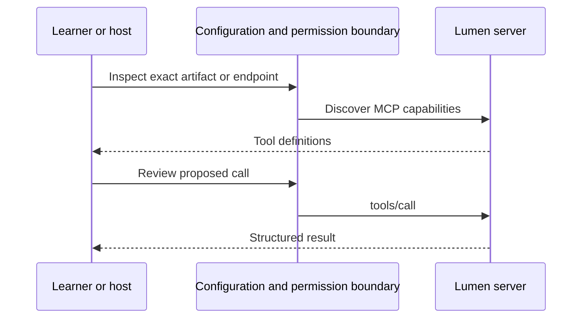

# Module 21: Building production hosts and clients
> After this module you can operate Lumen Chat v4 with approvals, task input and an isolated App.

**Time:** ~180 min · **Level:** Advanced · **LLM needed:** Optional · **Languages:** Python
**Spec sections:** [Tools](https://modelcontextprotocol.io/specification/2026-07-28/server/tools), [transports](https://modelcontextprotocol.io/specification/2026-07-28/basic/transports).

**Workspace and Chat version 6 / 4:** Operate lumen chat v4 with approvals, task input and an isolated app.

[TypeScript companion](typescript/README.md) covers the native cases and API differences.

## Prerequisites

Complete [the previous module](../20_deployment/README.md). Use Python 3.12–3.14, Node 24/26 and frozen dependencies (`uv sync --all-extras`, `npm ci`). Run commands from the repository root in PowerShell or a POSIX terminal. MCP and JSON-RPC were introduced in Module 01, OAuth and scopes in Module 11. Docker is needed only for container rehearsals.

## Learning objectives

- Load bounded multi-server configuration.
- Invalidate approval when definitions change.
- Distinguish safe retries from unknown write outcomes.
- Handle input, Tasks and Apps in a browser.
- Connect using older protocol handshakes.

## The big idea

The model proposes work; the host owns connections and decides what may run. An approval is like signing one purchase order: changing the item or price requires a new signature. Lumen Chat v4 binds review to the complete tool definition and exact arguments, then checks the catalog again before dispatch. One owner task manages each SDK connection so browser requests cannot accidentally tear down another request's transport. The UI separates user decisions from server results, even when those results contain instructions.

## How it works



Under the hood, packaging/discovery chooses an executable or endpoint; MCP starts when a client connects. Approval and authorization remain explicit. Captures show actual requests, not invented publication traffic.

## On the wire

Run `uv run python scripts/tier5.py --module 21 --capture`, then `uv run python scripts/render_wire_docs.py`. The request names the tool/arguments; the response returns actual synthetic data. Module 20 redacts authorization headers. Module 21 also records an older handshake.

<!-- wire:start -->

Source: [captured python_main](wire/python_main.jsonl). Each JSON block below is a complete message copied from that run.

```json
{
  "jsonrpc": "2.0",
  "id": 5,
  "method": "tools/call",
  "params": {
    "name": "search_notes",
    "arguments": {
      "query": "release"
    },
    "_meta": {
      "io.modelcontextprotocol/protocolVersion": "2026-07-28",
      "io.modelcontextprotocol/clientInfo": {
        "name": "mcp",
        "version": "0.1.0"
      },
      "io.modelcontextprotocol/clientCapabilities": {}
    }
  }
}
```

```json
{
  "jsonrpc": "2.0",
  "id": 5,
  "result": {
    "content": [
      {
        "text": "{\n  \"id\": 1,\n  \"title\": \"Release handover\",\n  \"body\": \"Review the release checklist.\",\n  \"tags\": [\n    \"release\"\n  ]\n}",
        "type": "text"
      }
    ],
    "isError": false,
    "resultType": "complete",
    "structuredContent": {
      "result": [
        {
          "id": 1,
          "title": "Release handover",
          "body": "Review the release checklist.",
          "tags": [
            "release"
          ]
        }
      ]
    },
    "_meta": {
      "io.modelcontextprotocol/serverInfo": {
        "name": "Lumen notes",
        "version": "1.0"
      }
    }
  }
}
```

<!-- wire:end -->

## Key APIs at a glance

| Python API | TypeScript API or equivalent | What it does | When to use it |
|---|---|---|---|
| Connection / ProductionHost | Client + AppBridge | Own transport and approvals | Host execution |
| Session.question() | DOM form controls | Ask for user input | Elicitation/Tasks |
| tasks/cancel | AppBridge.teardownResource() | Stop work or dispose view | Cancellation |
| Client(mode="legacy") | SDK compatibility mode | Older handshake | Older peers |

## Walkthrough

### 01 connections

Load three reviewed profiles and inspect capabilities.

```text
uv run python modules/21_production_hosts/python/examples/01_connections.py
```

Expected: `notes, issues, gateway; actual negotiated capabilities`.

### 02 catalog change

Reject a stale tool definition before execution.

```text
uv run python modules/21_production_hosts/python/examples/02_catalog_change.py
```

Expected: `Tool changed after review. Start again and review its new definition.`.

### 03 older protocol

Use the current SDK with an older handshake.

```text
uv run python modules/21_production_hosts/python/examples/03_older_protocol.py
```

Expected: `PASS compatible read on 2025-11-25`.

### Start Lumen Chat v4

```text
uv sync --all-extras
npm ci
npm run build:chat
uv run python -m common.web_chat --port 8766
```

Open `http://127.0.0.1:8766`. Practice mode makes no model requests: scripted choices drive real MCP calls against synthetic data. Try **Save a follow-up note**, inspect exact content and decline. **Draft a weekly update** needs two approvals. **Build a quarterly report** asks for approval and then a separate details choice. Start another report and cancel it while input is pending: the host sends `tasks/cancel`. **Open analytics** displays the App; Refresh may call only the displayed read-only analytics tool. Close view tears down its bridge and iframe.

The shared [host](../../common/production_host.py), [web service](../../common/web_chat.py), [front end](../../common/web_ui/app.source.js) and [browser tests](../../tests/browser/chat.pw.ts) implement this flow. Chromium tests verify parent-DOM and network isolation, rather than assuming an iframe is safe.

### Configuration and providers

[lumen-chat.json](host_configs/lumen-chat.json) selects one to five reviewed profiles with unique aliases. It is trusted local host configuration, never model output. To use deployed issues, add `"url": "http://127.0.0.1:8001/mcp"` and `"token_env": "LUMEN_ISSUES_TOKEN"` to its entry, and supply an already obtained short-lived token in the host environment/ignored `.env`. Tokens stay server-side. This sample does not implement browser OAuth login/refresh; Module 11 supplies the client flow, and the deployed acceptance check composes it without writing tokens to disk.

Select Anthropic, OpenAI, Gemini or Ollama only after configuring the model and corresponding key in [.env](../../.env.example). Provider-specific `ANTHROPIC_MODEL`, `OPENAI_MODEL`, `GEMINI_MODEL` and `OLLAMA_MODEL` are supported. The optional model field selects a model, never a URL or executable. Adapters reuse `common/llm.py`. Hosted providers can incur cost; acceptance makes no live provider calls.

### Connections and approvals

Startup has a 20-second deadline, SDK reads 12 seconds, actions 15 seconds, catalog traversal 20 pages. Duplicate names and repeated cursors fail closed. A workflow is bounded to six model turns/eight tool calls, with existing result-size limits. Human questions expire at 120 seconds; the workflow at 240 seconds. Four browser sessions may live for 30 minutes. Reconnect is available between workflows and warns that ephemeral data may reset.

The fingerprint covers the full tool definition, including description/schema/annotations/metadata. Catalogs refresh for every workflow and immediately before execution, so list changes invalidate stale approvals without depending on a persistent notification stream. Reconnect also refreshes. One automatic retry is allowed only for a local read allowlist; server annotations cannot grant retry privileges. A lost write response is an unknown outcome, not an invitation to retry. Inspect actual state or idempotency evidence first.

Modern clients negotiate extensions and handle input-required/claimed results. URL elicitation is declined without opening a URL. Older mode uses the current SDK's compatibility handshake; no old SDK imports are needed. [legacy.jsonl](wire/legacy.jsonl) captures initialize and the negotiated revision. This tests a real compatibility-mode notes server, not an independently installed old vendor release. Tasks/Apps require negotiated support.

### Browser boundary and limits

This is a **local single-user teaching host**, not a public multi-tenant service. It binds to 127.0.0.1, checks exact Host/Origin, rejects cross-site requests, uses an HttpOnly SameSite cookie plus per-session CSRF, and binds answers to one pending ID. Server text uses textContent. The App runs in an opaque-origin iframe with `sandbox="allow-scripts"`, restrictive CSP, no same-origin permission or external fetch, and no arbitrary tool dispatch. The official bridge pins its source window. The App cannot see keys or approve another tool.

Before public deployment, add user authentication, per-user upstream identities/catalogs, encrypted token storage/refresh, shared durable sessions/workflows, a dedicated App origin, operational monitoring and shared Task storage. Changing the bind address alone is insufficient.

```text
npx playwright install chromium
npm run test:browser
```

Linux CI uses `npx playwright install --with-deps chromium`. Browser installation is a one-time network step, separate from offline tests. Screenshots are saved under `.runtime/phase7/`.


## Try it in a host

Generate paths for your checkout. The committed configs show the author's Windows paths; regenerate before using them.

```text
uv run python scripts/host_configs.py --module 21
```

| Host | Configuration |
|---|---|
| Claude Desktop | [JSON](host_configs/claude-desktop.json) |
| Claude Code | [JSON](host_configs/claude-code.json) |
| VS Code | [JSON](host_configs/vscode.json) |
| Cursor | [JSON](host_configs/cursor.json) |

Copy the generated entry into your existing configuration, preserving other servers. Ask “Search the notes for release”. These configs expose the lesson demo server; the v4 web host has its separate lumen-chat.json. Review permission dialogs. Config/docs support is distinct from a vendor GUI test; see [verification](../../docs/PHASE_7_VERIFICATION.md).

## Real-world use case

Lumen needs to combine notes, issues and analytics in a host with human decisions. The examples reuse shared code and real MCP transports; synthetic data makes rehearsal reproducible.

```text
uv run python modules/21_production_hosts/python/use_case/main.py
```

Expected: `PASS Module 21`. This finite acceptance check exits; the walkthrough above gives the interactive build/deployment/browser commands. A company would supply its own package namespace, identities, storage and release policy before using business data.

**What could go wrong?** Tool text or Apps can attempt to bypass approval; refresh definitions, validate decisions and isolate the App.

## Common mistakes

| Error or status you will see | Fix |
|---|---|
| `Use unique aliases and reviewed built-in server profiles.` | Use distinct local aliases and supported profiles. |
| `Tool changed after review. Start again and review its new definition.` | Restart the workflow and review the current definition. |
| `Outcome unknown; this operation was not retried.` | Inspect server state/idempotency evidence before repeating a write. |
| `Answer is invalid, expired or already used.` | Use the current question once; old tabs cannot replay approval. |
| `Configure the selected provider's model and key on the server first.` | Configure the host environment; keep credentials out of the browser. |

## Exercises

Starters run but intentionally fail extension checks until implemented. These gaps are confined to learner exercises, not reference implementations.

**Practice:** Approve only if the exact full definition fingerprint is unchanged. [Starter](python/exercises/01_catalog.py) · [Solution](python/solutions/01_catalog.py).

```text
uv run python scripts/check_exercise.py --module 21 --exercise 1
uv run python scripts/check_exercise.py --module 21 --exercise 1 --solution
```

**Apply:** Retry once only when local policy marks a read safe and there is a transport failure. [Starter](python/exercises/02_retry.py) · [Solution](python/solutions/02_retry.py).

```text
uv run python scripts/check_exercise.py --module 21 --exercise 2
uv run python scripts/check_exercise.py --module 21 --exercise 2 --solution
```

**Stretch:** Accept a decision only for the current unexpired unanswered question ID. [Starter](python/exercises/03_decision.py) · [Solution](python/solutions/03_decision.py).

```text
uv run python scripts/check_exercise.py --module 21 --exercise 3
uv run python scripts/check_exercise.py --module 21 --exercise 3 --solution
```

## Quiz

The [seven-question quiz](quiz.md) is also included here. Answer before expanding.

### 1. Who authorizes a proposed call?

<details><summary>Answer</summary>

The host enforces local policy and asks the human; the model cannot approve itself.

</details>

### 2. Why fingerprint descriptions too?

<details><summary>Answer</summary>

A changed meaning must invalidate review even when arguments have the same shape.

</details>

### 3. Can idempotentHint alone grant retry permission?

<details><summary>Answer</summary>

No. Retry eligibility is local policy.

</details>

### 4. Does aborting a browser request cancel a Task?

<details><summary>Answer</summary>

Not necessarily. Address its task ID with tasks/cancel.

</details>

### 5. Why give a connection one owner task?

<details><summary>Answer</summary>

To preserve asynchronous transport lifetime and cancellation rules.

</details>

### 6. Does compatibility need old imports?

<details><summary>Answer</summary>

No. The current SDK provides a legacy handshake.

</details>

### 7. What may the App refresh call?

<details><summary>Answer</summary>

Only the displayed analytics_dashboard with empty arguments through the pinned bridge.

</details>

## Key takeaways

- Own each connection in one task and close failed starts as well as successful sessions.
- Refresh definitions before executing a reviewed call; a cache hint cannot grant permission.
- Retry only locally approved read operations; a lost write response has an uncertain outcome.
- Keep approval, elicitation and Task cancellation visible to the user.
- Render Apps inside a constrained frame and allow only reviewed bridge operations.

## Go deeper

- [Python SDK](https://github.com/modelcontextprotocol/python-sdk)
- [Tasks extension](https://modelcontextprotocol.io/extensions/tasks/overview)
- [Apps SDK](https://github.com/modelcontextprotocol/ext-apps)

## Next: shipping checkpoint

Run the [Tier 5 checkpoint](../../checkpoints/05_shipping/README.md). Phase 8 bonuses and capstones remain planned.

## TypeScript counterpart

The optional [full TypeScript track](typescript/README.md) supplies executable examples, a use case, exercises and tests for this module.
