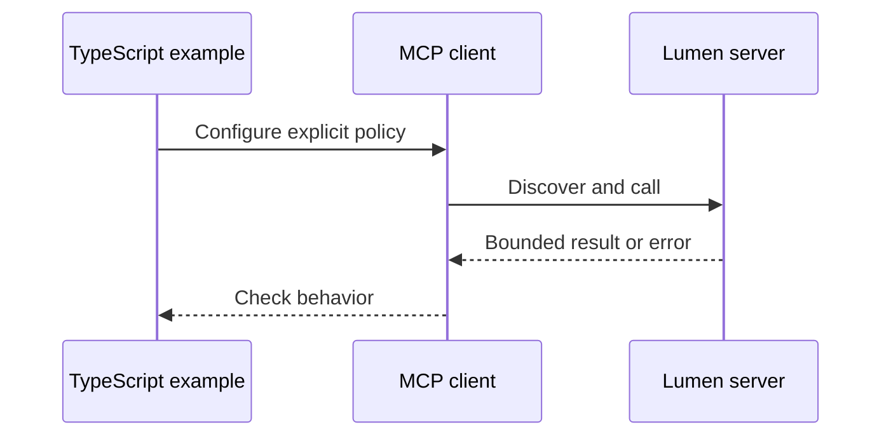

# TypeScript 21: Production hosts

Own child connections, bound retries and require reviewed catalogs after discovery. These are the TypeScript counterparts to [Module 21](../README.md). Read that lesson's explanation, diagram and quiz first; this page records language-specific behavior.

## Prerequisites

From the root: `npm ci`. Node 24 or 26 is required. The pinned official MCP SDK is 2.4.0; the protocol is 2026-07-28. No model key is needed.

## Learning objectives

- Execute each case and explain its observable assertion.
- Identify the boundary enforced by the server or host.
- Make a controlled change and demonstrate its failing regression.

## The big idea

Own child connections, bound retries and require reviewed catalogs after discovery. The language changes syntax and library choices; the peer still sees the same JSON-RPC contract. A deterministic fixture is an integration check, not a measured model-quality claim.

## How it works

## On the wire

[Actual TypeScript traffic](../../bonus/B1_typescript_track/wire/notes.jsonl), [form retries](../../bonus/B1_typescript_track/wire/forms.jsonl), and [Tasks](../../bonus/B1_typescript_track/wire/tasks.jsonl) share the current envelope. [Regeneration manifest](../../bonus/B1_typescript_track/wire/manifest.json). Captures are shared by capability, not duplicated to imply a separate capture of an in-memory assertion.

## Key APIs at a glance

| Python | TypeScript | Purpose |
|---|---|---|
| MCPServer | McpServer | Register local behavior |
| Client | Client | Request/validate protocol results |
| Context | ctx.mcpReq | Cancellation, input state and notifications |
| gateway/host helpers | CourseHost, Gateway, Connection | Keep execution policy outside model proposals |

## Walkthrough

- `01_reconnect.ts`: run `node --import tsx modules/21_production_hosts/typescript/examples/01_reconnect.ts`; expect `status: PASS`.
- `02_catalog_review.ts`: run `node --import tsx modules/21_production_hosts/typescript/examples/02_catalog_review.ts`; expect `status: PASS`.
- `03_compatibility.ts`: run `node --import tsx modules/21_production_hosts/typescript/examples/03_compatibility.ts`; expect `status: PASS`.

The executable contracts live in [advanced_lessons.ts](../../../common/typescript/advanced_lessons.ts); follow the module-number branch to the focused implementation it invokes. This avoids copying the same host/security logic into every example.

The terminal host with four native model adapters is `node --import tsx common/typescript/chat.ts --live` (module 06). The local web shell is `node --import tsx common/typescript/web_host.ts`. It provides a two-server catalog, frozen one-use approvals and exact argument review. Its final dispatch checks the original reviewed definition again using a fresh SDK catalog response, even if a server advertises a cache TTL. Failed or interrupted startup closes every child before returning.

The complete dashboard, Tasks display and settings UI described by the main lesson use the shared [Python production host](../../../common/production_host.py) and [browser application](../../../common/web_ui/app.source.js). Native TypeScript Tasks and App bridge implementations are taught and tested in module 17; the smaller TypeScript web shell is not a duplicate of that complete UI. This runtime boundary is recorded in the B1 coverage table.

## Try it in a host

Use the [B1 host configs](../../bonus/B1_typescript_track/host_configs/vscode.json), replacing the absolute repository path. Ask "Find release notes." The fixed `notes` profile starts with protocol-only stdout. The `forms` profile asks for a bulletin decision; the `workflow` profile reads and drafts without publishing.

## Real-world use case

Run `node --import tsx modules/21_production_hosts/typescript/use_case/main.ts`. Expect three passing cases. In a company, keep the same boundary checks while replacing the synthetic data source and setting an explicitly reviewed identity policy.

## Common mistakes

- `Unknown lesson`: use a listed module and part 1–3.
- `User declined`: the host decision was false; do not silently retry a write.
- `Review the current catalog first`: discover and review before executing.
- `Invalid issuer, audience or expiry`: verify the configured resource and issuer; never weaken checks to make a token pass.

## Exercises

Run `node --import tsx scripts/check-ts-extension-exercise.ts 21 1` (or 2/3). Initially it reports a deliberate mismatch; use `--solution` to verify the answer.

1. **Practice — retry_read:** Permit one retry only for the local read allowlist, never for writes or a second retry. Run exercise 1 against the independent positive and negative cases in `common/typescript/exercise_contracts.ts`.
2. **Apply:** require a nonempty reviewed fingerprint, exact equality with the current fingerprint, and explicit approval. Test a changed catalog and a declined decision.
3. **Stretch:** consume page cursors until `undefined`, count pages, reject repeats and stop at 20 pages. An empty/incomplete sequence is an error. Apply it to discovery before exposing a model catalog.

## Quiz

Use the [module quiz](../quiz.md), then explain which assertions above support your answers. B1's [cross-language quiz](../../bonus/B1_typescript_track/quiz.md) checks API and runtime differences.

## Key takeaways

- The wire contract is language independent.
- Types do not replace runtime validation.
- Capability discovery is separate from approval.
- Finite budgets make failures visible.
- A local fake model cannot measure live model accuracy.

## Go deeper

[Official TypeScript SDK](https://github.com/modelcontextprotocol/typescript-sdk), [current specification](https://modelcontextprotocol.io/specification/2026-07-28).

## Next

Return to the [full track index](../../bonus/B1_typescript_track/README.md).

Run `npm run chat:typescript` and open http://127.0.0.1:8768 for the complete native [Chat Pro backend](../../../common/typescript/chat_pro.ts): provider settings, multiple services, exact-call review, ordinary input, Tasks, Apps, cancellation and reconnect. The [application guide](../../../docs/TYPESCRIPT_APPLICATIONS.md) explains remote/legacy configuration and the deployment acceptance. `npm run test:browser:typescript` runs the same browser scenarios as the Python reference. The [small web shell](../../../common/typescript/web_host.ts) remains available with `node --import tsx common/typescript/web_host.ts` for the isolated two-server approval lesson.
