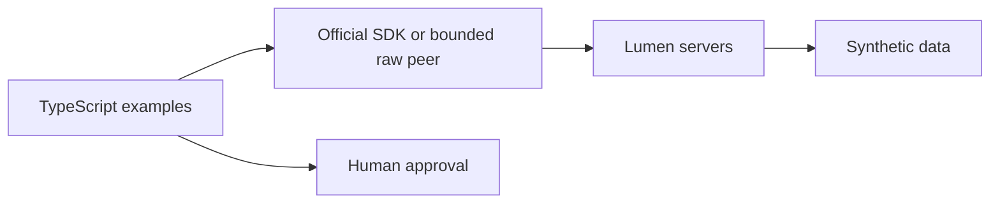

# Module B1: The full TypeScript track
> After this module you can follow all 22 modules with TypeScript implementations and identify deliberate runtime differences.

**Time:** ~12 additional hours · **Level:** Intermediate–Advanced · **LLM needed:** Optional · **Languages:** TypeScript
**Spec sections:** [2026-07-28](https://modelcontextprotocol.io/specification/2026-07-28)
**Workspace and Chat version 5:** Native examples for every module beyond the original five TypeScript lessons.

## Prerequisites

Install Node 24 or 26 and run `npm ci` at the root. Follow modules 02–05 and 10 for the original native TypeScript foundations. Install Python with `uv sync` for the cross-language OAuth fixture and wire recorder.

## Learning objectives

- Run the complete 22-module TypeScript sequence.
- Compare SDK APIs without changing the protocol contract.
- Detect changed catalogs and reject unapproved operations.
- Exercise three framework runtimes and current extension messages.

## The big idea

The protocol is the common language between independently written programs. A TypeScript type is useful inside a program; a JSON schema and a tested exchange are the agreement between programs. This track keeps those boundaries visible. Shared implementations keep each lesson short, and the lesson's own assertions show the behavior it promises.

## How it works



The original Python pages supply the conceptual sequence. Each TypeScript page names runnable cases and API differences. The native SDK Tasks limitation is explained in module 17, with a tested transport-level implementation rather than an obsolete Task API.

## On the wire

[Notes](wire/notes.jsonl), [form retries](wire/forms.jsonl), [Tasks](wire/tasks.jsonl), and [manifest](wire/manifest.json) are actual captures. Inspect `resultType`, per-request capability metadata and correlation IDs.

<!-- bonus-wire:start -->
Captured from [forms.jsonl](wire/forms.jsonl); tools/list.

```json
{
  "jsonrpc": "2.0",
  "id": 1,
  "method": "tools/list",
  "params": {
    "_meta": {
      "io.modelcontextprotocol/protocolVersion": "2026-07-28",
      "io.modelcontextprotocol/clientInfo": {
        "name": "mcp",
        "version": "0.1.0"
      },
      "io.modelcontextprotocol/clientCapabilities": {
        "elicitation": {
          "form": {},
          "url": {}
        }
      }
    }
  }
}
```

Captured from [forms.jsonl](wire/forms.jsonl); correlated response.

```json
{
  "result": {
    "tools": [
      {
        "name": "read_bulletin",
        "description": "Read the synthetic review bulletin.",
        "inputSchema": {
          "type": "object",
          "$schema": "https://json-schema.org/draft/2020-12/schema",
          "properties": {}
        },
        "annotations": {
          "readOnlyHint": true,
          "destructiveHint": false,
          "idempotentHint": true,
          "openWorldHint": false
        }
      },
      {
        "name": "review_bulletin",
        "description": "Ask the user to approve exact bulletin text before replacing the ephemeral bulletin.",
        "inputSchema": {
          "type": "object",
          "$schema": "https://json-schema.org/draft/2020-12/schema",
          "properties": {
            "text": {
              "type": "string",
              "minLength": 1,
              "maxLength": 200
            }
          },
          "required": [
            "text"
          ]
        },
        "annotations": {
          "readOnlyHint": false,
          "destructiveHint": false,
          "idempotentHint": false,
          "openWorldHint": false
        }
      },
      {
        "name": "quarterly_report",
        "description": "Generate a cancellable synthetic report; dates are simulated.",
        "inputSchema": {
          "type": "object",
          "$schema": "https://json-schema.org/draft/2020-12/schema",
          "properties": {
            "quarter": {
              "default": "Q1",
              "type": "string",
              "enum": [
                "Q1",
                "Q2",
                "Q3",
                "Q4"
              ]
            }
          }
        },
        "annotations": {
          "readOnlyHint": true,
          "destructiveHint": false,
          "idempotentHint": true,
          "openWorldHint": false
        }
      },
      {
        "name": "checked_note",
        "description": "Check a synthetic note length without writing it.",
        "inputSchema": {
          "type": "object",
          "$schema": "https://json-schema.org/draft/2020-12/schema",
          "properties": {
            "text": {
              "type": "string"
            }
          },
          "required": [
            "text"
          ]
        },
        "annotations": {
          "readOnlyHint": true,
          "destructiveHint": false,
          "idempotentHint": true,
          "openWorldHint": false
        }
      }
    ],
    "resultType": "complete",
    "ttlMs": 0,
    "cacheScope": "private",
    "_meta": {
      "io.modelcontextprotocol/serverInfo": {
        "name": "Lumen TypeScript workflow",
        "version": "1.0"
      }
    }
  },
  "jsonrpc": "2.0",
  "id": 1
}
```
<!-- bonus-wire:end -->

## Key APIs at a glance

| Python | TypeScript | Use |
|---|---|---|
| MCPServer | McpServer | Native server registration |
| Client | Client / RpcPeer | Typed requests / explicit extension result handling |
| Pydantic | Zod | Validate untrusted arguments |
| asyncio cancellation | AbortSignal | Stop work and release connections |

## Walkthrough

| Module | TypeScript lesson | Contract |
|---|---|---|
| 00 Environment and first contact | [00_setup](../../00_setup/typescript/README.md) | Count the fixed synthetic sample, inspect the installed SDK, and discover a real server. |
| 01 Protocol architecture | [01_architecture_wire](../../01_architecture_wire/typescript/README.md) | Send correlated requests over the official transport, then compare raw and SDK paths. |
| 06 Build a host | [06_building_a_host](../../06_building_a_host/typescript/README.md) | Run a bounded model loop; proposals remain separate from human authorization. |
| 07 Structured tools | [07_real_data](../../07_real_data/typescript/README.md) | Read SQLite data, reject an unapproved write, and prove replay-safe issue creation. |
| 08 Long operations | [08_server_utilities](../../08_server_utilities/typescript/README.md) | Run a cancellable report and reject data beyond the documented size limit. |
| 09 Interactive input | [09_elicitation_sampling_roots](../../09_elicitation_sampling_roots/typescript/README.md) | Use input_required form retries and bind opaque one-use state to exact arguments. |
| 11 Authorization | [11_authorization](../../11_authorization/typescript/README.md) | Verify RS256 signatures against a pinned key and bind identity to issuer, audience and expiry. |
| 12 Security boundaries | [12_security](../../12_security/typescript/README.md) | Deny path escape, redact nested credentials and reject public cleartext endpoints. |
| 13 Quality and evaluation | [13_testing_observability](../../13_testing_observability/typescript/README.md) | Check actual results, negative cases and the discovered tool inventory within a time budget. |
| 14 Tool design | [14_tool_design](../../14_tool_design/typescript/README.md) | Measure catalog size and detect changed semantics before execution. |
| 15 Framework integration | [15_agent_frameworks](../../15_agent_frameworks/typescript/README.md) | Run the same two-step read-only triage in three actual JavaScript runtimes. |
| 16 Composition | [16_composition](../../16_composition/typescript/README.md) | Apply per-user discovery, call-time scope checks, rate limits and bounded audit records. |
| 17 Tasks and Apps | [17_extensions](../../17_extensions/typescript/README.md) | Persist task state, answer report input and exercise the official App bridge lifecycle. |
| 18 Packaging | [18_packaging](../../18_packaging/typescript/README.md) | Inspect and run the same native notes implementation used by the npm and MCPB packages. |
| 19 Registry | [19_registry](../../19_registry/typescript/README.md) | Separate namespace/schema validation from permission to connect to a server. |
| 20 Remote deployment | [20_deployment](../../20_deployment/typescript/README.md) | Test actual HTTP headers and enforce transport and rate policies. |
| 21 Production hosts | [21_production_hosts](../../21_production_hosts/typescript/README.md) | Own child connections, bound retries and require reviewed catalogs after discovery. |

Run `npm run check` for all TypeScript contracts. Run `node --import tsx modules/bonus/B1_typescript_track/typescript/use_case/main.ts` for the additional 17-module sequence. Expected: 51 PASS cases. The existing five modules retain their original tests.

## Try it in a host

Use [VS Code](host_configs/vscode.json), [Claude Desktop](host_configs/claude_desktop.json), [Claude Code](host_configs/claude_code.json), or [Cursor](host_configs/cursor.json). Replace the example absolute checkout path. Ask "Find release notes". The fixed profile prevents a model from supplying an executable command.

## Real-world use case

The use case runs the sequence with no external model. Native OAuth clients are exercised by `uv run python scripts/ts_auth.py` and `--enterprise`; only the local synthetic authorization service is Python. Native framework integrations use actual Agents SDK, LangChain and LangGraph runtimes. A company can swap its data adapter while preserving the contract suite.

## Common mistakes

- `ERR_PACKAGE_PATH_NOT_EXPORTED`: use the SDK 2.4 package exports shown in the examples.
- `Elicitation requestedSchema contains unsupported JSON Schema constraint(s)`: use the form subset; keep strict policy validation outside the presented schema.
- `Invalid tools/call result`: the SDK's built-in result validator cannot accept current Tasks handles; use the documented extension peer.
- `Review the current catalog first`: review before calling or after semantics change.

## Exercises

Practice, Apply and Stretch exercises live beside each module. Their runnable checker compares input boundaries, review decisions and pagination against the solution. Start with [module 06](../../06_building_a_host/typescript/README.md).

## Quiz

[Six expandable questions](quiz.md).

## Key takeaways

- Protocol behavior survives a language change.
- SDK support must be verified per feature.
- Current Tasks differ from legacy task methods.
- Model decisions never grant authorization.
- Repeatable local integrations are evidence, not live model benchmarks.

## Go deeper

[Official SDK](https://github.com/modelcontextprotocol/typescript-sdk), [specification](https://modelcontextprotocol.io/specification/2026-07-28).

## Next

[B2: Other SDKs](../B2_other_sdks/README.md).
