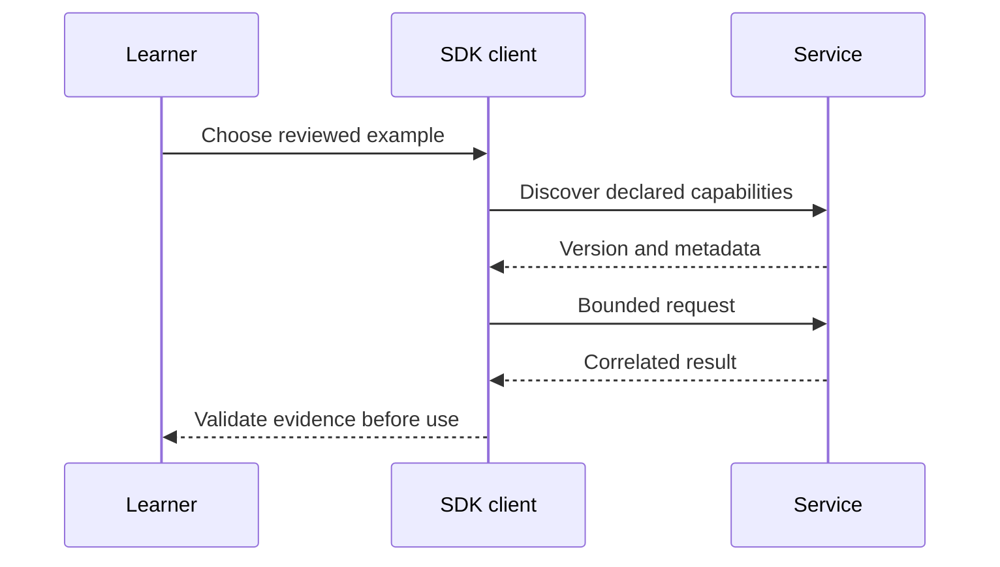

# Module B2: Other official SDKs
> After this module you can compare the same notes contract in Go, C#, Java and Rust.

**Time:** ~120 min · **Level:** Advanced · **LLM needed:** No · **Languages:** Go, C#, Java, Rust + Python contract
**Spec sections:** [Current protocol](https://modelcontextprotocol.io/specification/2026-07-28), [extension lifecycle](https://modelcontextprotocol.io/extensions).
**Workspace and Chat version 5:** Compare the same notes contract in Go, C#, Java and Rust.

## Prerequisites

Finish [Module 21](../../21_production_hosts/README.md). Run from the repository root with `uv sync --all-extras` and `npm ci`. Native SDK builds also require their toolchains; see [the B2 version matrix](../B2_other_sdks/VERSIONS.md). Python examples use no keys or external services.

## Learning objectives

- Identify the revision implemented by an SDK.
- Execute a bounded example and inspect actual messages.
- Reject untrusted or incompatible inputs.
- Explain what the acceptance check proves and what it does not.

## The big idea

Compare the same notes contract in Go, C#, Java and Rust. Treat the specification like a shared contract between independently built systems. A shipping label can tell you what a package claims to contain; you still inspect it before using it. Version labels, manifests and annotations support discovery, while verified behavior and explicit permission determine what may run.

## How it works



Under the hood: The native sources own their tool logic. The shared client contract independently checks behavior and captures stdout; it is intentionally a cross-language interoperability test. Go and C# also expose a prompt. Rust and Java expose the required resource and tools.

## On the wire

The [wire manifest](wire/manifest.json) records regeneration commands. JSONL files contain actual requests and responses, not handwritten sketches. Compare required per-request metadata with Java's explicitly labeled older handshake. The excerpt below is inserted from the capture after execution.

<!-- bonus-wire:start -->
Captured from [csharp.jsonl](wire/csharp.jsonl); tools/list.

```json
{
  "jsonrpc": "2.0",
  "id": 1,
  "method": "tools/list",
  "params": {
    "_meta": {
      "io.modelcontextprotocol/protocolVersion": "2026-07-28",
      "io.modelcontextprotocol/clientInfo": {
        "name": "mcp",
        "version": "0.1.0"
      },
      "io.modelcontextprotocol/clientCapabilities": {}
    }
  }
}
```

Captured from [csharp.jsonl](wire/csharp.jsonl); correlated response.

```json
{
  "result": {
    "tools": [
      {
        "name": "search_notes",
        "description": "Find synthetic notes by title or body. Empty query lists all.",
        "inputSchema": {
          "type": "object",
          "properties": {
            "query": {
              "type": "string",
              "default": ""
            }
          }
        },
        "annotations": {
          "destructiveHint": false,
          "idempotentHint": true,
          "openWorldHint": false,
          "readOnlyHint": true
        }
      },
      {
        "name": "create_note",
        "description": "Create an ephemeral note after explicit human confirmation.",
        "inputSchema": {
          "type": "object",
          "properties": {
            "title": {
              "type": "string"
            },
            "body": {
              "type": "string"
            },
            "confirmed": {
              "type": "boolean",
              "default": false
            }
          },
          "required": [
            "title",
            "body"
          ]
        },
        "annotations": {
          "destructiveHint": false,
          "idempotentHint": false,
          "openWorldHint": false,
          "readOnlyHint": false
        }
      },
      {
        "name": "tag_note",
        "description": "Add a tag once after confirmation.",
        "inputSchema": {
          "type": "object",
          "properties": {
            "note_id": {
              "type": "integer"
            },
            "tag": {
              "type": "string"
            },
            "confirmed": {
              "type": "boolean",
              "default": false
            }
          },
          "required": [
            "note_id",
            "tag"
          ]
        },
        "annotations": {
          "destructiveHint": false,
          "idempotentHint": true,
          "openWorldHint": false,
          "readOnlyHint": false
        }
      }
    ],
    "ttlMs": 0,
    "cacheScope": "private",
    "resultType": "complete",
    "_meta": {
      "io.modelcontextprotocol/serverInfo": {
        "name": "Notes",
        "version": "1.0.0.0"
      }
    }
  },
  "id": 1,
  "jsonrpc": "2.0"
}
```
<!-- bonus-wire:end -->

## Key APIs at a glance

| Python / native API | TypeScript equivalent | Purpose |
|---|---|---|
| Client and StdioServerParameters | Client and StdioClientTransport | Own a child process connection |
| Extension / MethodBinding | SkillsExtension / attach | Add explicitly declared extension methods |
| JWTVerifier | verifyToken | Verify identity and resource binding before policy |
| TypeAdapter(JSONRPCMessage) | SDK request/result schemas | Check shape; semantic assertions remain necessary |

## Walkthrough

### Native tools

Compile each SDK notes server and compare search, confirmation and idempotent tagging.

`uv run python scripts/native_sdks.py --language go --build --capture`

Expected: a bounded result or `PASS`; see the actual capture for full request metadata.

### Native resources

Read lumen://notes/help through each SDK; explain why the URI is an identifier rather than an arbitrary file path.

`uv run python scripts/native_sdks.py --language csharp --build --capture`

Expected: a bounded result or `PASS`; see the actual capture for full request metadata.

### Cross-language client contract

Use the Python SDK client against each native process. Java is explicitly tested in legacy mode; the other three use 2026-07-28.

`uv run python scripts/native_sdks.py --language java --build --capture`

Expected: a bounded result or `PASS`; see the actual capture for full request metadata.

## Try it in a host

Use the [VS Code config](host_configs/vscode.json), or the sibling Claude Desktop, Claude Code and Cursor files. Replace the repository path with its absolute path. Ask “Find the release note” for notes servers or inspect Skills with the provided client. A host that lacks an extension must not issue its methods or pretend to render its UI. The course client is the verified host for these bonus flows.

## Real-world use case

A Lumen platform team checks an independently implemented service before adding it to the approved catalog. Run `uv run python scripts/native_sdks.py --language go --build`. Expected: `PASS`. Record revision, capabilities, denial tests and cleanup alongside the proposed configuration. Keep real credentials in a deployment secret store.

## Common mistakes

| Error | Cause and fix |
|---|---|
| `Confirmation required` | Obtain a separate human decision for exact write arguments. |
| `Unknown skill URI.` | Use the complete returned skill URI and the same originating server. |
| `Endpoint requires HTTPS and an explicitly trusted host.` | Review the host separately from schema validity. |
| `Skill content changed after manifest review.` | Refetch metadata and ask for review again. |
| `Unknown skill cursor.` | Treat cursors as server-issued opaque values. |

## Exercises

Practice: check a declared capability. Apply: validate a bounded name list. Stretch: bind review to both origin and URI. Run `uv run pytest modules/bonus/B2_other_sdks/python/tests -q`; run `uv run python scripts/check_bonus_exercise.py B2 1` (or 2/3), adding `--solution` to verify the reference. Starters define conservative pure functions; the checker reports differences. Solutions and tests are separate.

## Quiz

Answer the [six questions](quiz.md) before revealing the expandable answers.

## Key takeaways

- Official SDK status is separate from a specific protocol revision.
- An extension is opt-in and has its own lifecycle.
- Identity includes origin; a friendly name is not a trust boundary.
- A schema-valid result can still be unsafe or semantically wrong.
- Keep measured behavior separate from untested vendor integration.

## Go deeper

- [Official SDK directory](https://modelcontextprotocol.io/docs/sdk)
- [Specification](https://modelcontextprotocol.io/specification/2026-07-28)
- [Governance](https://modelcontextprotocol.io/community/governance)
- [Skills](https://modelcontextprotocol.io/extensions/skills/overview)
- [Client credentials](https://modelcontextprotocol.io/extensions/auth/oauth-client-credentials)

## Next

Choose a [capstone](../../../capstones/01_personal_knowledge/README.md) and use its acceptance criteria to review your own implementation.

## Native examples and host launch

Build a selected language first: `uv run python scripts/native_sdks.py --language go --build --capture` (replace go with csharp, java or rust). The three examples per language are the tool implementation, context resource/prompt implementation, and the shared cross-language client contract. Go additionally includes a native in-memory client test.

| Language | Tools | Context | Client acceptance |
|---|---|---|---|
| Go | [main.go](go/main.go) | [context.go](go/context.go) | [native Go test](go/contract_test.go) and shared runner |
| C# | [Program.cs](csharp/Program.cs) | [Context.cs](csharp/Context.cs) | shared runner using the compiled DLL |
| Java | [Notes.java](java/src/main/java/example/lumen/Notes.java) | [NoteContext.java](java/src/main/java/example/lumen/NoteContext.java) | shared runner in labeled Legacy mode |
| Rust | [main.rs](rust/src/main.rs) | [context.rs](rust/src/context.rs) | shared runner using the compiled binary |

The committed host configs select the built Go executable on Windows. Regenerate the command for another platform or use the exact command returned by `scripts/native_sdks.py`'s `command(language)` helper. C# starts with dotnet plus the Notes.dll path; Java uses java -jar plus the built jar; Rust starts its target/debug executable. None of these host entries launch Python as the server. The common Python client deliberately tests interoperability.
