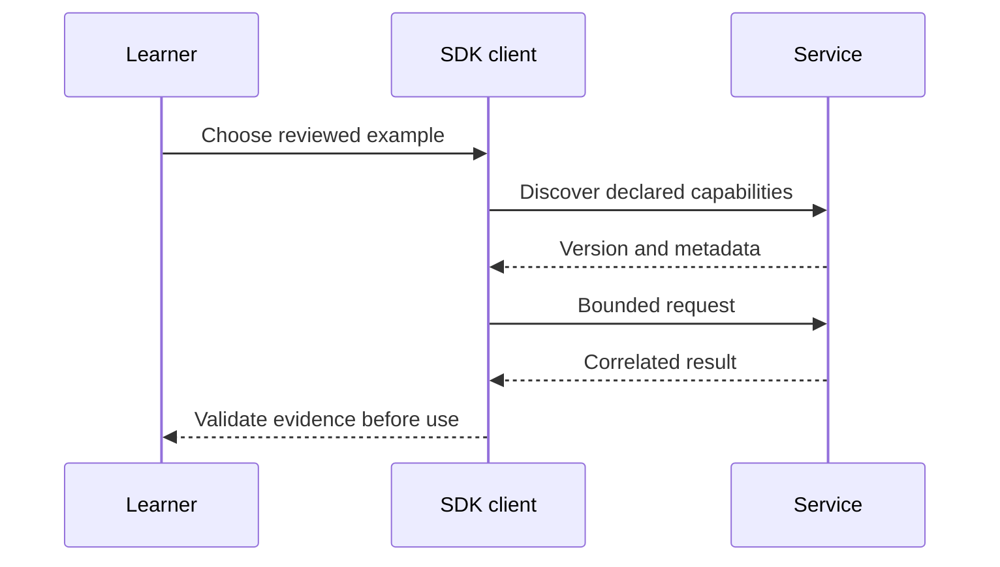

# Module B3: Reading the spec and contributing
> After this module you can turn a protocol observation into a reproducible, redacted contribution.

**Time:** ~120 min · **Level:** Advanced · **LLM needed:** No · **Languages:** Python + TypeScript
**Spec sections:** [Current protocol](https://modelcontextprotocol.io/specification/2026-07-28), [extension lifecycle](https://modelcontextprotocol.io/extensions).
**Workspace and Chat version 5:** Turn a protocol observation into a reproducible, redacted contribution.

## Prerequisites

Finish [Module 21](../../21_production_hosts/README.md). Run from the repository root with `uv sync --all-extras` and `npm ci`. Native SDK builds also require their toolchains; see [the B2 version matrix](../B2_other_sdks/VERSIONS.md). Python examples use no keys or external services.

## Learning objectives

- Identify the revision implemented by an SDK.
- Execute a bounded example and inspect actual messages.
- Reject untrusted or incompatible inputs.
- Explain what the acceptance check proves and what it does not.

## The big idea

Turn a protocol observation into a reproducible, redacted contribution. Treat the specification like a shared contract between independently built systems. A shipping label can tell you what a package claims to contain; you still inspect it before using it. Version labels, manifests and annotations support discovery, while verified behavior and explicit permission determine what may run.

## How it works



Under the hood: Each example isolates one operation. The use case combines them through SDK calls; authentication traffic uses a real loopback server and fresh synthetic keys. No source instruction is automatically activated.

## On the wire

The [wire manifest](wire/manifest.json) records regeneration commands. JSONL files contain actual requests and responses, not handwritten sketches. Compare required per-request metadata with Java's explicitly labeled older handshake. The excerpt below is inserted from the capture after execution.

<!-- bonus-wire:start -->
Captured from [main.jsonl](wire/main.jsonl); tools/list.

```json
{
  "jsonrpc": "2.0",
  "id": 1,
  "method": "tools/list",
  "params": {
    "_meta": {
      "io.modelcontextprotocol/protocolVersion": "2026-07-28",
      "io.modelcontextprotocol/clientInfo": {
        "name": "mcp",
        "version": "0.1.0"
      },
      "io.modelcontextprotocol/clientCapabilities": {}
    }
  }
}
```

Captured from [main.jsonl](wire/main.jsonl); correlated response.

```json
{
  "jsonrpc": "2.0",
  "id": 1,
  "result": {
    "resultType": "complete",
    "_meta": {
      "io.modelcontextprotocol/serverInfo": {
        "name": "Lumen raw directory",
        "version": "1.0"
      }
    },
    "ttlMs": 0,
    "cacheScope": "private",
    "tools": [
      {
        "name": "directory_count",
        "description": "Count the synthetic employee sample.",
        "inputSchema": {
          "type": "object",
          "properties": {},
          "additionalProperties": false
        },
        "annotations": {
          "readOnlyHint": true,
          "destructiveHint": false,
          "idempotentHint": true,
          "openWorldHint": false
        }
      }
    ]
  }
}
```
<!-- bonus-wire:end -->

## Key APIs at a glance

| Python / native API | TypeScript equivalent | Purpose |
|---|---|---|
| Client and StdioServerParameters | Client and StdioClientTransport | Own a child process connection |
| Extension / MethodBinding | SkillsExtension / attach | Add explicitly declared extension methods |
| JWTVerifier | verifyToken | Verify identity and resource binding before policy |
| TypeAdapter(JSONRPCMessage) | SDK request/result schemas | Check shape; semantic assertions remain necessary |

## Walkthrough

### 01_schema_contract

Validate real JSON-RPC capture shapes and correlate response IDs.

`uv run python modules/bonus/B3_spec_contributing/python/examples/01_schema_contract.py`

Expected: a bounded result or `PASS`; see the actual capture for full request metadata.

### 02_sep_index

Follow the stable revision to its changelog, then SEP-2575; compare the current rule with the historical design proposal.

`uv run python modules/bonus/B3_spec_contributing/python/examples/02_sep_index.py`

Expected: a bounded result or `PASS`; see the actual capture for full request metadata.

### 03_conformance_case

Generate a local issue draft containing versions, reproduction and measured observations. Nothing is submitted.

`uv run python modules/bonus/B3_spec_contributing/python/examples/03_conformance_case.py`

Expected: a bounded result or `PASS`; see the actual capture for full request metadata.

## Try it in a host

Use the [VS Code config](host_configs/vscode.json), or the sibling Claude Desktop, Claude Code and Cursor files. Replace the repository path with its absolute path. Ask “Find the release note” for notes servers or inspect Skills with the provided client. A host that lacks an extension must not issue its methods or pretend to render its UI. The course client is the verified host for these bonus flows.

## Real-world use case

A Lumen platform team checks an independently implemented service before adding it to the approved catalog. Run `uv run python scripts/bonus.py --module B3`. Expected: `PASS`. Record revision, capabilities, denial tests and cleanup alongside the proposed configuration. Keep real credentials in a deployment secret store.

## Common mistakes

- `Capture contains an uncorrelated response.`: preserve request IDs and both directions; notifications do not need a response.
- `ValidationError`: distinguish malformed JSON-RPC shape from a semantic violation after successful parsing.
- `Unknown skill cursor.` in a reproduction: include the exact method and capability declarations, not only the last error.
- `Unsupported protocol version`: record the wire revision and SDK version separately; reproduce with the pinned environment before reporting a defect.

## Exercises

Practice: check a declared capability. Apply: validate a bounded name list. Stretch: bind review to both origin and URI. Run `uv run pytest modules/bonus/B3_spec_contributing/python/tests -q`; run `uv run python scripts/check_bonus_exercise.py B3 1` (or 2/3), adding `--solution` to verify the reference. Starters define conservative pure functions; the checker reports differences. Solutions and tests are separate.

## Quiz

Answer the [six questions](quiz.md) before revealing the expandable answers.

## Key takeaways

- Official SDK status is separate from a specific protocol revision.
- An extension is opt-in and has its own lifecycle.
- Identity includes origin; a friendly name is not a trust boundary.
- A schema-valid result can still be unsafe or semantically wrong.
- Keep measured behavior separate from untested vendor integration.

## Go deeper

- [Official SDK directory](https://modelcontextprotocol.io/docs/sdk)
- [Specification](https://modelcontextprotocol.io/specification/2026-07-28)
- [Governance](https://modelcontextprotocol.io/community/governance)
- [Skills](https://modelcontextprotocol.io/extensions/skills/overview)
- [Client credentials](https://modelcontextprotocol.io/extensions/auth/oauth-client-credentials)

## Next

Choose a [capstone](../../../capstones/01_personal_knowledge/README.md) and use its acceptance criteria to review your own implementation.

## Read and contribute step by step

1. Open the [dated specification](https://modelcontextprotocol.io/specification/2026-07-28) and its [changelog](https://modelcontextprotocol.io/specification/2026-07-28/changelog). Record the revision before comparing messages. Normative MUST/SHOULD requirements matter more than a tutorial's pseudocode.
2. Follow the prose to the linked schema. Check required fields, types, capability preconditions, transport constraints and error handling. A JSON Schema validator cannot prove consent, ownership or retry safety.
3. Reproduce one assertion with the first example. Identify the request, response and precise normative sentence. Reduce it to synthetic input and one failing expectation.
4. Use the SEP index example to trace motivation, proposed design, alternatives, compatibility and status. An accepted proposal does not prove that a package release implements it; verify the released spec and SDK.
5. Consult [governance](https://modelcontextprotocol.io/community/governance) for the current maintainers and decision process. Working groups develop scoped proposals; discussion and review happen before changes become a release. Follow the repository's contribution guide and code of conduct rather than sending a large unreviewed rewrite.
6. The third example produces a local issue draft with exact versions, command, expected/observed behavior and redacted evidence. Check existing issues, add a minimal regression, and submit only after your own review. This course never posts an issue on your behalf.

The bundled SEP index is dated evidence, not a live status feed. Server Cards demonstrate why status labels and implementation repositories must be checked separately.
