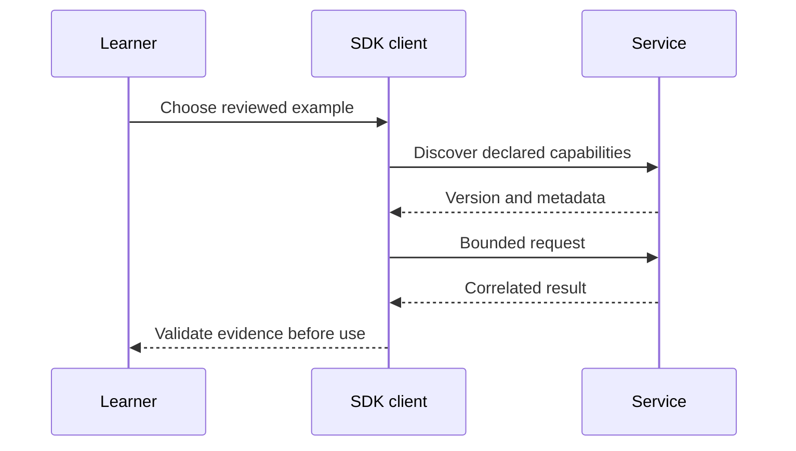

# Module B4: Skills and authorization extensions
> After this module you can verify extension metadata and exercise machine authorization without activating remote instructions.

**Time:** ~120 min · **Level:** Advanced · **LLM needed:** No · **Languages:** Python + TypeScript
**Spec sections:** [Current protocol](https://modelcontextprotocol.io/specification/2026-07-28), [extension lifecycle](https://modelcontextprotocol.io/extensions).
**Workspace and Chat version 5:** Verify extension metadata and exercise machine authorization without activating remote instructions.

## Prerequisites

Finish [Module 21](../../21_production_hosts/README.md). Run from the repository root with `uv sync --all-extras` and `npm ci`. Native SDK builds also require their toolchains; see [the B2 version matrix](../B2_other_sdks/VERSIONS.md). Python examples use no keys or external services.

## Learning objectives

- Identify the revision implemented by an SDK.
- Execute a bounded example and inspect actual messages.
- Reject untrusted or incompatible inputs.
- Explain what the acceptance check proves and what it does not.

## The big idea

Verify extension metadata and exercise machine authorization without activating remote instructions. Treat the specification like a shared contract between independently built systems. A shipping label can tell you what a package claims to contain; you still inspect it before using it. Version labels, manifests and annotations support discovery, while verified behavior and explicit permission determine what may run.

## How it works



Under the hood: Each example isolates one operation. The use case combines them through SDK calls; authentication traffic uses a real loopback server and fresh synthetic keys. No source instruction is automatically activated.

## On the wire

The [wire manifest](wire/manifest.json) records regeneration commands. JSONL files contain actual requests and responses, not handwritten sketches. Compare required per-request metadata with Java's explicitly labeled older handshake. The excerpt below is inserted from the capture after execution.

<!-- bonus-wire:start -->
Captured from [skills.jsonl](wire/skills.jsonl); server/discover.

```json
{
  "jsonrpc": "2.0",
  "id": 1,
  "method": "server/discover",
  "params": {
    "_meta": {
      "io.modelcontextprotocol/protocolVersion": "2026-07-28",
      "io.modelcontextprotocol/clientInfo": {
        "name": "mcp",
        "version": "0.1.0"
      },
      "io.modelcontextprotocol/clientCapabilities": {}
    }
  }
}
```

Captured from [skills.jsonl](wire/skills.jsonl); correlated response.

```json
{
  "jsonrpc": "2.0",
  "id": 1,
  "result": {
    "cacheScope": "private",
    "capabilities": {
      "extensions": {
        "io.modelcontextprotocol/skills": {}
      },
      "prompts": {
        "listChanged": true
      },
      "resources": {
        "listChanged": true,
        "subscribe": true
      },
      "tools": {
        "listChanged": true
      }
    },
    "resultType": "complete",
    "supportedVersions": [
      "2026-07-28"
    ],
    "ttlMs": 0,
    "_meta": {
      "io.modelcontextprotocol/serverInfo": {
        "name": "Lumen incident skills",
        "version": ""
      }
    }
  }
}
```
<!-- bonus-wire:end -->

## Key APIs at a glance

| Python / native API | TypeScript equivalent | Purpose |
|---|---|---|
| Client and StdioServerParameters | Client and StdioClientTransport | Own a child process connection |
| Extension / MethodBinding | SkillsExtension / attach | Add explicitly declared extension methods |
| JWTVerifier | verifyToken | Verify identity and resource binding before policy |
| TypeAdapter(JSONRPCMessage) | SDK request/result schemas | Check shape; semantic assertions remain necessary |

## Walkthrough

### 01_skills

Discover skills/list and skills/get, verify SHA-256 bytes, then read resources without activating instructions.

`uv run python modules/bonus/B4_whats_new/python/examples/01_skills.py`

Expected: a bounded result or `PASS`; see the actual capture for full request metadata.

### 02_server_cards

Validate the actual experimental card schema and apply a separate trusted-endpoint policy.

`uv run python modules/bonus/B4_whats_new/python/examples/02_server_cards.py`

Expected: a bounded result or `PASS`; see the actual capture for full request metadata.

### 03_client_credentials

Use the SDK provider to discover a pinned issuer and acquire one reusable machine token.

`uv run python modules/bonus/B4_whats_new/python/examples/03_client_credentials.py`

Expected: a bounded result or `PASS`; see the actual capture for full request metadata.

### 04_enterprise_auth

Use the SDK ID-JAG provider for the second exchange leg; validate signed claims and reject assertion reuse.

`uv run python modules/bonus/B4_whats_new/python/examples/04_enterprise_auth.py`

Expected: a bounded result or `PASS`; see the actual capture for full request metadata.

## Try it in a host

Use the [VS Code config](host_configs/vscode.json), or the sibling Claude Desktop, Claude Code and Cursor files. Replace the repository path with its absolute path. Ask “Find the release note” for notes servers or inspect Skills with the provided client. A host that lacks an extension must not issue its methods or pretend to render its UI. The course client is the verified host for these bonus flows.

## Real-world use case

A Lumen platform team checks an independently implemented service before adding it to the approved catalog. Run `uv run python scripts/bonus.py --module B4`. Expected: `PASS`. Record revision, capabilities, denial tests and cleanup alongside the proposed configuration. Keep real credentials in a deployment secret store.

## Common mistakes

| Error | Cause and fix |
|---|---|
| `Confirmation required` | Obtain a separate human decision for exact write arguments. |
| `Unknown skill URI.` | Use the complete returned skill URI and the same originating server. |
| `Endpoint requires HTTPS and an explicitly trusted host.` | Review the host separately from schema validity. |
| `Skill content changed after manifest review.` | Refetch metadata and ask for review again. |
| `Unknown skill cursor.` | Treat cursors as server-issued opaque values. |

## Exercises

Practice: check a declared capability. Apply: validate a bounded name list. Stretch: bind review to both origin and URI. Run `uv run pytest modules/bonus/B4_whats_new/python/tests -q`; run `uv run python scripts/check_bonus_exercise.py B4 1` (or 2/3), adding `--solution` to verify the reference. Starters define conservative pure functions; the checker reports differences. Solutions and tests are separate.

## Quiz

Answer the [six questions](quiz.md) before revealing the expandable answers.

## Key takeaways

- Official SDK status is separate from a specific protocol revision.
- An extension is opt-in and has its own lifecycle.
- Identity includes origin; a friendly name is not a trust boundary.
- A schema-valid result can still be unsafe or semantically wrong.
- Keep measured behavior separate from untested vendor integration.

## Go deeper

- [Official SDK directory](https://modelcontextprotocol.io/docs/sdk)
- [Specification](https://modelcontextprotocol.io/specification/2026-07-28)
- [Governance](https://modelcontextprotocol.io/community/governance)
- [Skills](https://modelcontextprotocol.io/extensions/skills/overview)
- [Client credentials](https://modelcontextprotocol.io/extensions/auth/oauth-client-credentials)

## Next

Choose a [capstone](../../../capstones/01_personal_knowledge/README.md) and use its acceptance criteria to review your own implementation.

## Extension status and trust boundaries

| Feature | Status evidence and implementation | Important boundary |
|---|---|---|
| Skills | Beta extension; native TypeScript SDK catalog/client and Python additive extension methods | Verify digest and size, partition by origin plus URI, and obtain separate activation approval |
| Server Cards | SEP 2127 is marked Final, but the prototype repository still says experimental; this lesson validates its vendored experimental schema | Schema validity grants no network, installation or credential permission |
| Client credentials | Stable authorization extension; official Python and TypeScript providers | Pin the issuer before sending a registered service credential; this represents a service identity |
| Enterprise authorization | Stable extension; official provider performs ID-JAG-to-access-token exchange | The local signed assertion replaces vendor login; vendor SSO and the IdP token-exchange leg are not claimed |

The Server Card schema and license were copied from the [experimental repository](https://github.com/modelcontextprotocol/ext-server-card); compare that implementation status with [SEP 2127](https://modelcontextprotocol.io/seps/2127-mcp-server-cards). Do not silently promote the prototype to a stable protocol feature. The committed card's `ops.lumen.example` endpoint is fictional and never contacted.

Run the four TypeScript examples under `typescript/examples/` with `node --import tsx <path>`. Examples 03 and 04 start the synthetic Python issuer and then execute the native TypeScript SDK client; they do not delegate the token acquisition to Python. The reference providers use a configured issuer, fresh secrets and a bounded local HTTP exchange. The token is reused for two reads. `tests/test_phase8.py` also rejects wrong resources, corrupt assertions and replayed ID-JAGs.

The Python SDK's installed constructor uses `scope` (singular) and an explicit `issuer`; the TypeScript providers use `expectedIssuer`. Some upstream tutorial snippets differ. See [verification](../../../docs/PHASE_8_VERIFICATION.md) for the tested swaps.
